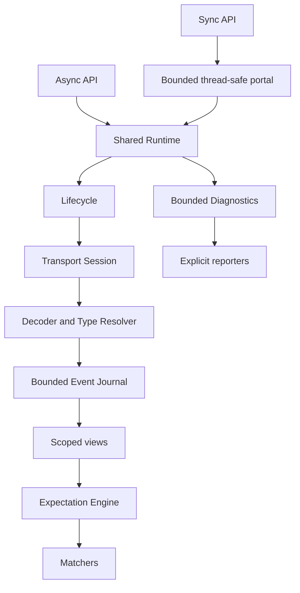

# Event Observer — final technical specification

**Revision:** 1.2\
**Date:** November 2, 2026\
**Basis:** ADR-001–012 decisions, synchronous test support, and the authorized RabbitMQ extension.\
**First target release:** 0.1.0.\
**Working distribution name:** `event-observer`; working import namespace: `event_observer`.\
**Status:** normative implementation requirements, not a description of a released or tested product.

PyPI name availability, the right to use the name, the license, and verified dependency ranges must be checked before publication. Installation commands using the working name are not a recommendation to install an existing third-party package with the same name.

This document describes a standalone library. It contains no source code, message schemas, infrastructure addresses, credentials, or other materials from a private project. Domain examples are fictional. Implementation must not require access to a private repository.

## Contents

1. [Requirement status and decision register](#s01)
2. [Purpose, product boundaries, and MVP](#s02)
3. [Main scenarios: sync and async](#s03)
4. [Architecture and resource ownership](#s04)
5. [Normalized data models](#s05)
6. [Public observation API](#s06)
7. [Readiness, start positions, and replay](#s07)
8. [Event Journal, memory, and completeness](#s08)
9. [Transport Adapter API and backpressure](#s09)
10. [Kafka Adapter for the first release](#s10)
11. [Decoder, Protobuf, and mixed types](#s11)
12. [Matchers and Expectations](#s12)
13. [Scoped correlation](#s13)
14. [Time, concurrency, and result commitment](#s14)
15. [Lifecycle, errors, and cleanup](#s15)
16. [ADR-013 supplement: synchronous API](#s16)
17. [Diagnostics, Allure, secrets, and trace context](#s17)
18. [Temporal Assertions: next-stage contract](#s18)
19. [Programmatic configuration and pytest](#s19)
20. [Error catalog](#s20)
21. [Testing and contract testing framework](#s21)
22. [Compatibility, benchmarks, CI/CD, and release gates](#s22)
23. [Packaging, pyproject.toml, and publication](#s23)
24. [API stability, documentation, and deprecation](#s24)
25. [Implementation plan and acceptance criteria](#s25)
26. [Clarifications made while consolidating ADRs](#s26)
27. [External technical references](#s27)
28. [RabbitMQ extension: dedicated exchange subscriptions](#s28)

---

<a id="s01"></a>
## 1. Requirement status and decision register

### 1.1. Normative terms

**MUST / MUST NOT** indicate a mandatory requirement or prohibition. **SHOULD / SHOULD NOT** indicate recommended behavior; a deviation requires a documented rationale and a test. **MAY** indicates an allowed extension, not a release commitment.

If an early illustrative ADR example conflicts with this specification, this document governs implementation. Changes to essential contracts after the specification is accepted require a new revision and a changelog entry. Method names in code blocks are normative unless a block is explicitly labeled as a sketch, template, or implementation example.

The numeric defaults below are project settings, not measured performance or a guaranteed upper RSS bound. Statements about third-party tools link to primary documentation in section 27. The project's own MUST/SHOULD statements are its design decisions.

### 1.2. Register

| Decision | Choice | Normative content |
|---|---|---|
| ADR-001 | B | Unified Event Observer, with separate Core, Transport, Decoder, and Reporting layers |
| ADR-002 | B | New events by default, explicit replay, readiness, and fail-closed behavior when an observation violation is detected |
| ADR-003 | B | Bounded Journal; FAIL by default; independent readers |
| ADR-004 | B | Python predicates and structured matchers; a single deadline |
| ADR-005 | A | Programmatic configuration; user fixtures; no hidden connections |
| ADR-006 | B | Public Transport Protocol, an explicitly supplied adapter, and contract tests |
| ADR-007 | B | Decoder abstraction, Protobuf, and an explicit resolver for mixed-type streams |
| ADR-008 | B | Structured diagnostics, optional Allure, and passive trace context |
| ADR-009 | B | Scoped correlation over a shared Journal |
| ADR-010 | B | Temporal assertions without a scenario DSL; implementation after 0.1 |
| ADR-011 | B | Contract tests, real brokers, fault injection, and release gates |
| ADR-012 | A | One distribution, optional extras, and unified versioning |
| ADR-013 supplement | New requirement | Complete sync API in 0.1 over the same runtime; architectural details in section 16 |

The user separately confirmed the need for synchronous tests. The `SyncEventObserver` name and dedicated event loop model are this specification's technical definition of that requirement, not a pre-existing implementation.

<a id="s02"></a>
## 2. Purpose, product boundaries, and MVP

### 2.1. Goal

The library helps black-box integration tests connect to a broker **before the test action**, accumulate messages, and verify results without writing a consumer loop, adding sleeps, deserializing in every test, or managing offsets manually.

It supports ordinary `def test_*` and asynchronous `async def test_*` tests. Core MUST work outside pytest. The system under test need not use any particular Python framework or be written in Python.

### 2.2. Required scope of 0.1.0

| Area | Included in 0.1.0 |
|---|---|
| Runtime | `EventObserver` for async and `SyncEventObserver` for sync; a shared core |
| Transport | Kafka through `confluent-kafka`; independent sessions and manual partition assignment; RabbitMQ through `aio-pika` as defined in section 28 |
| Start | `latest`, `earliest`, explicit Kafka offsets, and timestamp resolution; RabbitMQ latest-only exchange subscription |
| Formats | Raw bytes / null payload; ordinary Protobuf through `*_pb2.py` |
| Mixed types | Explicit header/source/callable resolvers; `FAIL_FAST`, `SKIP_UNKNOWN_TYPE` |
| Journal | Bounded in-memory journal, FAIL / DROP_OLDEST / DROP_NEWEST, and loss tracking |
| Expectations | `wait_for`, `wait_for_event`, `wait_for_count` |
| Matchers | Fields, presence, partial Protobuf, composition, and payload/event predicates |
| Correlation | Scopes, nested scopes, history / from-now / sequence, payload, and metadata |
| Diagnostics | Bounded snapshots, mismatch reasons, and errors; opt-in Allure |
| Tracing | W3C trace context extraction without creating spans |
| Testing | Fake adapter, reusable contract tests, real Kafka and RabbitMQ according to declared capabilities, basic faults, xdist, and sync/async parity |
| Delivery | Wheel + sdist, typing, extras, documentation, and a protected release pipeline |

### 2.3. After the MVP

Revision 1.2 adds RabbitMQ as an authorized extension to the original Kafka-first MVP; its contract is in section 28. Temporal assertions, Redis Streams, followed by Redis Pub/Sub and NATS, remain separate stages. Their architectural contracts are defined now, but the presence of these sections does not authorize advertising a nonexistent adapter or publishing empty extras.

Outside the immediate MVP: Schema Registry, automatic schema guessing, message publication, HTTP/gRPC clients, an on-disk Journal, reconnect with checkpoint recovery, dynamic partition assignment expansion, a distributed journal, a scenario DSL, and OpenTelemetry span generation.

### 2.4. Limits of the guarantees

Observation does not prove exactly-once delivery, absence of duplicates, global ordering across Kafka partitions, absence of producer losses, absolute durability of broker data, or absence of an event in the future. The library MUST make detected incompleteness and the range over which an assertion was evaluated explicit.

The MVP is not a hard real-time system. A synchronous user callback or a hung native client cannot be assumed to be forcibly interruptible by a timer.

<a id="s03"></a>
## 3. Main scenarios: sync and async

The examples describe the target API. The `example_pb2`, `sync_service_client`, and `async_service_client` modules belong to the user's test project.

### 3.0. Public synthetic example schema

This schema is unrelated to any private project and can be used in examples and contract fixtures. The generated Python file is created by the usual Protobuf toolchain in the development environment, not while the observer runs.

```proto
syntax = "proto3";
package example;

enum OperationStatus {
  OPERATION_STATUS_UNSPECIFIED = 0;
  CREATED = 1;
  COMPLETED = 2;
  FAILED = 3;
}

message OperationEvent {
  string operation_id = 1;
  OperationStatus status = 2;
}

message OperationCreated {
  string operation_id = 1;
}

message OperationCompleted {
  string operation_id = 1;
}
```

### 3.1. Ordinary synchronous pytest test

```python
from uuid import uuid4

import pytest

from event_observer import ScopeStart, SyncEventObserver
from event_observer.matchers import field_equals
from event_observer.transports.kafka import KafkaAdapter, KafkaConfig
from example_pb2 import OperationEvent, COMPLETED


@pytest.fixture(scope="session")
def kafka_config() -> KafkaConfig:
    return KafkaConfig(bootstrap_servers="localhost:9092")


@pytest.fixture
def events(kafka_config: KafkaConfig) -> SyncEventObserver:
    return SyncEventObserver(transport=KafkaAdapter(kafka_config))


def test_operation(events, sync_service_client):
    operation_id = uuid4().hex

    with events.watch(
        source="example.events",
        message_type=OperationEvent,
    ) as watcher:
        scope = watcher.scope(
            field_equals("operation_id", operation_id),
            start=ScopeStart.from_now(),
        )

        # The reader keeps running while this ordinary call blocks the test.
        sync_service_client.perform(operation_id=operation_id)

        event = scope.wait_for(
            field_equals("status", COMPLETED),
            timeout=10.0,
        )
        assert event.operation_id == operation_id
```

This mode requires neither `pytest.mark.asyncio`, an async fixture, nor an installed `pytest-asyncio`. A blocking expectation returns a value, not a coroutine or a Future.

### 3.2. Asynchronous test

```python
from uuid import uuid4

import pytest

from event_observer import EventObserver, ScopeStart
from event_observer.matchers import field_equals
from event_observer.transports.kafka import KafkaAdapter, KafkaConfig
from example_pb2 import OperationEvent, COMPLETED


@pytest.fixture
def async_events(kafka_config: KafkaConfig) -> EventObserver:
    return EventObserver(transport=KafkaAdapter(kafka_config))


@pytest.mark.asyncio
async def test_operation_async(async_events, async_service_client):
    operation_id = uuid4().hex

    async with async_events.watch(
        source="example.events",
        message_type=OperationEvent,
    ) as watcher:
        scope = watcher.scope(
            field_equals("operation_id", operation_id),
            start=ScopeStart.from_now(),
        )
        await async_service_client.perform(operation_id=operation_id)
        event = await scope.wait_for(
            field_equals("status", COMPLETED),
            timeout=10.0,
        )
        assert event.operation_id == operation_id
```

The expected message type, matcher, scope, Journal, errors, and diagnostic formats are identical in both modes. The call mechanism and event loop owner differ.

### 3.3. Brief intermediate states

```python
created = scope.wait_for(field_equals("status", CREATED), timeout=5.0)
completed = scope.wait_for(field_equals("status", COMPLETED), timeout=5.0)
```

The second expectation MUST find an already retained `COMPLETED`, even if it arrived before the first expectation finished. These calls do not assert the order `CREATED → COMPLETED`: ordering is specified by a separate temporal API after the MVP.

### 3.4. Checking metadata

```python
observed = scope.wait_for_event(
    field_equals("status", COMPLETED),
    timeout=10.0,
)
assert observed.payload.operation_id == operation_id
assert observed.raw.source == "example.events"
partition = observed.raw.metadata["kafka.partition"]
```

The public result does not allow mutation of the Journal's canonical payload. Returned results belong to the user and are excluded from the library's subsequent retention budget.

<a id="s04"></a>
## 4. Architecture and resource ownership



### 4.1. Dependency rules

Core MUST NOT import `confluent_kafka`, `aio_pika`, `aiormq`, `pamqp`, `google.protobuf`, `pytest`, `allure`, or `opentelemetry` during an ordinary `event_observer` import. Optional modules are loaded when the corresponding capability is used.

Transport has no knowledge of business predicates, Protobuf classes, or Allure. Decoder has no knowledge of consumer lifecycle. Journal does not perform commits/acks. Expectation Engine reads the Journal, not the broker. Reporter does not participate in delivery acknowledgment.

### 4.2. Owners

| Object | Owner and lifetime |
|---|---|
| `EventObserver` / `SyncEventObserver` | User's lazy factory; no connections or background threads before `watch().__enter__` / `__aenter__` |
| `TransportAdapter` | Factory of independent sessions; stores immutable configuration |
| `TransportSession` | One watcher; owns its client and controlled resources |
| `EventJournal` | One watcher; one writer in one event loop |
| `EventScope` | Lightweight view; no consumer or Journal copy of its own |
| Expectation | One wait call; deadline, scan position, and bounded state |
| Sync runtime loop | One active sync watcher; runs continuously until cleanup |
| Kafka polling worker | One Kafka session; serializes blocking client operations |
| RabbitMQ connection/channel/subscription | One RabbitMQ session; created and used in its runtime loop |
| Reporter binding | One watcher/test reporting context; not a global singleton |

An adapter supporting both facades MUST create loop-bound resources inside `open`, not in its constructor. The implementation MUST NOT share a transport session, task, lock, or Journal between pytest-xdist processes.

<a id="s05"></a>
## 5. Normalized data models

### 5.1. RawEvent

```python
from dataclasses import dataclass
from typing import Mapping

MetadataScalar = str | int | float | bool | bytes | None


@dataclass(frozen=True, slots=True)
class RawEvent:
    payload: bytes | None
    source: str
    headers: tuple[tuple[str, bytes | None], ...] = ()
    key: bytes | None = None
    metadata: Mapping[str, MetadataScalar] = ...
    delivery_id: str | None = None
```

`...` in the models denotes a field to implement, not a runtime default. In the implementation, absent mappings are created by a safe factory and copied into an immutable representation.

**DATA-01.** `payload=None` differs from `payload=b""`. A null payload and an empty byte string are not interchangeable.

**DATA-02.** Headers preserve order, duplicate names, and null values. Conversion to a `dict` that loses duplicates is forbidden.

**DATA-03.** `source` is the event's concrete normalized source. Transport-specific fields are namespaced: `kafka.partition`, `kafka.offset`, `kafka.timestamp_ms`, `kafka.timestamp_kind`. A native client object's string representation is not metadata.

**DATA-04.** `delivery_id` is an opaque session-local token for the settlement extension. It is neither a business identifier nor a deduplication key and is excluded from the default report.

### 5.2. Journal event

```python
from datetime import datetime
from typing import Generic, TypeVar

T = TypeVar("T")


@dataclass(frozen=True, slots=True)
class ObservedEvent(Generic[T]):
    observer_id: str
    sequence: int
    payload: T
    raw: RawEvent
    recorded_at: datetime
    recorded_monotonic: float
    message_type: str | None
    trace_context: "TraceContextInfo | None"
```

`sequence` increases monotonically within a watcher and is never reused. It is not a Kafka offset. A Kafka record redelivered by the transport can receive a different Journal sequence: there is no automatic deduplication.

`recorded_monotonic` is assigned during the atomic admission/append operation. This is the time used for deadlines and temporal assertions. Native client receive time and broker timestamp MAY be retained separately but do not replace Journal time.

`recorded_at` is timezone-aware UTC for reporting. Wall-clock time is never used to calculate a timeout.

### 5.3. A decoding error is not a payload

The Journal has typed internal `DecodedRecord`, `FilteredRecord`, `DecodeFailureRecord`, and `LossRange` records. A decoding error MUST NOT be represented as `ObservedEvent(payload=None)`: `None` is a valid RawDecoder value, and conflating these states breaks typing.

Only successfully decoded events reach ordinary payload matchers. Filtered and failed records are available through bounded diagnostics.

### 5.4. An immutable envelope does not make Protobuf immutable

A frozen dataclass prevents field replacement but does not prevent mutation of a mutable payload. The Journal retains the original bytes and its own decoded object. For the built-in Protobuf codec, public results and user callbacks receive independent copies through the message interface; Protobuf documents `CopyFrom`. [S04]

A user Decoder MUST transfer ownership of its result to the runtime. Arbitrary mutable types use `PayloadAccess[T]`: independent copying and a size accounting model. `deepcopy` is an acceptable default; a copying failure is an explicit `PayloadIsolationError`, not permission to expose an unprotected internal object.

<a id="s06"></a>
## 6. Public observation API

### 6.1. Factories

```python
class EventObserver:
    def __init__(
        self,
        *,
        transport: "TransportAdapter | BuiltinTransportConfig",
        journal: "JournalPolicy | None" = None,
        lifecycle: "LifecyclePolicy | None" = None,
        buffers: "TransportBufferLimits | None" = None,
        runtime_limits: "RuntimeLimits | None" = None,
        diagnostics: "DiagnosticPolicy | None" = None,
        reporters: "Sequence[DiagnosticReporter]" = (),
    ) -> None: ...

    def watch(
        self,
        *,
        source: "str | TransportSource",
        message_type: "type[T] | None" = None,
        decoder: "Decoder[T] | None" = None,
        payload_access: "PayloadAccess[T] | None" = None,
        start: "StartPosition | None" = None,
        decoding: "DecodingPolicy | None" = None,
        identity: "ObservationIdentity | None" = None,
    ) -> "AsyncContextManager[EventWatcher[T]]": ...


class SyncEventObserver:
    # The constructor and watch accept the same arguments.
    # watch returns ContextManager[SyncEventWatcher[T]], not a coroutine.
    ...
```

The actual `watch` annotations MUST use overloads: `message_type=type[T]` and `decoder=Decoder[T]` produce `T`; omitting both produces `bytes | None`. Supplying both is forbidden. Generic `T` in the abbreviated signature does not imply a mandatory Core dependency on Protobuf.

Resolving the built-in `KafkaConfig` into `KafkaAdapter` is an isolated convenience layer. Core does not check `isinstance(session, KafkaSession)` to select semantics.

### 6.2. Watchers and scopes

| Method | Async watcher/scope | Sync watcher/scope |
|---|---|---|
| `wait_for(matcher, *, timeout, description=None, require_complete=True)` | `await → T` | `→ T` |
| `wait_for_event(...)` | `await → ObservedEvent[T]` | `→ ObservedEvent[T]` |
| `wait_for_count(matcher, count, *, timeout, description=None, require_complete=True)` | `await → list[T]` | `→ list[T]` |
| `scope(matcher, *, name=None, start=None)` | `→ EventScope[T]`, no I/O | `→ SyncEventScope[T]`, bounded portal call |
| `snapshot()` | Consistent `JournalSnapshot` / `ScopeSnapshot` in the owner loop | Detached snapshot through the portal |
| `diagnostics.snapshot()` | Safe `DiagnosticSnapshot` | Detached safe snapshot |
| `close()` | `await → None`, watcher only | `→ None`, watcher only |

Scopes do not have their own `close()`. Closing the watcher makes new expectations invalid for all scopes. A finished watcher retains detached snapshots for diagnostics but does not provide replay after closing in the MVP.

### 6.3. Invocation rules

`watch()` MUST NOT perform I/O. Entering the context performs startup and returns a READY watcher. Re-entering the same context/session is forbidden; a new `watch()` call creates a new observation.

A factory may be used as a session-scoped fixture if it has no loop-bound state. An active watcher SHOULD be function-scoped or live directly inside a test. Sharing a watcher between tests does not provide automatic logical isolation.

<a id="s07"></a>
## 7. Readiness, start positions, and replay

### 7.1. StartPosition

```python
StartPosition.latest()
StartPosition.earliest()
StartPosition.at_offset({0: 125, 1: 242})
StartPosition.at_timestamp(timestamp, require_existing=False)
```

| Policy | Requirement |
|---|---|
| `latest()` | Default. Capture the current boundaries; read new records relative to those boundaries |
| `earliest()` | Start at the earliest available position without promising that the entire history exists |
| `at_offset(mapping)` | Explicit inclusive Kafka lower bounds for all selected partitions; no silent fallback |
| `at_timestamp(t)` | Resolve a start position by timestamp; does not establish a permanent timestamp filter |
| `committed()` | Not supported in the MVP |
| Arbitrary native position | Extension once a corresponding adapter exists |

`timestamp` MUST be a timezone-aware datetime or explicitly typed epoch milliseconds, not an ambiguous `float`. The offsets mapping MUST cover the entire selected partition set. Positions for nonexistent partitions are rejected.

### 7.2. Readiness barrier

**START-01.** Successful context entry means that the source is resolved, the supported policy is checked, the reader is independent, positions are set, the receive path can accept events, and no startup failure is known.

**START-02.** There must be no unprotected loss window between transport readiness and starting the core reader. An empty topic does not require publishing a service test message to reach READY.

**START-03.** Messages between boundary capture and the return from context entry are within the observation range. They are not discarded to enforce wording such as 'only after `with`'.

**START-04.** Preparation has a separate `startup_timeout`. Failure/cancellation of a partially completed startup MUST roll back resources already created, even if the session has not yet been returned.

### 7.3. Kafka boundary

A Kafka boundary is a vector of partition offsets, not an atomic topic timestamp. For `latest`, the uncached high watermark of each selected partition is captured and an explicit numeric assignment is used. The client describes the high watermark as the last record's offset + 1. [S05]

This procedure cannot be replaced with the single `auto.offset.reset=latest` setting. In the MVP, reset for an unavailable position is configured to fail, and stored group offsets are not used.

The position `offset == high` is valid: it waits for future messages. Resolving `offset < low` or `offset > high` produces an explicit error. Within `[low, high)`, a compacted/control/invisible transactional record may not be returned. Therefore, `at_offset(n)` means 'read from lower bound n', not 'guarantee a business message at exactly n'.

### 7.4. Timestamp replay

`offsets_for_times` returns the earliest available position with a timestamp no smaller than the requested value; the client may return `-1` if no suitable record exists. [S05]

If no record exists and `require_existing=False`, the captured high boundary of that partition is selected. With `require_existing=True`, absence of a suitable position in any selected partition produces `StartPositionUnavailableError`.

Ordinary reading then follows. Timestamp replay does not prove that all subsequent message timestamps are monotonic or satisfy the original threshold. Such a requirement needs a separate matcher.

### 7.5. Isolation and topology

Kafka uses `assign`, a unique diagnostic `group.id`, `enable.auto.commit=false`, and `enable.auto.offset.store=false`, with no commits. Independence is provided by direct reading, not merely by a unique group name.

The MVP topology policy is `STATIC_FAIL`: the partition set is fixed and metadata is checked periodically. A detected change terminates observation with an error; new partitions are not silently attached at their ends.

Topology checking is not a continuous transactional lock: a change can be detected after an individual assertion completes. A previously returned result is not rewritten. A known background failure MUST be visible when the context exits, even if no active waiters remain.

### 7.6. Continuity

`CONTINUOUS` means no violation was detected within the declared range; it does not prove absence of all losses. `UNCERTAIN` and `GAP_DETECTED` cause fail-closed behavior in the MVP when the required range is affected. The adapter does not start a new reader with `latest` after an error.

A jump in Kafka offsets by itself MUST NOT be considered a loss: compaction and transactional visibility make `offset + 1` arithmetic insufficient. Detected position availability errors, handoff overflow, and known observation gaps are tracked separately.

<a id="s08"></a>
## 8. Event Journal, memory, and completeness

### 8.1. Retention model

The Journal is a single-writer / multiple-readers structure in one runtime event loop. Each watcher has a separate Journal. There is one broker reader; waiters do not compete for delivery or remove matched events.

**JOURNAL-01.** Admission atomically assigns a sequence and monotonic time and increments the version. Every payload rejected by policy produces a skip record or terminal failure rather than disappearing without a trace.

**JOURNAL-02.** Matchers are never called under the Journal lock. A library structured matcher may read the canonical message; a user predicate/custom matcher receives an independent copy.

**JOURNAL-03.** Bounds apply not only to retained events but also to pinned batches, intermediate copies, results of unfinished expectations, the gaps ledger, and diagnostic samples.

### 8.2. Defaults

| Setting | Default | Meaning |
|---|---:|---|
| `max_events` | 10 000 | Retained decoded records |
| `max_bytes` | 64 MiB | Accounted Journal budget, not exact RSS |
| `max_event_bytes` | 16 MiB | Hard raw event limit: payload, key, headers, and bounded metadata |
| `max_active_waiters` | 128 | Protection against unbounded expectation state |
| `max_scopes` | 256 | Registered logical scope definitions |
| `max_loss_ranges` | 1 024 | Exact ledger of lost ranges before conservative compaction |
| `max_result_events` | 10 000 | Upper bound on `count` and a single result |
| `max_result_bytes` | 64 MiB | Total accounted budget of watcher results not yet returned |
| `scan_batch_events` | 64 | Maximum scanning step before a cooperative yield |

Settings MUST be positive finite values of the appropriate type. `max_event_bytes` cannot exceed the transport handoff capacity limit. Reducing the budget below one allowed event is a configuration error, not a deadlock while waiting for free space.

The additional waiter/scope/result limits resolve the previously open resource question. They are configurable and do not promise performance at their maximum values.

### 8.3. Accounted bytes

The accounting model MUST be deterministic and published: lengths of raw bytes and key/headers, bounded encoded metadata size, fixed structural overhead adjustments, and an estimate for the decoded object. For Protobuf, wire size is not the actual native heap size; it may be used only as a documented estimate.

The library MUST NOT promise that `max_bytes=64 MiB` limits the entire process to 64 MiB. Python, native client buffers, the parser, user-owned results, and other fixtures use additional memory. Size is limited before decoding, but this is not absolute protection against expansion of a binary representation on the heap.

A snapshot must not make an unbounded copy of the entire Journal. Snapshot defaults are metadata and a bounded sample; explicit payload export is governed by separate budgets and a disclosure policy.

### 8.4. Aggregate overflow policies

| Policy | Behavior | Continue |
|---|---|---|
| `FAIL` | Record a bounded failure summary; terminal observer failure | No |
| `DROP_OLDEST` | Remove old records until space is available; register the lost range | Yes, with incomplete history |
| `DROP_NEWEST` | Do not retain the new record; register its sequence/range and reason | Yes, with incomplete history |

`max_event_bytes` is a separate hard safety limit. Exceeding it produces `EventTooLargeError` under every aggregate overflow policy; an implementation cannot attempt an unbounded parse merely to discard the record afterward. This explicitly clarifies the early ADR-003 example and is consistent with transport backpressure.

DROP policies MUST NOT apply automatically to hidden transport queues. Loss there is a transport failure.

### 8.5. Range completeness

A global `DEGRADED` state is only a summary. Completeness MUST be checked for the expectation's specific `sequence` range and decoding domain.

By default, a new assertion inherits the **logical start boundary of its watcher/scope** rather than silently shifting to the first retained record. Earlier eviction therefore does not turn incomplete history into complete history merely because the waiter was created later.

`ScopeStart.from_now()` can create a new complete range after an earlier eviction. It does not restore removed history; it explicitly selects a later range.

If records are removed after evaluation, the MVP uses a conservative rule: `require_complete=True` requires retained/confirmed completeness of the entire evaluated range at the result commitment point. A waiter MUST NOT return a complete result by relying on unbounded private archives of removed records.

The loss ledger stores mergeable ranges. Upon reaching `max_loss_ranges`, it may coarsen a range into a conservative `UNKNOWN/INCOMPLETE` state; it must not forget a gap and declare the history complete. Boundaries after the last affected position may remain usable.

### 8.6. Filtered, failed, and lost

| State | Meaning |
|---|---|
| `FILTERED` | Explicitly excluded from the declared decode domain; not a transport loss |
| `MISMATCH` | Decoded but did not satisfy the matcher |
| `NOT_APPLICABLE` | The check does not apply to this otherwise valid type |
| `DECODE_FAILED` | The type/format could not be processed; fail-fast in the MVP except for explicit unknown-type exclusion |
| `DROPPED` | History lost because of the retention policy |
| `TRANSPORT_GAP` | Known delivery/position violation |

A scope filters after admission. It does not reduce the stream in the shared Journal or protect the watcher against overflow caused by irrelevant messages.

<a id="s09"></a>
## 9. Transport Adapter API and backpressure

### 9.1. Base contracts

```python
from typing import AsyncIterator, Protocol


class TransportSession(Protocol):
    @property
    def readiness(self) -> "TransportReadiness": ...

    def receive(self) -> AsyncIterator[RawEvent]: ...

    async def wait_failure(self) -> "TransportError | None": ...

    async def close(self, *, deadline: float) -> None: ...


class TransportAdapter(Protocol):
    @property
    def capabilities(self) -> "TransportCapabilities": ...

    async def open(
        self,
        source: "TransportSource",
        start: "StartPosition",
        *,
        context: "OpenContext",
    ) -> TransportSession: ...
```

`receive` is an ordinary method returning an async iterator, or an async generator with an equivalent external form. It does not return a coroutine that must first be awaited separately to obtain the iterator.

`OpenContext` contains observation identity, the startup deadline in the shared monotonic clock domain, buffer limits, and a safe diagnostic sink. It contains no Protobuf class, matcher, or Allure object.

`wait_failure()` makes terminal transport failure visible even when backpressure temporarily pauses the reader. It returns a typed error on failure and `None` only on intentional closure. Cancelling one monitor waiter does not cancel the underlying session failure signal. If receive unexpectedly ends for an infinite source, Core creates `UnexpectedStreamEndError`.

### 9.2. Resolved readiness

```python
@dataclass(frozen=True, slots=True)
class TransportReadiness:
    boundary: "ObservationBoundary"
    resolved_capabilities: "TransportCapabilities"
    source_metadata: "Mapping[str, MetadataScalar]"
    ready_monotonic: float
```

Static capabilities describe the adapter's potential capabilities; resolved capabilities describe the mode actually applicable to a particular session. A permission failure is neither encoded as 'capability unavailable' nor swallowed.

### 9.3. Capability model

| Group | Example values |
|---|---|
| `start_modes` | LATEST, EARLIEST, OFFSET, TIMESTAMP, NATIVE_POSITION |
| `isolation_modes` | INDEPENDENT_READER, DEDICATED_SUBSCRIPTION |
| `flow_control_modes` | FETCH_LIMIT, PAUSE_RESUME, PREFETCH, NONE |
| `ordering_scope` | NONE, SOURCE, PARTITION, NATIVE_DOMAIN, QUEUE |
| `supports_headers` | Availability of normalized headers |
| `supports_null_payload` | Availability of a distinct null body, rather than empty bytes |
| `supports_duplicate_headers` | Ability to preserve repeated header names |
| `supports_key` | Availability of the message key |
| `supports_source_timestamps` | Timestamp and its origin |
| `supports_position_tracking` | Native position for diagnostics |
| `supports_topology_detection` | Checking the selected topology |
| `supports_settlement` | Optional settlement extension is required |

Flow control does not guarantee fixed native RSS. A capability MUST NOT imply 'unbounded replay': retention, compaction, and permissions are described separately.

Competing consumption from an ordinary application queue is not a safe official adapter mode. RabbitMQ uses a separate queue with its own bindings as specified in section 28; Redis Streams uses independent XREAD, not another consumer group. RabbitMQ Streams has separate transport semantics, not AMQP queue replay.

Null body and duplicate-header capabilities are explicit boolean preconditions for transport contract tests. They default to supported for existing Core/Kafka adapters. A transport that cannot represent those inputs MUST declare the corresponding capability false rather than coerce, lose, or fabricate values. DATA-01 and DATA-02 continue to govern accepted normalized events; Kafka and Core preservation requirements are unchanged. A claimed capability MUST NOT be hidden behind a not-applicable result.

### 9.4. Settlement extension

The earlier wording 'ack after the Journal' had no invocation point in the protocol. An explicit optional extension is defined:

```python
class SettlementSession(Protocol):
    async def settle(
        self,
        delivery_id: str,
        outcome: "DeliveryOutcome",
    ) -> None: ...
```

`DeliveryOutcome` is `ADMITTED`, `FILTERED`, or `DISCARDED_BY_EXPLICIT_JOURNAL_POLICY`. The runtime invokes settlement only after committing the corresponding outcome. The Journal does not call the adapter itself.

On decode failure, hard oversize, or FAIL overflow, an ack is not sent as if processing succeeded. The adapter documents reject/requeue/closure of its isolated subscription. A DROP policy permits settlement of an explicitly recorded discard; completeness is already marked as violated.

Kafka does not advertise `supports_settlement`, create a receipt, or perform an offset commit. EventWatcher has no generic 'commit'.

### 9.5. Session ownership

Each `watch` creates a separate session. The MVP has no shared consumer, connection pool, or hidden multiplexing. A session permits only one receive iterator. All loop-bound objects belong to the runtime loop; in sync mode, this is a private background loop.

`close` is idempotent: concurrent close requests join one operation. Startup rollback is `open`'s responsibility if it could not return a session. The error path MUST be tested at every preparation stage.

### 9.6. Bounded transfer

Default transport handoff: 256 records and 16 MiB of accounted bytes. The byte bound includes the item held by the producer-side bridge and a pending transfer, not merely the length of `asyncio.Queue`.

**FLOW-01.** It is forbidden to create unbounded `call_soon_threadsafe` callbacks or a separate Future/Task per incoming message without an in-flight bound.

**FLOW-02.** The bridge reserves capacity before publishing a callback to the event loop. Fetching and pause/resume use high/low watermarks to avoid toggling control for every message.

**FLOW-03.** Native buffers are configured separately and reflected in diagnostics. Their limits must not be presented as an exact bound on total RAM.

**FLOW-04.** A session retains a separate control path for stop/failure. A full data buffer must not block close or delivery of a terminal error.

**FLOW-05.** If an accepted record cannot be retained and safe flow control is unavailable, `TransportBackpressureError` is raised. Silent transport drops are forbidden.

RabbitMQ prefetch limits unacknowledged deliveries; at the protocol level a value of 0 means no such limit. [S07] The adapter in section 28 requires a positive bounded prefetch and does not expose the unlimited setting. For Redis Streams, the cursor advances using received IDs; repeating `$` on every XREAD is forbidden. [S08]

<a id="s10"></a>
## 10. Kafka Adapter for the first release

### 10.1. Client and threading model

`confluent-kafka.Consumer` is used. Each session creates one polling worker; all consumer operations—configuration/start, assign, poll, pause/resume, metadata inspection, and close—are serialized through that worker. A native blocking call MUST NOT run in the asyncio loop.

Received payloads are converted into immutable bytes owned by Python, with bounded retention of native message objects. The worker transfers records through a bounded bridge. Broker callbacks are converted into typed states but do not call Allure or user matchers.

### 10.2. Managed parameters

| Parameter | Requirement |
|---|---|
| `enable.auto.commit` | `false`; overriding is forbidden |
| `enable.auto.offset.store` | `false`; overriding is forbidden |
| `auto.offset.reset` | `error`, not fallback to latest/earliest |
| `allow.auto.create.topics` | `false` |
| Assignment | Explicit list of topic/partition/numeric offset |
| Group coordination | Not used for partition distribution |
| `group.id` | Unique session diagnostic ID, without commit semantics |
| `enable.partition.eof` | May be used for readiness/diagnostics; EOF is neither a business event nor a terminal end |
| `isolation.level` | Explicitly set; the library default is `read_committed` |
| Native queue/fetch limits | Explicitly configured, tested, and reported as a separate budget |

`auto.offset.reset=error`, consumer queue limits, and transactional isolation have client-specific semantics; librdkafka configuration applies, not a mechanical copy of Java consumer options. [S06]

### 10.3. Transactions

`read_committed` means aborted transactional records are not returned. Observable availability may stop at the last stable offset. [S06]

The MVP preserves ADR-002's **numeric high-watermark boundary for latest**: records with offsets below the captured boundary are excluded even if a transaction that existed before READY commits later. This means 'new log records after the boundary', not 'everything that became committed after READY'.

Readiness MUST NOT require receiving a committed business record or indefinitely await closure of someone else's open transaction. The implementation must confirm fetch path functionality separately from the presence of visible data. Transactional integration tests are required before claiming this support.

### 10.4. Readiness and faults

Successful `metadata` and `assign` alone are insufficient to claim that the Read ACL has definitely been checked. The adapter SHOULD confirm successful fetching/reader availability for the selected partitions, including empty ones, without modifying the topic. If confirmation is not obtained within the startup budget, context entry fails instead of optimistically returning READY.

The native client may perform internal network retries. The library does not promise to observe every brief network fault. A known terminal error, unavailable position, or interval whose continuity cannot be confirmed under the adapter's policy is recorded with fail-closed behavior. A silent restart from a different position is forbidden.

Topology has a positive `topology_check_interval`; the proposed default is 1.0 s. This is a checking interval, not a hard real-time detection guarantee. Metadata probes and polling have finite timeouts bounded by the lifecycle budget.

### 10.5. Kafka-specific acceptance

MUST test: empty topic readiness; multiple partitions; data between boundary capture and READY; production immediately after READY; retained committed offsets are not used; offset==high; out-of-range without reset; compacted gaps; transactional visibility; detected topic recreation/topology change; EOF does not stop the observer; bridge pressure; close under load; auth/ACL failures; two independent sessions on one topic.

<a id="s11"></a>
## 11. Decoder, Protobuf, and mixed types

### 11.1. Decoder API

```python
from typing import Protocol, TypeVar

T_co = TypeVar("T_co", covariant=True)


class Decoder(Protocol[T_co]):
    def decode(self, event: RawEvent) -> T_co: ...
```

A Decoder is synchronous, performs no network I/O, does not mutate RawEvent, and creates a separate result for each call. An Encoder is not required and is absent from the MVP. Custom callbacks are trusted project code but still must satisfy the bounded-time and canonical-state immutability requirements.

`RawDecoder` returns `bytes | None`. `ProtobufDecoder[T]` accepts a generated Python class `type[T]`. The `message_type=T` shorthand creates this decoder.

### 11.2. Protobuf deserialization

The algorithm is: check size → check null → create a new message → `ParseFromString` → optionally check `IsInitialized` → return the message. Library parser errors are retained as the cause of a normalized error. Message access, presence, and copying follow the generated Python API. [S04]

**PROTO-01.** `b""` can be a valid Protobuf message with default fields. It MUST NOT be declared corrupt solely because its length is zero. `None` produces `NullPayloadError` in the default ProtobufDecoder.

**PROTO-02.** `validate_required_fields=True` checks for missing proto2 required fields after parsing by default. This checks Protobuf initialization, not business validity.

**PROTO-03.** Unknown fields are preserved to the extent supported by the runtime in use. An incompatible payload cannot be 'repaired' by removing unknown fields before matching.

**PROTO-04.** A successful parse does not prove that the type is correct. The type cannot be determined by trying every `*_pb2` class until the first successful parse.

**PROTO-05.** Generated-code/runtime compatibility is checked separately from wire schema compatibility. If `*_pb2.py` and the installed Protobuf runtime are incompatible, functionality cannot be promised merely because the `protobuf` package is installed. [S14]

### 11.3. Resolver API

```python
class ProtobufTypeResolver(Protocol):
    def resolve(self, event: RawEvent) -> "type[Message] | None": ...
```

Optional `known_message_types` supplies a finite set of classes for early matcher validation. Built-in resolvers must expose it; a dynamic custom resolver may not know the complete set.

```python
decoder = ResolvingProtobufDecoder(
    resolver=HeaderTypeResolver(
        header="event_type",
        types={
            b"operation.created": OperationCreated,
            b"operation.completed": OperationCompleted,
        },
    ),
)
```

Default mapping keys are binary. Text keys are permitted only with an explicitly specified `encoding`. `SourceTypeResolver` uses the normalized source name. `CallableTypeResolver` accepts a user function; an invalid result type produces `UnsupportedMessageTypeError`.

### 11.4. Missing, unknown, ambiguous

| Situation | Default |
|---|---|
| Discriminator is missing | `UnknownMessageTypeError(reason="missing_discriminator")` |
| Value is not registered | `UnknownMessageTypeError(reason="unregistered_type")` |
| Multiple headers with the same name | `AmbiguousMessageTypeError`, even if their values are identical |
| Invalid selected text encoding | `TypeResolverError` |
| Resolver raises an exception | `TypeResolverError` with a cause |
| Result is not a Protobuf class | `UnsupportedMessageTypeError` |
| Type is known, parsing is impossible | `InvalidPayloadError` |

`REQUIRE_UNIQUE` is the default type header policy. FIRST/LAST are not enabled implicitly.

### 11.5. Decode policies

`FAIL_FAST` is the default. The first decode/resolver error is recorded as a bounded summary and puts the watcher into terminal failure.

`SKIP_UNKNOWN_TYPE` suppresses **only** `UnknownMessageTypeError` (including a missing discriminator according to the explicitly accepted domain). The event becomes `FILTERED`. Ambiguous headers, a resolver function error, a null payload of a known Protobuf type, and a corrupt payload remain fatal.

`SKIP_INVALID` is not part of 0.1. This prevents a real schema violation from becoming an ordinary timeout.

The decoding domain is fixed at startup. It is not valid to expect an unknown/excluded type while claiming completeness for all topic messages. Diagnostics exposes filtered record counters without retaining their raw payloads without bounds.

### 11.6. Typing and ownership

`message_type=OperationEvent` produces `EventWatcher[OperationEvent]` or `SyncEventWatcher[OperationEvent]`. A mixed-type decoder produces an explicitly annotated union, or `Message` for a dynamic type set. Automatic union inference from an arbitrary dictionary is not promised.

A user decoder for a mutable type MAY supply `PayloadAccess[T]` with `clone_for_user(value)` and `estimate_bytes(value)`. Built-in Raw/Protobuf implementations provide this contract. Re-encoding the message for each evaluation is unnecessary: Protobuf uses an independent copy of the already parsed value.

<a id="s12"></a>
## 12. Matchers and Expectations

### 12.1. Two explicit protocols

```python
T_contra = TypeVar("T_contra", contravariant=True)


class PayloadMatcher(Protocol[T_contra]):
    def match(self, value: T_contra) -> "MatchResult": ...


class EventMatcher(Protocol[T]):
    def match_event(self, event: ObservedEvent[T]) -> "MatchResult": ...
```

Distinct method names remove the ambiguity between two structural Protocols with the same `match(...)`. An ordinary `Callable[[T], bool]` is treated only as a payload predicate. A full event predicate requires the explicit `event_predicate(fn)` wrapper.

Inside the Engine, everything is compiled into an event matcher. Compositions can lift a payload matcher into an event matcher; public users do not write the adapter manually.

### 12.2. MatchResult

```python
class MatchStatus(Enum):
    MATCH = "match"
    MISMATCH = "mismatch"
    NOT_APPLICABLE = "not_applicable"


@dataclass(frozen=True, slots=True)
class MatchResult:
    status: MatchStatus
    mismatches: tuple["Mismatch", ...] = ()


@dataclass(frozen=True, slots=True)
class Mismatch:
    path: str
    reason_code: str
    expected: "DiagnosticValue"
    actual: "DiagnosticValue"
```

`DiagnosticValue` passes through disclosure/redaction before export. An arbitrary live object's `repr` or the full predicate string is not a safe diagnostic value.

### 12.3. MVP matchers

| Matcher | Semantics |
|---|---|
| `field_equals(path, value)` | Field equality |
| `field_matches(path, matcher)` | Nested check |
| `has_field(path)` | Explicit presence; unsupported presence is a configuration error |
| `protobuf_partial(mapping)` | Recursive comparison of specified fields |
| `all_of`, `any_of`, `not_` | Composition of three-valued results |
| `predicate(fn)` | Explicit payload predicate wrapper |
| `event_predicate(fn)` | Explicit full-event wrapper |
| `is_message_type(T)` | Message class check; another class is MISMATCH |
| `on_type(T, matcher)` | Type guard: another type → NOT_APPLICABLE; the nested matcher is not called |
| `header_equals`, `key_equals`, `source_equals` | Metadata comparison |
| `trace_id_equals` | Comparison of a valid extracted trace ID |

`on_type` is added as an explicit guard for mixed streams. `all_of(is_message_type(T), user_predicate)` does not guarantee short-circuiting: all_of may collect diagnostics from every branch. A predicate that is safe only for `T` MUST use `on_type` or its own explicit `isinstance` check.

### 12.4. Protobuf semantics

Field paths use protobuf schema field names, not JSON aliases. An absent nested message with explicit presence produces a mismatch instead of substituting a default-created nested object. An implicit-presence scalar is read according to Protobuf semantics; `has_field` is rejected for it. Presence is not inferred from `value != default`. [S04]

In partial comparison, specified scalar fields are compared; nested messages are compared recursively; repeated fields use the entire specified ordered sequence; maps use the specified keys; oneof uses the active branch; an unknown field name is a configuration error. `None` does not mean field absence. Enums are compared numerically or using a compatible enum value; string names are not silently converted.

For a finite set of allowed types, a field path is validated during binding. If it exists in none of the allowed descriptors, this is a configuration error. Absence of the path in an event of another type may produce NOT_APPLICABLE.

For a dynamic decoder without a finite type set, early validation is impossible. Structured access to type-specific fields requires `on_type(T, ...)`/explicit descriptor binding; arbitrary predicates remain available. Typos cannot be hidden behind endless NOT_APPLICABLE results.

### 12.5. Composition

Normative three-valued logic:

- `all_of`: if any result is MISMATCH → MISMATCH; otherwise, if any is NOT_APPLICABLE → NOT_APPLICABLE; otherwise MATCH.
- `any_of`: if any result is MATCH → MATCH; otherwise, if any is NOT_APPLICABLE → NOT_APPLICABLE; otherwise MISMATCH.
- `not_`: MATCH ↔ MISMATCH; NOT_APPLICABLE remains NOT_APPLICABLE.

Empty `all_of`/`any_of` compositions are rejected by the public API so that an accidentally empty configuration does not match the entire stream. `all_of` collects bounded mismatches from all applicable branches. `any_of` may stop evaluation after the first MATCH in declaration order; unevaluated branches are not evaluated retrospectively for reporting.

An exception from an evaluated branch does not become a mismatch. A callback MUST be deterministic, short, and free of I/O. The canonical value must not change between callbacks; for independent user branches, mutation of one branch's copy does not affect the others.

### 12.6. `wait_for` and `wait_for_event`

An expectation scans history from the logical lower bound, then new records; it does not consume events and returns the first MATCH by Journal sequence. NOT_APPLICABLE is skipped with a separate counter. The same record can satisfy several independent waiters.

Each call receives an expectation ID, one deadline, and `next_sequence`. A record already evaluated by that waiter is not reevaluated on an ordinary wakeup; diagnostics does not rerun the predicate.

`wait_for` returns a payload copy. `wait_for_event` returns a detached envelope with an independent payload. After terminal failure, new expectations fail immediately.

### 12.7. `wait_for_count`

`count=N` means finding the first N distinct Journal records satisfying the matcher and returning them in Journal order. It means 'at least N by the success point', not proof of exactly N over all time. There is no automatic deduplication by business ID.

`N` is a positive integer, not bool; exceeding result limits is rejected before waiting. One deadline covers the entire set. Implementing this as N repeated `wait_for` calls is forbidden because that could return the same record multiple times.

An unfinished CountExpectation reserves bounded memory for matched results. Exceeding the budget produces `ExpectationResourceLimitError`, not silent removal of matches.

### 12.8. Exceptions predicates

A predicate must return an actual `bool`; a coroutine/awaitable or another value produces `InvalidMatcherResultError`. An async callback SHOULD be rejected during binding; a detected returned coroutine is closed safely to avoid a 'never awaited' warning.

An ordinary function exception is wrapped in `MatcherEvaluationError` with chaining and a safe sequence reference. The error terminates only that waiter, not the entire observer. `KeyboardInterrupt`, `SystemExit`, and cancellation are not converted into mismatches; cancelling an expectation preserves its semantics.

<a id="s13"></a>
## 13. Scoped correlation

### 13.1. A scope is a view, not a subscription

`watcher.scope(filter, *, name=None, start=None)` creates an immutable range definition. It uses the shared Journal and creates no consumer, transport session, or separate history copy.

The scope filter and expectation matcher are separate layers: the former determines scenario membership, while the latter determines the expected state. A message can belong to multiple scopes. Cancellation or failure of one scoped waiter does not affect the others.

### 13.2. Boundaries

```python
ScopeStart.all_retained()       # default: parent's logical history
ScopeStart.from_now()           # next admission position
ScopeStart.from_sequence(100)   # explicit Journal lower bound
```

The name `all_retained` does not permit ignoring known gaps: it includes the available records from the parent's logical range and inherits that range's completeness. Intentionally discarding old history requires `from_now` or an explicit sequence.

`from_now` is captured in the runtime atomically with the Journal version and next sequence. In sync mode, the boundary is captured when the runtime executes the command, not when the test thread sends it; the method returns only after capture. Events still in broker/native buffers may arrive later and are included in the new range.

`from_sequence` accepts a nonnegative position no later than the current next sequence. Referencing a removed range creates the scope, but strict expectations produce `IncompleteObservationError`. The position is interpreted only within the current watcher; a foreign observer event/reference is rejected.

### 13.3. Nesting

The effective lower bound is the maximum of all ancestor boundaries. The effective filter applies filters sequentially from parent to child, followed by the expectation matcher.

Short-circuiting applies between levels: an event rejected by the parent scope does not invoke the child predicate. Separate composition rules from section 12 apply within `all_of`.

Scopes do not change after creation. Different correlation requires a new scope. The limit on registered scope definitions applies per watcher; an unbounded registry is forbidden.

### 13.4. Correlation metadata

Correlation may use a Protobuf field, exact source, message key, headers, and a valid trace ID. `header_equals(name, expected_bytes)` requires a unique header by default. Absence is a mismatch; an ambiguous duplicate header is an explicit evaluation error under REQUIRE_UNIQUE. A null header differs from an empty one.

A wrapper with `encoding="utf-8"` permits text comparison but not silent replacement decoding. Transport header names do not automatically become case-insensitive HTTP headers; normalization rules for a particular extractor are documented separately.

Mixed types SHOULD use `on_type` and descriptor-aware matchers. A correlation predicate receives the same copying and error guarantees as an ordinary matcher.

### 13.5. Trace correlation

`trace_id_equals(expected)` compares only a validated trace ID. Missing/invalid context produces a mismatch and a safe diagnostic reason, not a decode failure.

A trace ID does not prove membership in a single business operation. The library does not modify traceparent, create HTTP/gRPC context propagation, or add correlation IDs to business messages. The choice of business ID/header/trace ID is always explicit.

### 13.6. Scoped waiters and snapshots

In the MVP, each waiter evaluates scope filters independently, with its own cursor and deadline. There is no shared membership cache. User callbacks must not depend on call counts or mutable external state.

`ScopeSnapshot` contains the definition, lower bound, completeness, and bounded expectation results. It does not rerun a user predicate to count messages.

Correlation counters belong to a specific expectation. If a summary aggregates multiple waiters, the field is explicitly called `evaluations`, not 'unique events': one event may have been evaluated many times. The sum of repeated evaluations cannot be presented as the number of received records.

The full Journal remains available for diagnostics within budget/disclosure limits. Irrelevant payloads are not disclosed automatically.

<a id="s14"></a>
## 14. Time, concurrency, and result commitment

### 14.1. Shared Clock

Core uses injectable `Clock.monotonic()`; the production implementation uses `time.monotonic()`. All internal deadlines and Journal timestamps of one watcher belong to one clock domain. Wall-clock UTC is used only for reporting. The asyncio scheduler receives a calculated remaining duration; an absolute `loop.time()` cannot be compared with an arbitrary injected Clock without an explicit conversion.

In the sync API, the deadline is captured on entry to the public blocking method and passed to the runtime as an absolute value. Command queue time counts toward the budget; a fresh full timeout is not granted after dispatch.

`timeout` and `duration` are positive finite seconds, not bool. Zero, negative values, NaN, and infinity are rejected. Infinite waits are forbidden in the MVP.

### 14.2. Scanning and notification protocol

Normative order:

1. On the owner loop, check lifecycle and relevant completeness; register the waiter with its lower bound and deadline.
2. Under Journal synchronization, obtain a bounded stable batch, version, and retention information.
3. Release synchronization; execute callbacks on protected user copies.
4. Yield control to the loop after the batch; do not permit endless scanning without a cooperative yield.
5. Before success, recheck terminal state, range completeness, and the result budget.
6. If no match exists, check the version and sleep conditions under the same synchronization; wait only when nothing has actually changed.

This prevents a lost wakeup between 'checked an empty journal' and 'started waiting'. Merely having a `Condition` is insufficient without a coordinated version check.

### 14.3. Deadline boundary

An event is eligible if its `recorded_monotonic <= deadline`. At the deadline, a final upper sequence is captured and bounded final processing of already admitted eligible records is performed. Messages that were only in broker/client buffers at the deadline do not count as having been observed in time.

The final scan may finish after the deadline. A timeout therefore bounds the event admission window and waiting for new data, but is not a hard guarantee of the call's wall-clock duration under CPU starvation, expensive matching, copying, or reporting. Instrumentation shows `elapsed`, `deadline_overrun`, and callback duration; it does not promise impossible forced interruption of Python code.

### 14.4. Result linearization point

An expectation result becomes final at atomic commitment in the owner runtime after state checks. Until that point, a known terminal failure prevents success. In strict mode, a known gap in the required range prevents success.

After commitment, a late event or failure does not rewrite the returned value. However, a terminal observer failure MUST still be raised on normal context exit if there is no other primary exception.

The guarantee applies to state **known to the runtime**. An error not yet delivered by the client from the native/network layer cannot retrospectively be placed 'before' an already completed commit.

### 14.5. Outcome precedence

Before commitment, the order is: explicit cancellation of the current call → known terminal observer failure → unsupported/incomplete range → current matcher error → match → deadline exhaustion.

A matcher error that has already completed does not become success when a match arrives later. Cancelling one waiter removes only its registrations and reservations. Shutdown separately cancels all active expectations according to lifecycle policy.

### 14.6. Callbacks that cannot be bounded

`asyncio` executes callbacks/tasks in its loop thread; blocking code stops that loop. Thread-safe scheduling APIs support communication between OS threads. [S01]

Core MUST measure callback duration and emit bounded slow-callback diagnostics. It MUST NOT automatically move arbitrary predicates into an unbounded thread pool. Isolating untrusted CPU code in a separate process is outside the MVP.

<a id="s15"></a>
## 15. Lifecycle, errors, and cleanup

### 15.1. States

Operational lifecycle: CREATED → STARTING → READY → STOPPING → CLOSED. A preparation/runtime error records FAILED. After successful cleanup, the operational failure remains in `terminal_error` even if the resource lifecycle reached CLOSED.

Cleanup state is separate: NOT_STARTED, RUNNING, COMPLETE, FAILED/ABANDONED. A hung resource cannot be declared cleanup COMPLETE merely because the caller stopped waiting for it.

Continuity and Journal completeness are separate dimensions; they are not collapsed into one 'everything good/bad' enum.

### 15.2. Startup and background tasks

The watcher owns all runtime tasks it creates: receive, failure monitor, topology probe, and bounded control handlers. Their handles are retained, exceptions are collected, and untracked fire-and-forget is forbidden.

On startup failure, rollback proceeds in reverse resource creation order. A startup timeout does not orphan a session returned late: a generation/lifecycle token prevents publication of READY after startup cancellation.

### 15.3. Context exit

Exit MUST: reject new expectations; record stopping; wake/finish waiters; stop the reader and settlement; close the transport; collect diagnostics; finish owned tasks; release bridges; and, in sync mode, stop the loop and join controlled threads.

If user code has already raised an exception, it remains primary. Cleanup failures are attached through a safe diagnostic record and `add_note` without credentials; an AssertionError cannot be replaced with a close error.

If the body completed successfully, a terminal transport/decoder/Journal failure MUST be raised at exit. This prevents 'the test passed although the reader died'. If a cleanup failure occurs simultaneously, the primary terminal cause is preserved along with additional cleanup diagnostics.

If there is no primary error but cleanup did not finish, exit raises a cleanup error and the test is not considered successful.

In a test intentionally expecting terminal observer failure, `pytest.raises` SHOULD surround the entire context manager rather than suppress the error only inside `wait_for` and then expect a clean exit.

### 15.4. Defaults lifecycle

| Setting | Default |
|---|---:|
| `startup_timeout` | 15 s |
| `shutdown_timeout` | 5 s |
| `sync_control_timeout` | 5 s for snapshot/scope/control without an explicit timeout |
| `cancellation_grace` | 1 s, within the overall shutdown budget during shutdown |

`shutdown_timeout` is a budget for best-effort cleanup and waiting, not permission to kill a thread unsafely. Native calls must use their own finite timeouts and service stop requests.

### 15.5. Cancellation and KeyboardInterrupt

Cleanup runs as a separate tracked operation, protected from the original cancellation for a bounded interval. The original `CancelledError` / `KeyboardInterrupt` propagates again after cleanup. A simple `shield` without tracking and joining is insufficient: it must not leave a forgotten task running without control.

If a callback/native call does not yield control, the runtime may not finish in time. The library records failure/abandoned resources, does not falsely report CLOSED, and does not claim that the thread was forcibly stopped. Such fault tests use a subprocess with an external hard timeout.

GC/finalizers may issue `ResourceWarning`, but are not the primary mechanism for network cleanup. Python cleanup is not guaranteed under SIGKILL, worker crashes, or interpreter crashes.

<a id="s16"></a>
## 16. ADR-013 supplement: synchronous API

### 16.1. Decision and scope

**SYNC-01.** Support for ordinary synchronous tests is included in 0.1.0 alongside the async API.

**SYNC-02.** `EventObserver` remains the async API. `SyncEventObserver`, `SyncEventWatcher[T]`, and `SyncEventScope[T]` are added. There are no auto-detect methods that return `T` in one environment and a coroutine in another.

**SYNC-03.** Broker adapters and Expectations are implemented once. The sync facade does not implement a second Kafka consumer algorithm or duplicate matchers, scopes, codecs, completeness, or temporal logic.

### 16.2. Why `asyncio.run` in every method is insufficient

`asyncio.run` creates/manages an event loop and closes it when finished; it cannot be called when another loop is already running in the same thread. [S02]

A wrapper that runs `asyncio.run` around open and then around wait_for would leave an interval without a continuously running runtime and create ownership problems for loop-bound objects. This approach, `nest_asyncio`, and hidden loop monkey-patching are prohibited.

### 16.3. Runtime model

Entering a synchronous `with` creates a dedicated background thread with its own asyncio event loop. The loop runs **throughout the context**, including while an ordinary HTTP/gRPC call executes in the pytest thread.

```text
pytest/test thread                         watcher runtime thread
------------------                         ----------------------
with events.watch(...)  -- open request --> event loop + core startup
                         <-- READY -------- boundary + reader prepared
sync_service.perform()                     receive -> decode -> Journal
scope.wait_for(...)     -- expectation -->  scan history + await new records
                         <-- typed result - commit result
exit with               -- close --------> cancel tasks + close session
                         <-- closed ------- stop loop, join resources
```

A Kafka session additionally has its own polling worker as specified in section 10. The native client may have internal threads; the thread count is not hidden in performance diagnostics.

The default is one runtime thread per active sync watcher, rather than a global loop for the entire pytest run. Shared runtimes/pooling are deferred because they complicate isolation and cleanup.

### 16.4. Portal contract

The sync facade submits commands through thread-safe scheduling, such as `asyncio.run_coroutine_threadsafe`, and waits for a `concurrent.futures.Future` from another thread. These APIs are intended for such cross-thread communication; direct access to asyncio objects from the pytest thread is prohibited. [S01, S03]

A command contains an operation ID, immutable arguments, a copied execution context, an absolute deadline, and a lifecycle generation. The portal has a bounded queue/number of in-flight commands; the owner-thread MVP permits one external blocking call on a particular handle at a time.

The returned object is fully detached from the Journal. Mutating the result in the pytest thread does not affect the runtime or other expectations. A successful command leaves no coroutine/task waiting for a forgotten future.

### 16.5. Thread affinity and API misuse

| Scenario | MVP behavior |
|---|---|
| Ordinary `def test_*` in one test thread | Supported |
| Multiple sync watchers in one test | Supported; each has a separate runtime |
| Sync and async tests in one pytest run | Supported; independent sessions |
| `SyncEventObserver` inside a thread with an active asyncio loop | `SyncAPIInAsyncContextError`; use `EventObserver` |
| Calling a sync handle from its runtime thread | `ReentrantSyncCallError`, without deadlock |
| Concurrent use of one sync watcher from multiple user threads | Unsupported in 0.1; `ThreadAffinityError` |
| Passing an active watcher to another process / after fork | Unsupported; PID/owner guard |
| Passing an async watcher to another event loop | `EventLoopMismatchError` |

The owner-thread restriction applies to the public sync handle, not to independent internal runtime tasks. Users use the async API for parallel waiters; sequential sync expectations still see the same accumulated history.

### 16.6. Where user code executes

Decoders, resolvers, scope predicates, custom matchers, and payload-copy helpers execute in the runtime loop thread. This MUST be explicitly documented.

They MUST NOT assume a pytest main thread, a thread-local ORM session, a synchronous UI loop, an Allure context, or a thread-affine client. They must not call the blocking API of the same watcher. Supplied closures must be pure; external mutable state must not be changed during an expectation.

A snapshot of `contextvars.copy_context` MAY be used for each public call to allow reading explicitly supplied context values. Changes to contextvars are not propagated back to the caller. Thread-local variables are not transferred. Implicitly applying an OpenTelemetry context to the background consumer is prohibited.

The startup/decoder context is captured on entry to `with`; the matcher context is captured for each particular expectation. Trace context extracted from a message remains data, rather than becoming the runtime's current span context.

### 16.7. Timeouts and bridge cancellation

`timeout` starts before dispatch. If a message was already admitted within the allowed interval, later runtime scheduling does not change its timestamp.

The portal MUST distinguish a domain `EventTimeoutError` from a technical `SyncRuntimeUnresponsiveError`. An external Future timeout does not permit immediately forgetting the underlying coroutine: cancellation must be sent, completion acknowledged within the grace budget, and reservations released.

`KeyboardInterrupt` occurs in the caller; the facade initiates controlled cancellation and bounded cleanup, then preserves the original exception. Unfinished resources are recorded if the runtime is unresponsive. Forcibly terminating an arbitrary Python/native thread is outside the contract.

### 16.8. Allure in sync mode

Background threads produce only structured diagnostic records. Allure steps and attachments are created in the original pytest/reporting thread at safe facade boundaries, rather than in a Kafka polling callback or runtime reader.

Event information may be collected in the background, but the renderer receives an already redacted bounded export. A reporter error does not turn a match into a failure.

### 16.9. Fixtures

An ordinary fixture returning `SyncEventObserver` requires no teardown: the factory opens nothing. A yield fixture may provide an active sync watcher:

```python
@pytest.fixture
def operation_watcher(events):
    with events.watch(
        source="example.events",
        message_type=OperationEvent,
    ) as watcher:
        yield watcher
```

A session-scoped active watcher is allowed only as deliberately shared history; it is not the recommended default. After the runtime closes, no new blocking calls are allowed except reading cached detached diagnostics.

### 16.10. Required sync/async parity

Given the same deterministic sequence of admitted events, both modes MUST return the same sequence IDs, match outcomes, domain error classes, and completeness result. Execution time and thread count need not be identical.

Separate checks cover collection during a blocking service call; readiness before the body; already-arrived events; timeout without a dangling task; Ctrl-C in a subprocess; exception chaining; cleanup after failed enter; repeated close; repeated watcher creation/destruction without accumulating threads; and Allure only in the caller context.

<a id="s17"></a>
## 17. Diagnostics, Allure, secrets, and trace context

### 17.1. Contract

Core provides `DiagnosticRecord`, `DiagnosticSnapshot`, `ExpectationDiagnostics`, and `ScopeDiagnostics`. The structures are immutable, versioned, and JSON-serializable after applying the export policy. They contain no native client, task, live exception, or mutable protobuf object.

`DiagnosticRecord` contains schema_version, kind, observer/scope/expectation IDs, UTC/monotonic timestamps, and typed attributes. A diagnostic sequence is not an event sequence; event references are explicit.

A reporter receives a **sanitized export**, rather than the complete internal Journal. Reporters are specified when creating the observer; hot-plugging after READY is outside the MVP.

```python
class DiagnosticReporter(Protocol):
    def emit(self, report: "DiagnosticExport") -> None: ...
```

This is a synchronous bounded callback at a reporting boundary, not on the receive path. Long-running/network reporters are outside the MVP. An explicit `export()` MAY return an error to the caller; automatic best-effort reporting does not change the expectation result.

### 17.2. What a timeout report shows

The report MUST distinguish: no messages; messages present but excluded by the scope; correlation passed but the expectation did not match; an inapplicable type; the required count not reached; an incomplete required range; and a runtime/transport error.

The requested/resolved start boundary, scope lower bound, deadline and elapsed time, evaluated/matched/filtered counters, bounded mismatch samples, terminal/cleanup outcomes, and truncated flags are retained. There is no promise to automatically explain an arbitrary lambda's Python expression; a safe description and the fact that it returned false are used.

The matcher is not invoked again to produce a report. Sequence/trace/key/payload previews do not replace the stored outcome.

### 17.3. Allure steps

Integration is explicit:

```python
from event_observer.integrations.allure import AllureReporter

events = SyncEventObserver(
    transport=kafka_adapter,
    reporters=[AllureReporter()],
)
```

Allure provides step contexts and attachments through its public API. [S09] The integration MUST NOT assume an automatically task-local step stack for multiple concurrent asyncio waiters.

The safe MVP default is **completed summary steps**: after an operation finishes, the renderer creates a short step and attaches the actual duration/timeline from diagnostics. It does not keep an Allure context open between `await` calls of multiple tasks. A live step in the caller thread is allowed for sync, but the resulting report structure and error semantics must match.

A long-lived step for the entire watcher, opened in a background task, is prohibited. There is no separate step for each incoming message. For parallel async expectations, the exact duration comes from an attachment, rather than the duration of the short summary step.

The reporter MUST check for an active test/report context; without one, it must not write data to the next test. During normal context exit, diagnostics are flushed before the fixture/test finishes. The caller is responsible for its own external tasks; the library manages only its own.

### 17.4. Attachments and limits

The default mode is `ERRORS_ONLY`. `SUMMARY` adds concise successful results; `VERBOSE` does not remove budgets.

| Artifact | Condition |
|---|---|
| `observer-summary.json` | Watcher/context error |
| `expectation-result.json` | Timeout, matcher error, failed expectation |
| `mismatches.json` | Structured mismatches are present |
| `event-timeline.json` | Bounded significant lifecycle/expectation events |
| `transport-state.json` | Transport failure |
| `protobuf-message.json` | Only permitted disclosure and redactor |
| `message-content.json` | Permitted non-Protobuf matched or mismatched message content |
| `raw-payload.bin` | Separate explicit opt-in, size limit |

| Diagnostic limit | Default |
|---|---:|
| Lifecycle/diagnostic records | 1 000 |
| Completed expectation summaries | 256 |
| Mismatch samples per expectation | 20, first and last |
| Matched message samples per expectation | 20, first and last (`max_matched_samples`) |
| Mismatches per sample | 10 |
| Attachment | 256 KiB |
| Total export budget per watcher | 2 MiB |
| User-specified total test/report budget | Additional explicit object for multiple watchers |

The budget includes encoded JSON overhead as well as payload. Truncated JSON remains valid; counts/omitted/truncated are preserved. High-frequency receive events are aggregated, and errors/lifecycle have reserved quotas. Arbitrary unbounded exception chains are not serialized.

With disclosure enabled, matched and mismatched message samples share the watcher's content capture and cumulative export byte budgets. Sample content MUST NOT change the wait result. Omitted matched samples are counted explicitly; content omitted for byte limits retains a truncation marker. Optional matched content is removed before dropping expectation summaries to fit export limits. Each disclosed message identifies its expectation, event sequence, and `match_status` (`matched` or `mismatch`). This status describes an event evaluation, not the final expectation outcome; partial matches may be retained for a timeout, cancellation, or error. Outcome attachments and text summaries do not duplicate message bodies.

### 17.5. Redaction

Default `METADATA_ONLY`: a permitted allowlist of technical fields; payload, key, arbitrary headers, credentials, exception strings, matcher expected/actual values, and user descriptions are not disclosed automatically.

`REDACTED_PAYLOAD` requires a specified redactor. `FULL_PAYLOAD` explicitly permits message disclosure, but does **not** permit transport credential/config disclosure.

The redactor runs on an independent copy outside locks. It MUST return a bounded JSON-compatible structure. A redactor error fails closed for **content export**: the payload is omitted and a safe redaction error code is retained; falling back to raw content is prohibited.

Under `FULL_PAYLOAD`, top-level bytes/bytearray use strict UTF-8 text with `payload_encoding="utf-8"`, or lossless base64 with `payload_encoding="base64"` for binary data. Empty bytes and null payloads remain distinct. This conversion does not weaken the redactor's JSON-compatible return contract or enable the separate `raw-payload.bin` artifact.

Topic names, source labels, file paths, correlation IDs, and even schema names can be sensitive. The policy provides allowlisting/aliasing for them. Hashing IDs is not declared to be anonymization and is not used by default as a "safe" substitute.

The original cause is retained in Python exception chaining. The library does not guarantee that a pytest traceback, user logger, or third-party plugin will not reveal a secret contained there. Sanitizing its own attachments does not sanitize the entire process.

### 17.6. Trace context

Core extracts W3C `traceparent` / `tracestate` through a separate extractor without requiring the OpenTelemetry SDK. Format/version/length/zero IDs are validated according to W3C. [S10]

`TraceContextInfo` contains a status (MISSING/VALID/INVALID/AMBIGUOUS), normalized trace ID/span ID/flags, and tracestate according to policy. Multiple ambiguous traceparent values are not chosen silently. Invalid context does not break Protobuf decoding and is not installed in the current context.

The primary trace context status refers to `traceparent`; invalid `tracestate` is discarded separately and does not invalidate a correctly extracted trace ID. Validation supports W3C versioning rather than declaring every deviation from the hard-coded version 00 length an error.

Baggage is neither exported nor propagated automatically. Trace IDs/tracestate are included in reports only through opt-in. The library does not create spans, export telemetry, or promise that a trace ID is the only correct business correlation key.

<a id="s18"></a>
## 18. Temporal Assertions: next-stage contract

This section is normative for implementation of the temporal feature set after 0.1. The first release does not publish stub methods raising `NotImplementedError` as though they were a supported feature.

### 18.1. General contract

All temporal operations are available on watcher and scope; once introduced, they are available in both sync and async facades. They use Journal order, `recorded_monotonic`, one shared deadline, independent waiters, and a complete checked range.

| Operation | Result |
|---|---|
| `wait_for_sequence(matchers, *, timeout, order=OBSERVED, contiguous=False, require_complete=True)` | A list of distinct payload records in the discovered order |
| `wait_for_any(alternatives, *, timeout, require_complete=True)` | `AnyMatch(name, event, event_sequence)` |
| `assert_no_message(matcher, *, duration, start=NOW)` | `None` after the complete window, or an error |
| `wait_for_event(matcher, *, timeout, after=event, within=seconds, ...)` | An event after the anchor within the specified interval |

### 18.2. Order

`OBSERVED` means Journal sequence. `TRANSPORT` is allowed only for comparable ordering-domain positions. Kafka records from different partitions do not acquire a causal order through timestamps or delivery order.

Transport ordering requires a capability/optional comparator with a documented scope. If the selected sequence requires comparing incomparable events, `IncomparableEventOrderError` is raised. Silently falling back to OBSERVED is prohibited.

### 18.3. Sequences

`contiguous=False` searches for an existing ordered subsequence. `contiguous=True` requires adjacency among events that **passed the scope**, rather than the entire broker stream. Events outside the scope do not break a candidate.

One record cannot occupy two positions in one result. The search supports overlapping starts and restarting. A correct greedy algorithm is acceptable for a simple subsequence without additional temporal constraints; contiguous/constrained variants require an algorithm that does not lose valid candidates. The claim that "greedy is always incorrect" is not accepted.

Success is existential: at least one sequence was found. It does not assert that the entire business process followed a state machine. The best prefix is a diagnostic result, not partial success.

Search state is bounded by `max_sequence_candidates` and the result budget; if a complete search cannot continue, the result is `ExpectationResourceLimitError`, rather than silently discarding candidates.

### 18.4. Alternatives

`wait_for_any` scans events by sequence. For one event, it checks alternatives in insertion order, and the first MATCH wins. An earlier event takes priority over alternative order. After the selected MATCH, subsequent branches need not be evaluated.

An error in a matcher that was actually evaluated is not treated as a losing alternative. The operation is not implemented as a race between multiple independent waiters with a nondeterministic choice over already-retained history.

### 18.5. Negative assertions

`NOW` atomically captures the next Journal sequence at startup. `SCOPE_START` checks history from the logical scope lower bound **and** continues observing for `duration` after the call. Duration is not interpreted as "until scope_start + duration".

A matching forbidden event within the eligible range causes an immediate `UnexpectedEventError`. Success is possible only after the complete window and a final scan. Observer close, a known gap, runtime failure, and Journal loss do not yield success.

`require_complete=False` is prohibited for a negative assertion. The absence of a message that may have been lost cannot be proven.

### 18.6. after/within

The anchor must belong to the same watcher. The result event has `sequence > anchor.sequence` and `0 <= recorded_time - anchor.recorded_time <= within`. This is observation time, not a service processing SLA.

If the time window has already ended, retained eligible history is checked without waiting again. The call deadline and temporal boundary are independent: an earlier exhausted call budget produces `EventTimeoutError`; a closed temporal window without a match produces `TemporalConstraintError`. When the boundaries coincide, diagnostics use an explicit temporal reason.

### 18.7. Diagnostics and acceptance of the temporal feature set

The following MUST be checked: a sequence accumulated before the call; repeated starts; overlapping matchers; distinct records at different steps; scoped contiguous matching; deterministic alternatives; the same event matching multiple alternatives; a forbidden event before/on/after the boundary; exclusion of historical records in NOW; inclusion of history in SCOPE_START; a gap within a negative window; an anchor from another watcher; incomparable order; cancellation; and identical sync/async results.

Each failure retains bounded prefix/alternative/window/anchor diagnostics without automatic payload disclosure.

<a id="s19"></a>
## 19. Programmatic configuration and pytest

### 19.1. Configuration

There is no mandatory YAML/TOML connection registry, library-defined environment variable names, or broker auto-discovery. Users create typed configs through their own fixtures, secrets provider, or test infrastructure.

Config validates and copies mutable mappings. Modifying the original dictionary does not change a running session. A factory does not connect during import/collection. A custom adapter requires only an implemented Protocol, rather than global registration.

`client_options` are allowed for client settings not explicitly provided by the library, but attempts to override reserved correctness parameters are rejected. An unknown parameter must not disappear silently: validation/client startup reports the error.

### 19.2. Credentials

Secrets are not displayed by `repr`, serialized in config snapshots, or saved to disk by the library. `repr=False` is only an additional safeguard, not a complete redaction policy.

The MVP receives already-resolved credentials before connecting. An external secret manager is not called from a matcher/consumer loop. Rotation applies to new sessions; updating active OAuth credentials is possible only through an explicitly supported and tested client callback, without promising a general credential refresh framework.

### 19.3. Fixtures and loop scopes

| Object | Recommended fixture scope |
|---|---|
| Broker configuration | session |
| Stateless adapter/factory | function or session |
| Active watcher | function / explicit test context |
| Journal | watcher only |
| Stateless matcher definitions | any |

An async watcher belongs to one loop. The fixture scope of an active async session MUST be compatible with the pytest-asyncio loop scope. An ordinary fixture returning a lazy factory does not itself require an async plugin. Synchronous mode does not use pytest-asyncio or change its settings.

### 19.4. Pytest plugin

A passive `pytest11` entry point is permitted by ADR-012. Pytest discovers installed entry points regardless of which extra was used during installation. [S11]

The plugin therefore MUST load safely when pytest is present without requiring Kafka/Protobuf/Allure; it MUST NOT create an `events` fixture, open connections, install an autouse observer, or change the event loop policy.

Explicit integration MAY pass nodeid, worker_id, and run_id to `ObservationIdentity` and add safe diagnostics to the report. The library is fully functional without the plugin. Core does not read the "current pytest test" from global mutable state.

### 19.5. pytest-xdist

Each worker creates its own clients, loops, journals, and identities. `observer_id` is unique for every `watch`, including reruns. A worker/session fixture is not a singleton for the entire xdist run, as confirmed by the xdist documentation. [S12]

A factory does not pass active handles between processes. A runtime object contains a PID guard. Each worker can read a shared Kafka topic independently, but logical correlation by operation ID remains mandatory for a shared stream.

Outside pytest, the run/test/worker identity fields may be absent; the observer ID is required. Raw nodeids and correlation values are not included in public reports without applying the disclosure policy.

### 19.6. Public configuration object catalog

| Object | Minimum fields / purpose |
|---|---|
| `JournalLimits` | `max_events`, `max_bytes`, `max_event_bytes`, `max_loss_ranges`; section 8 defaults |
| `JournalPolicy` | `limits: JournalLimits`, `overflow: OverflowPolicy = FAIL` |
| `RuntimeLimits` | `max_active_waiters`, `max_scopes`, `max_result_events`, `max_result_bytes`, `scan_batch_events`; section 8 defaults |
| `TransportBufferLimits` | `max_events=256`, `max_bytes=16 MiB`; native client budget is configured separately |
| `LifecyclePolicy` | `startup_timeout`, `shutdown_timeout`, `sync_control_timeout`, `cancellation_grace`; section 15 |
| `DecodingPolicy` | `error_policy=FAIL_FAST`; the Protobuf-specific required-fields setting is passed to ProtobufDecoder |
| `DiagnosticPolicy` | `disclosure=METADATA_ONLY`, `mode=ERRORS_ONLY`, `limits`, optional redactor and allowlists, trace export flags off |
| `DiagnosticLimits` | Record/summary/sample/attachment limits from section 17 |
| `KafkaConfig` | `bootstrap_servers`, `security_protocol`, optional SASL/TLS, `isolation_level`, `topology_check_interval`, `client_options` |
| `ObservationIdentity` | Optional `run_id`, `worker_id`, `test_id`; the runtime adds a unique observer ID |

`KafkaConfig.bootstrap_servers` accepts a nonempty string or a tuple of addresses. `security_protocol` allows PLAINTEXT, SSL, SASL_PLAINTEXT, and SASL_SSL; the PLAINTEXT default is intended for an explicitly selected test environment, not automatic security downgrades. TLS/SASL does not fall back to plaintext on an error. Optional `sasl_mechanism`, `sasl_username`, `sasl_password`, `ssl_ca_location`, and certificate/key settings are validated consistently; secret fields are excluded from repr. `isolation_level=read_committed` and `topology_check_interval=1.0` are explicitly set by the library.

Policy/config dataclasses are logically immutable. Default objects are created by a factory rather than shared as a mutable singleton. Settings for a particular watch are captured before startup; modifying factory configuration while a session is active is unsupported.

This revision's official API accepts `journal=JournalPolicy(...)`, `buffers=TransportBufferLimits(...)`, and `runtime_limits=RuntimeLimits(...)`. The earlier `journal_limits=...` example was illustrative, rather than a second mandatory alias from a nonexistent release.

<a id="s20"></a>
## 20. Error catalog

### 20.1. Hierarchy and the failure/assertion distinction

`EventObserverError` is the base operational/configuration error. `EventAssertionError(AssertionError)` represents an unsuccessful checked assertion with sufficient data. Operational failures are not disguised as the absence of the desired message.

`EventTimeoutError` inherits from `EventAssertionError`; sharing a name with the built-in `TimeoutError` does not require inheriting from it. A bridge Future timeout is an internal mechanism, not a public domain result.

| Class | Meaning and scope |
|---|---|
| `ConfigurationError` | Invalid/conflicting settings before I/O |
| `MissingOptionalDependencyError` | A feature was requested without its required dependency |
| `UnsupportedCapabilityError` | The adapter does not support the requested semantics |
| `TransportError` | Base class for normalized client errors |
| `TransportConnectionError` | Failed to establish/maintain a connection |
| `TransportAuthenticationError` | Invalid authentication |
| `TransportAuthorizationError` | Insufficient permissions |
| `TransportReadinessError` | Reader readiness was not confirmed |
| `TransportSubscriptionError` | Subscription/assignment error |
| `StartPositionUnavailableError` | The requested position cannot be used |
| `TopologyChangedError` | A change to the fixed topology was detected |
| `TransportInterruptedError` | An interruption of the required observation was detected |
| `TransportBackpressureError` | The transport record cannot be transferred/retained safely |
| `UnexpectedStreamEndError` | An infinite receive stream ended unexpectedly |
| `ObserverStartupTimeoutError` | The shared startup deadline expired |
| `ObserverFailedError` | Background terminal failure; contains the original typed cause |
| `ObserverClosedError` | An expectation was invoked/interrupted by closing |
| `ObserverCleanupError` | Incomplete/failed cleanup |
| `ObserverCleanupTimeoutError` | The cleanup budget was exhausted |
| `JournalOverflowError` | Aggregate overflow under FAIL |
| `EventTooLargeError` | The hard single-event budget was exceeded |
| `IncompleteObservationError` | The required range is incomplete/its completeness is unknown |
| `ExpectationResourceLimitError` | A waiter/result/candidate budget was exceeded |
| `ScopeResourceLimitError` | The scope definition limit was exceeded |
| `EventDecodingError` | Base decode error |
| `NullPayloadError` | The selected decoder cannot handle null |
| `InvalidPayloadError` | Corrupt/uninitialized message |
| `UnknownMessageTypeError` | Missing/unregistered discriminator |
| `AmbiguousMessageTypeError` | Ambiguous discriminator |
| `TypeResolverError` | Type selection error |
| `UnsupportedMessageTypeError` | The resolver returned an invalid class |
| `PayloadIsolationError` | The public mutable payload cannot be safely detached |
| `MatcherConfigurationError` | Field path/type binding/composition error |
| `UnsupportedFieldPresenceError` | The selected Protobuf field has no presence semantics |
| `InvalidMatcherResultError` | A non-bool / non-MatchResult / coroutine was returned instead of a result |
| `MatcherEvaluationError` | An exception from a user predicate or matcher |
| `EventTimeoutError` | The expected event/count was not found within the budget |
| `EventLoopMismatchError` | An async object is used from another loop |
| `ThreadAffinityError` | A sync handle is used outside its owner thread |
| `ProcessAffinityError` | An active object was used in another process |
| `SyncAPIInAsyncContextError` | The blocking facade was called with an active loop in the caller thread |
| `ReentrantSyncCallError` | A callback attempts a blocking call to its own runtime |
| `SyncRuntimeUnresponsiveError` | The portal received no valid response/cancellation within the control budget |
| `DiagnosticConfigurationError` | Unsafe/invalid disclosure configuration |
| `DiagnosticExportError` | Explicit export failed |

After the MVP: `UnexpectedEventError`, `EventSequenceTimeoutError`, and `TemporalConstraintError` inherit from `EventAssertionError`; `IncomparableEventOrderError` is an operational error for insufficient comparability, not an ordinary timeout.

### 20.2. Error normalization

Startup errors are raised by context entry as their specific typed class. A background decoder/transport/Journal failure is recorded once and delivered to waiters/normal context exit as `ObserverFailedError` with a cause of the appropriate class.

`MatcherEvaluationError`, `EventTimeoutError`, and a particular waiter's resource error do not put a healthy observer into FAILED. An incomplete interval does not necessarily terminate the reader under a DROP policy, but it prohibits a strict result for that expectation.

Every error MUST have a stable `code`, a safe summary, observer/expectation IDs when available, and a detached diagnostic reference. The complete `str(cause)` is not copied into the safe summary. Exception chaining is retained for local debugging.

<a id="s21"></a>
## 21. Testing and the contract testing framework

### 21.1. Levels

| Level | Coverage | Run |
|---|---|---|
| Unit | Bounds, scopes, codecs, matchers, tri-state logic, errors, redaction | Every PR |
| Core integration | FakeTransport + deterministic scheduler/clock, lifecycle and notification races | Every PR |
| Transport contract | Shared mandatory guarantees on a real broker | Every PR for primary Kafka |
| Reliability | Network faults, topology/retention, cancellation, backpressure, xdist | Critical cases in PRs; full suite on main/release |
| Benchmarks | Core overhead and real-broker throughput/latency/RSS | Pinned runner, scheduled/release |
| Packaging | Clean wheel/sdist installs, optional dependency isolation, typing, docs | Every PR/release |

Hypothesis/property tests MAY be used for pure Journal/matcher algorithms; this does not require building a complete chaos platform. Time-sensitive unit tests use Clock injection rather than a real `sleep(5)`.

### 21.2. FakeTransport

FakeTransport MUST support controlled READY, immediate delivery, pause/failure barriers, an empty source, unexpected end, invalid metadata, an oversized event, stalled close, and cancellation races. It must not hide real adapter errors; its purpose is to reproduce Core interleavings demonstrably.

Failing scenarios receive a seed/event script and a regression test. "It passed after a retry" is not evidence that a race was fixed.

### 21.3. Reusable contract suites

Testing utilities are shipped in `event_observer.testing`, without being imported during core operation. They are enabled explicitly. Each contract check is a separate pytest node, rather than one mega-test.

```python
from event_observer.testing.contracts import (
    LifecycleContract,
    ReadinessContract,
    IsolationContract,
)


class TestCustomAdapter(
    LifecycleContract,
    ReadinessContract,
    IsolationContract,
):
    pass
```

The adapter project provides the `adapter_harness` fixture. Base-class methods use fixture arguments; they do not create global state or connections during collection.

### 21.4. Harness

```python
class AdapterTestHarness(Protocol):
    @property
    def adapter(self) -> TransportAdapter: ...

    async def create_source(self, *, case_id: str) -> TransportSource: ...

    async def publish(
        self,
        source: TransportSource,
        payload: bytes | None,
        *,
        key: bytes | None = None,
        headers: tuple[tuple[str, bytes | None], ...] = (),
    ) -> "PublishReceipt": ...

    async def cleanup(self) -> None: ...
```

The publisher uses an independent code path. A receipt confirms that publication was accepted by the corresponding test broker API, rather than merely placed in the producer's local queue.

Fault/position/topology controls are separate harness extension protocols, rather than methods that silently do nothing on an unsupported broker. Test applicability is specified through declarative preconditions. `NOT_APPLICABLE` is recorded in the contract report rather than hiding an unverified claimed capability.

Minimum security/independent observation/cleanup requirements cannot be bypassed by declaring them optional.

### 21.5. Real brokers and Testcontainers

Kafka uses Testcontainers Python with a pinned container image and a documented supported KRaft profile. An official KafkaContainer API and KRaft example exist, but the specific image/class/version combination must be verified: an arbitrary Apache image cannot be substituted into an entrypoint designed for another image. [S13]

A real Kafka broker is required for the original MVP. The RabbitMQ extension runs the same applicable suites on a real broker, with explicit optional capability preconditions; Redis/NATS receive them when added. Docker is not required to import the library, run unit tests, or serve an end user connecting to an existing broker.

Rules: dynamic mapped ports; unique source names; readiness through an API/health condition; pinned image digest; cleanup after a partially failed fixture; container logs on failure; no reuse between independent CI runs; and bounded startup budgets.

### 21.6. xdist infrastructure

Ordinary transport tests may use one job-level broker and unique resources per case/worker. Shared infrastructure is coordinated in the test harness/CI, not production Core.

Fault tests use a separate container or an isolated path through a proxy. Stopping a shared broker must not break unrelated tests. xdist session fixtures are created per worker; they cannot be treated as a shared singleton. [S12]

### 21.7. Fault injection

Toxiproxy provides controllable TCP faults; a specific container/client may be connected through a generic Testcontainers container if the pinned version has no dedicated module. [S15]

Kafka proxies cover **advertised broker endpoints**, rather than only the bootstrap address. The harness MUST prove that the consumer did not bypass the proxy after receiving metadata.

| Fault | Checked outcome |
|---|---|
| Broker unavailable during startup | Typed error/timeout + rollback |
| Invalid credentials / ACL | Auth/authz, not EventTimeout |
| Disconnect after READY | Known observation interruption fails closed, without reset |
| Latency / blackhole | Documented detection budget; deadlines are not restarted |
| Broker restart | No pretended uninterrupted latest reader |
| Retention removed a position | Position/continuity error without fallback |
| Compaction / control gaps | No false "gap from offset+1" |
| Partition added | Topology failure after detection |
| Bridge overload | Bounded growth, flow control, or an explicit error |
| Journal overflow | Exact policy and completeness |
| Invalid Protobuf / discriminator | Decode-policy semantics |
| Callback exception | Waiter failure only |
| Hung callback | Documented inability to preempt; subprocess guard |
| Cancel/KeyboardInterrupt | Controlled cleanup, original exception |
| Failed/stalled close | Cleanup failure, rather than a false CLOSED |
| Reporter/redactor failure | No raw fallback leak and no change to the match result |

Random sleeps are not used as the sole way to hit a race. A fault starts after a specific barrier: READY, an admitted sequence, waiting for bridge capacity, a registered waiter, and so on. The network detector has a finite budget; instantaneous detection of a physical disconnection is not promised.

### 21.8. Concurrency suites

Required scenarios: 100 async waiters within the limits; overlapping count; nested scopes; mutation isolation; cancellation of half the waiters; snapshots while writing; append between scan and wait; error between match and commit; close with a full bridge; a scope FROM_NOW boundary; DROP policies with a pinned batch; and metadata failure without an active waiter.

Additional sync checks: a service call blocks the caller while events continue to be recorded; a slow caller does not stop the reader; foreign-thread misuse is immediately rejected; a pytest run contains sync and async cases; and hundreds of enter/exit cycles do not accumulate runtime threads.

Sync/async parity is checked with identical event scripts in separate test modes. Running the sync facade directly from an async test loop for harness convenience is prohibited: it violates the contract being tested.

### 21.9. Golden reports and secrets

Synthetic fixtures MUST contain known test secret markers in payload, headers, key, matcher expected values, descriptions, filenames, and exception strings. Safe reports are checked for the absence of markers and correct behavior when a redactor fails.

Separate tests verify the limits of the guarantee: a local raw traceback may contain a user-provided cause, but the built-in safe export must not. Unintended payload snapshots are not included in public CI artifacts.

<a id="s22"></a>
## 22. Compatibility, benchmarks, CI/CD, and release gates

### 22.1. Compatibility policy

The target matrix for the first release is CPython 3.11–3.14. This is the project's chosen range, rather than a claim that no other current Python versions exist. Support is declared only after the matrix passes.

Linux is the required platform for Kafka integration gates. macOS/Windows receive Core, sync runtime, packaging, and transport smoke tests where possible; production Kafka support on a platform is declared only after the corresponding verification. Free-threaded Python, PyPy, and alternative event loops are not promised in 0.1 without separate tests.

| Dimension | PR | Release / scheduled |
|---|---|---|
| CPython 3.11–3.14 | Core + sync/async parity on all versions | All supported combinations |
| Kafka | Primary pinned broker profile | Primary profile and at least one claimed older profile |
| `confluent-kafka` | Lock profile and claimed lower bound | Claimed range with representative combinations |
| `protobuf` | Selected runtime + generated-code fixtures | Min/max claimed runtimes, multiple compatible protoc generations |
| pytest / pytest-asyncio / xdist | Primary profile | Claimed lower/upper versions |
| Allure | Safe report smoke and concurrency cases | Golden-output compatibility |
| OS | Everything on Linux, Core on macOS/Windows | Complete claimed platform matrix |
| Images | Pinned tags + digest | The same verified digests, not a floating latest |

Results are published as a tested matrix with exact versions. "Untested" cannot be labeled "supported". A lockfile fixes the development environment but does not replace lower-bound tests for public dependency ranges.

### 22.2. Benchmarks

Core and real-broker benchmarks are separate. Suggested profiles: payloads of 256 B / 4 KiB / 256 KiB, a burst of 10 000 events, 1/10/100 waiters, multiple scopes, Protobuf copy on/off only in separate internal experiments, and sync and async facades.

Metrics: decode throughput, Journal admission latency, matcher cost, event-to-result latency, readiness/shutdown latency, CPU, peak RSS, accounted bytes, bridge occupancy, pending tasks, live threads, cleanup iterations, and sync portal overhead.

Workload numbers are test settings, not advertised results. Before a baseline exists, absolute throughput SLAs or an arbitrary "+20% threshold" cannot be declared mandatory gates. After a reproducible baseline is established, thresholds are introduced through a separate versioned benchmark policy.

Memory/boundedness gates are mandatory from the outset: fixed event/byte/command limits are respected, and no unbounded list of callbacks, Futures, diagnostics, or retained failed results appears.

Measurements use warm-up and repetitions on a stable runner. The commit, hardware/OS, Python/client/broker versions, payload profile, and raw JSON are published. Comparing results from different CI host types without normalization is not evidence of a regression.

### 22.3. Pipeline

PR: lint/format/type checks → unit/core/parity → primary Kafka contracts → critical reliability → clean package build/install checks → docs examples.

Main/scheduled: extended dependencies/brokers, xdist, faults, repeated readiness, benchmarks. Release: the complete mandatory suite on the specific candidate commit and distributions.

Conceptual project commands:

```bash
uv sync --locked --all-groups --all-extras
uv run ruff check .
uv run ruff format --check .
uv run pyright
uv run pytest tests/unit tests/core
uv run pytest tests/contracts tests/integration/kafka
uv run pytest tests/reliability tests/sync
uv run pytest tests/packaging
uv build --no-sources
uv run twine check dist/*
```

The groups/directories must be implemented in the repository; this is not evidence of completed runs. Separate minimal-dependency jobs do not use `--all-extras`, because that would not test import isolation.

### 22.4. CI artifacts

JUnit, coverage, sanitized diagnostics, redacted container logs, fault scripts/seeds, the compatibility manifest, benchmark JSON, and distribution checksums are retained with size and retention limits.

Container/network logs are also considered potentially credential-bearing. Binary payload is not included automatically. Information from private test environments does not enter public CI.

### 22.5. Release gates

| Gate | Required result |
|---|---|
| RG-01 | Every MVP MUST requirement has a test/check in the traceability matrix |
| RG-02 | Core and sync/async parity pass across the claimed Python range |
| RG-03 | Kafka passes base and claimed capability contract tests on a real broker |
| RG-04 | Readiness, concurrent waiters, loss accounting, and cleanup reliability tests pass |
| RG-05 | The sync runtime receives events during a blocking action; no leaks in normal scenarios |
| RG-06 | Credentials/payload redaction fixtures do not leak into built-in artifacts |
| RG-07 | Explicit Allure opt-in does not change the outcome or mix test contexts |
| RG-08 | Wheel and sdist install in a clean environment; core import works without extras |
| RG-09 | `py.typed`, public signatures, and documentation examples are verified |
| RG-10 | Dependency minima and the actual tested matrix are recorded; there are no untested claims |
| RG-11 | No unbounded queues; memory/resource caps are tested |
| RG-12 | Tag/version/changelog agree; the source archive contains no secrets/private artifacts |
| RG-13 | Name, license, and publishing rights are resolved; publisher/environment are configured |
| RG-14 | The publish job uses a verified artifact from the same run/commit; the hash manifest matches |
| RG-15 | No ignored mandatory flaky failures or release stubs |

An automatic retry may aid diagnosis, but it does not rewrite the first mandatory failure into successful gate evidence. Quarantining a mandatory contract requires changing the claimed guarantees/support; simply hiding the test and releasing the same promised product is prohibited.

All gates are requirements for a future release. This specification does not claim that they have already passed.

<a id="s23"></a>
## 23. Packaging, pyproject.toml, and publishing

### 23.1. One distribution

One repository, version, and wheel/sdist; runtime extras install dependencies only for implemented features. Empty future adapters are not published. A third-party adapter may be a separate distribution depending on the documented Core API; there is no automatic plugin discovery.

```text
event-observer/
├── pyproject.toml
├── uv.lock
├── SPEC.md
├── README.md
├── CHANGELOG.md
├── CONTRIBUTING.md
├── SECURITY.md
├── LICENSE                       # added after the license is selected
├── src/event_observer/
│   ├── __init__.py
│   ├── py.typed
│   ├── core/
│   │   ├── observer.py
│   │   ├── watcher.py
│   │   ├── scope.py
│   │   ├── journal.py
│   │   ├── expectations.py
│   │   ├── lifecycle.py
│   │   ├── models.py
│   │   └── errors.py
│   ├── _runtime/
│   │   ├── loop.py
│   │   ├── clock.py
│   │   └── sync_portal.py
│   ├── sync.py
│   ├── transports/
│   │   ├── base.py
│   │   ├── kafka.py
│   │   └── rabbitmq.py
│   ├── codecs/
│   │   ├── base.py
│   │   ├── raw.py
│   │   ├── protobuf.py
│   │   └── resolvers.py
│   ├── matchers/
│   ├── diagnostics/
│   ├── integrations/
│   │   ├── allure.py
│   │   └── pytest_plugin.py
│   └── testing/
│       ├── harness.py
│       └── contracts/
├── tests/
│   ├── unit/
│   ├── core/
│   ├── sync/
│   ├── contracts/
│   ├── integration/kafka/
│   ├── reliability/
│   ├── benchmarks/
│   └── packaging/
├── examples/
│   ├── proto/example.proto
│   ├── test_sync_example.py
│   └── test_async_example.py
├── docs/
│   ├── getting-started/
│   ├── concepts/
│   ├── guides/
│   ├── api/
│   ├── compatibility.md
│   └── adr/
└── .github/workflows/
    ├── ci.yml
    ├── reliability.yml
    └── release.yml
```

Internal modules prefixed with `_` are not stable extension points. The documented Protocols in `transports.base`, `codecs.base`, `matchers`, and diagnostics are public.

### 23.2. Extras

| Extra | 0.1 contents | Enables behavior automatically? |
|---|---|---|
| No extra | stdlib Core + sync facade + raw | No |
| `kafka` | `confluent-kafka` | No connection |
| `rabbitmq` | `aio-pika` | No connection; dedicated subscription only when a watcher opens |
| `protobuf` | `protobuf` | No automatic schema loading |
| `pytest` | `pytest` | Only a passive plugin entry point during pytest startup |
| `pytest-asyncio` | `pytest`, `pytest-asyncio` | Does not change the project's loop mode |
| `allure` | `allure-pytest` and its transitive dependencies | Reporter is enabled only explicitly |
| `contract-tests` | pytest/pytest-asyncio/Testcontainers Kafka tooling | Containers only when the harness runs |
| `all` | Implemented end-user runtime/testing integrations, excluding contract benchmark infrastructure | No |

The `rabbitmq` extra is included with the implemented section 28 extension. Future `redis` and `nats` extras are declared only with their adapters. No sync extra is required: the sync facade uses stdlib threading/asyncio. Installing `allure-pytest` naturally brings pytest; Core remains independent of pytest in a base installation.

Optional dependencies differ from development dependency groups: the latter are not included in published runtime metadata. [S16, S17]

### 23.3. pyproject.toml: structural template

The template below is syntactically complete, but dependency floors are deliberately not invented. Before the first release, broad dependencies MUST be replaced by ranges with verified lower bounds; a release gate enforces this. The name, description, and classifiers also undergo publication review.

```toml
[build-system]
requires = ["hatchling"]
build-backend = "hatchling.build"

[project]
name = "event-observer"
version = "0.1.0"
description = "Typed event observation and assertions for synchronous and asynchronous Python tests"
readme = "README.md"
requires-python = ">=3.11,<3.15"
dependencies = []
classifiers = [
    "Programming Language :: Python :: 3",
    "Programming Language :: Python :: 3.11",
    "Programming Language :: Python :: 3.12",
    "Programming Language :: Python :: 3.13",
    "Programming Language :: Python :: 3.14",
    "Framework :: Pytest",
    "Typing :: Typed",
]

# license and license-files are added after a separate license decision.
# Apache-2.0 was previously a proposal, not a choice confirmed by the owner.

[project.optional-dependencies]
kafka = ["confluent-kafka"]
rabbitmq = ["aio-pika"]
protobuf = ["protobuf"]
pytest = ["pytest"]
pytest-asyncio = ["pytest", "pytest-asyncio"]
allure = ["allure-pytest"]
contract-tests = ["pytest", "pytest-asyncio", "testcontainers[kafka]"]
all = [
    "confluent-kafka",
    "aio-pika",
    "protobuf",
    "pytest",
    "pytest-asyncio",
    "allure-pytest",
]

[project.entry-points.pytest11]
event_observer = "event_observer.integrations.pytest_plugin"

[dependency-groups]
dev = ["ruff", "pyright", "build", "twine"]
test = [
    "pytest",
    "pytest-asyncio",
    "pytest-xdist",
    "pytest-cov",
    "hypothesis",
    "testcontainers[kafka]",
    "grpcio-tools",
]
benchmark = ["pytest-benchmark"]
docs = ["mkdocs", "mkdocstrings[python]"]

[tool.hatch.build.targets.wheel]
packages = ["src/event_observer"]

[tool.hatch.build.targets.sdist]
include = [
    "/src",
    "/tests",
    "/examples",
    "/docs",
    "/pyproject.toml",
    "/README.md",
    "/CHANGELOG.md",
    "/CONTRIBUTING.md",
    "/SECURITY.md",
    "/SPEC.md",
    "/LICENSE",
]

[tool.pytest.ini_options]
asyncio_mode = "strict"
asyncio_default_fixture_loop_scope = "function"
testpaths = ["tests"]
addopts = "--strict-markers"
markers = [
    "contract: transport conformance tests",
    "integration: real broker required",
    "reliability: fault and resource tests",
    "benchmark: performance measurements",
]
```

This pytest config applies to **library development**, rather than being imposed on users' test projects. `grpcio-tools` is needed for synthetic Protobuf fixtures/examples and does not add a gRPC runtime dependency to Core.

Hatchling is the chosen build backend; uv is the development/build frontend, not a runtime dependency. `uv build --no-sources` verifies the build without local source overrides. [S18, S19]

`py.typed` MUST be present in the wheel. The wheel contains only package files; the sdist may include public synthetic tests/docs but no private fixtures, reports, keys, or `.env`.

### 23.4. Build/release workflow

A normative outline instead of YAML with unverified action SHAs:

```text
protected release tag vX.Y.Z
    -> verify tag/version/source commit
    -> lint/type/tests/full release gates
    -> build wheel + sdist once
    -> test installed artifacts in clean environments
    -> write SHA-256 manifest + compatibility manifest
    -> upload immutable same-run artifact
    -> protected environment approval
    -> download exact artifact + verify manifest
    -> PyPI Trusted Publishing
    -> smoke-install published version + publish release notes
```

All third-party GitHub Actions are pinned to a complete verified commit SHA; a pin is updated through a separate reviewed PR. Minimum permissions are specified per job. GitHub recommends least privilege and immutable SHA pinning as workflow safeguards. [S20]

Build/test jobs have no PyPI publishing privileges. The publish job does not execute arbitrary package code, select artifacts using "the latest successful run", or rebuild after verification.

A tag/version mismatch, unknown distribution name, changed checksum, missing gate, or unresolved placeholder MUST block publication. Publishing from an unverified fork PR is prohibited. `pull_request_target` with an untrusted-code checkout is not used for a privileged build.

### 23.5. Trusted Publishing

PyPI Trusted Publisher is used: a short-lived GitHub Actions OIDC identity instead of a stored PyPI API token. [S21]

Publisher settings bind the owner/repository, the exact release workflow name, and the environment. Production uses the protected `pypi` environment; TestPyPI uses a separate publisher/environment. A pending publisher does not reserve a project name before its first publication. [S22]

Only the publish job has `id-token: write`; workflow defaults are read-only/minimal permissions. The official `pypa/gh-action-pypi-publish` is used with a verified SHA and without username/password token settings.

The PyPA publishing action supports automatic publish attestations with Trusted Publishing. Provenance is retained in release artifacts and documentation; an attestation is not claimed to prove the absence of source-code vulnerabilities. [S23]

### 23.6. Administrative release blockers

Before publication, the owner chooses the final name, license, and repository. The maintainer records verified dependency ranges, image digests, and action SHAs. These are mandatory publication inputs, rather than architectural decisions left to the agent's discretion.

The implementation agent MUST NOT publish the package, register a name, choose a license on the owner's behalf, or add private code. Implementation and local checks may proceed before these administrative decisions.

<a id="s24"></a>
## 24. API stability, documentation, and deprecation

### 24.1. Public surface

Stability applies to documented exports: factories, watcher/scope methods, configs, models, matchers, transport/decoder extension Protocols, error codes, and diagnostic schema. Internal underscore modules promise no compatibility.

Changes to the semantics of readiness, latest/replay, payload copying, completeness, predicate threading, ordering, default overflow, or exception classification are API changes even without a signature change.

### 24.2. Versioning

Before 1.0: `0.1.x` means fixes without intentional breaking changes; a new minor may contain incompatible changes only with an explicit changelog and migration guide. Removing a method cannot be disguised as a patch.

After 1.0: patch means compatible fixes; minor means additions; major means incompatible changes. Experimental interfaces are explicitly marked separately.

Third-party adapters SHOULD constrain the supported Core API range and run the contract suite when expanding it. Adding a mandatory method to the Transport Protocol is a breaking change. Optional extensions and capability negotiation are preferred to changing the base protocol.

Diagnostic export contains `schema_version`. Additive optional fields MAY be added compatibly; renaming/changing the meaning of existing fields requires a migration/version change. Enum expansion requires documenting consumers' unknown-value handling.

### 24.3. Deprecation

After 1.0, deprecated API emits `DeprecationWarning` with the correct caller stacklevel, has a replacement and a migration example. It is retained for at least one minor release; widely used API SHOULD be retained for two. Removal is allowed only in a subsequent major release, no earlier than the published deadline.

Before 1.0, a warning/migration period SHOULD be retained unless it prevents fixing a critical correctness defect. The reason for an exception to the normal period is publicly documented.

Project tests check warnings from the project's own deprecated surface. A warning must not be spammed for every event: it is tied to use of the deprecated API, rather than the receive loop.

### 24.4. Documentation

Documentation is published from Markdown through MkDocs and must include:

| Section | Required content |
|---|---|
| Quickstart | Complete sync and async examples with the same contract |
| Concepts | Factory, session, watcher, Journal, scope, matcher, expectation |
| Readiness/replay | Boundary vector, timestamp selector, empty source, transaction caveats, and RabbitMQ dedicated latest-only subscriptions |
| Sync runtime | Thread model, callbacks, owner affinity, blocked action, cleanup limits |
| Protobuf | Generated types, null/empty, presence, mixed resolver, runtime compatibility |
| Reliability | Loss ranges, overflow, fail-closed, backpressure, limitations |
| Diagnostics | Safe defaults, redaction, Allure concurrency, trace context |
| Extension guide | Custom adapter/decoder/matcher and reusable contract tests |
| Compatibility | Tested Python/client/broker/OS matrix |
| Security | Credentials, artifact policy, reporting failures |
| Migration | From manual consumers and between public API versions |
| Releases | Changelog, deprecation, known issues, constraints |

Examples MUST be checked in CI: syntax/type smoke, generated synthetic proto, and functional runs with fake/real brokers as appropriate. Documentation explicitly separates supported features from the roadmap and does not refer to private business services.

<a id="s25"></a>
## 25. Implementation plan and acceptance criteria

### 25.1. Implementation sequence

| Stage | Result | Progression condition |
|---|---|---|
| M0 | Repository, build metadata, public models/errors/Protocols, synthetic proto | Core import without extras, type checks, build |
| M1 | Clock, bounded Journal, gap accounting, lifecycle, and FakeTransport | Deterministic race/resource tests |
| M2 | Payload/event matchers, Expectation Engine, copies, and scopes | History/concurrency/count/completeness tests |
| M3 | Sync portal and separate facade over the same Core | Sync/async parity, blocked-action collection, cleanup/thread-affinity |
| M4 | Kafka Adapter, positions/readiness/native bridge | Real Kafka contract tests and faults |
| M5 | Protobuf single/mixed, typed resolver validation | Schema/presence/null/unknown-type/copy tests |
| M6 | Diagnostics, redaction, trace extractor, Allure | Safe-output golden tests and reporting-context isolation |
| M7 | Full compatibility, reliability, packaging, docs, and release gates | Candidate 0.1.0 ready for owner-authorized publication |
| M8 | Temporal Assertions | Separate temporal acceptance tests for both facades |
| M9 | RabbitMQ / Redis Streams, then ephemeral transports | Each broker's contract verified independently |

Individual Protobuf utilities may be implemented in parallel with M2; the sequence expresses dependencies between guarantees, rather than prohibiting local prototyping. A stage is not complete merely because an API stub exists. Revision 1.2 implements the RabbitMQ portion as the section 28 extension; the Redis Streams and ephemeral-transport portions of M9 remain deferred.

### 25.2. MVP acceptance matrix

The repository MUST contain a machine-readable mapping `requirement_id → tests/checks`. The table below is the mandatory minimum; the implementation fills in specific test nodeids rather than inventing them in this document.

| ID | Scenario | Criterion |
|---|---|---|
| AC-01 | Core import without extras | pytest, Kafka, Protobuf, and Allure are not imported |
| AC-02 | Factory/watch object creation | No network, tasks, consumer, or runtime thread |
| AC-03 | Sync enter | Returns a READY watcher before the body executes |
| AC-04 | Async enter | The same readiness semantics |
| AC-05 | Empty topic | READY without artificial publication |
| AC-06 | Event immediately after READY | Found without a startup race |
| AC-07 | Event between boundary and READY | Not discarded |
| AC-08 | Latest on multiple partitions | Explicit vector of start positions |
| AC-09 | Retained committed offsets | Do not change the selected start policy |
| AC-10 | Earliest | Available history is read; deleted history is not promised |
| AC-11 | Offset == high | Valid live start boundary |
| AC-12 | Offset outside the allowed range | Typed failure, without auto reset |
| AC-13 | Timestamp absent | Documented fallback/require_existing per partition |
| AC-14 | Future timestamp | No promise of a permanent timestamp filter |
| AC-15 | Compacted/control gaps | No false loss inferred through offset arithmetic |
| AC-16 | Transactional stream | Isolation and latest boundary verified |
| AC-17 | Topology change | Fail-closed after detection, rather than silent expansion |
| AC-18 | Two sessions of one adapter | Independent connections/journals/cleanup |
| AC-19 | Two workers, one topic | Independently receive the published record |
| AC-20 | Raw payload None and b"" | Distinguished without data corruption |
| AC-21 | Duplicate/null headers | Preserved in RawEvent without loss |
| AC-22 | Protobuf parse | Generated class is restored automatically |
| AC-23 | Empty Protobuf bytes | Allowed for a compatible message schema |
| AC-24 | Required proto2 fields | Documented initialization failure |
| AC-25 | Successful wrong-type parse | Not advertised as automatic type detection |
| AC-26 | Unknown type | FAIL_FAST / SKIP_UNKNOWN_TYPE strictly according to policy |
| AC-27 | Ambiguous/invalid discriminator | Not hidden by unknown-type skip |
| AC-28 | Mutable predicate argument | Does not change the Journal or another waiter |
| AC-29 | Mutable returned payload | Does not change the canonical message |
| AC-30 | Aggregate Journal FAIL | Typed terminal failure, all waiters notified |
| AC-31 | DROP_OLDEST | Correct loss ranges and scoped completeness |
| AC-32 | DROP_NEWEST | No unrecorded gaps |
| AC-33 | Hard oversized event | Error before decode, without unlimited parsing |
| AC-34 | Loss ledger overflow | Conservatively incomplete, rather than restored completeness |
| AC-35 | Waiter/result/scope limits | Resource error without unbounded state |
| AC-36 | History before wait_for is called | First matching event is found |
| AC-37 | Two expectations with the same matcher | The same record is allowed |
| AC-38 | wait_for_count | N distinct records, one deadline, no repeated counting |
| AC-39 | Broker duplicate | Counted as a separate record; no hidden deduplication |
| AC-40 | Lost-wakeup interleaving | Append between scan and sleep is not lost |
| AC-41 | Matcher exception/non-bool | Explicit waiter error, not timeout |
| AC-42 | Descriptor typo/presence | Early configuration error |
| AC-43 | Mixed-type guard | on_type does not call an inapplicable predicate |
| AC-44 | MATCH/MISMATCH/NA | All compositions verified by a truth table |
| AC-45 | Nested scopes | Do not expand the parent interval/filter |
| AC-46 | FROM_NOW sync/async | Atomic runtime boundary, not publisher time |
| AC-47 | New strict waiter after eviction | Does not lose incompleteness information |
| AC-48 | Late new scope | Can explicitly select a complete post-gap range |
| AC-49 | Scope snapshot | Does not invoke the predicate again or duplicate the Journal |
| AC-50 | Event before/on/after deadline | Correct eligibility and final scan |
| AC-51 | Error before result commit | Known failure does not lose to success |
| AC-52 | Error after result commit | No retroactive result rewrite; normal exit observes failure |
| AC-53 | Callback blocks the loop | No false hard-timeout promise; diagnosable overrun |
| AC-54 | Transport failure without a waiter | Context exit does not remain successful |
| AC-55 | Startup cancellation at each step | Rollback without forgotten resources |
| AC-56 | Normal/failed cleanup | Primary error preserved, secondary diagnostic |
| AC-57 | Repeated/concurrent close | One cleanup without double-free |
| AC-58 | One waiter cancelled | Others continue working |
| AC-59 | Full data bridge + close | Control path is not blocked by data capacity |
| AC-60 | Sync blocking service action | Reader continues receiving messages |
| AC-61 | Sync result | Value T, not a coroutine/Future |
| AC-62 | Sync callback thread | Documented runtime execution, safe copies |
| AC-63 | Sync inside async context | Explicit rejection, without nested loop/deadlock |
| AC-64 | Foreign thread/process/loop | Affinity error, rather than state corruption |
| AC-65 | Sync Ctrl-C/timeout | Controlled cancel; no forgotten coroutine with compliant callbacks |
| AC-66 | Repeated sync lifecycle | No accumulation of controlled tasks/threads |
| AC-67 | Sync/async event-script parity | Same domain results and errors |
| AC-68 | Callback uses its sync handle recursively | Immediate ReentrantSyncCallError |
| AC-69 | Diagnostics limits | Valid bounded JSON and explicit truncation flags |
| AC-70 | Metadata-only reporting | Payload/key/headers/expected secrets are not disclosed |
| AC-71 | Redactor failure | No fallback to raw content |
| AC-72 | Allure concurrent waiters | No mixing of parents/steps or lost outcome |
| AC-73 | Reporter failure | Does not change the match result; bounded safe error |
| AC-74 | Trace context invalid/duplicate/missing | Safe status; Protobuf continues working |
| AC-75 | Valid traceparent | Correct IDs; export only through opt-in |
| AC-76 | Reusable contract suite | Custom adapter integrates without modifying Core |
| AC-77 | Kafka fault proxy | Traffic does not bypass the proxy through advertised endpoints |
| AC-78 | Contract test applicability | A claimed capability cannot be hidden through skip |
| AC-79 | Clean wheel/sdist installs | Public imports and py.typed work |
| AC-80 | Missing optional dependencies | Clear MissingOptionalDependencyError |
| AC-81 | pytest plugin autoload | Passive, without a hidden fixture/connection |
| AC-82 | Pure sync pytest environment | Works without pytest-asyncio |
| AC-83 | xdist logs/resources | Unique IDs, no shared mutable runtime |
| AC-84 | Runtime memory/load | The library's own queues and pending work are bounded |
| AC-85 | Artifact/release integrity | Verified files, consistent version/tag/hash |
| AC-86 | Trusted Publishing | No long-lived PyPI token; protected workflow/environment |
| AC-87 | Public docs | Implemented and deferred features are not mixed |
| AC-88 | NDA-independent package | No internal names/schemas/credentials/source code |

### 25.3. Definition of Done 0.1.0

0.1.0 is ready when the mandatory requirements and AC-01–AC-88 have reproducible evidence, release gates RG-01–RG-15 pass for the candidate artifacts, documentation matches the code, and no critical reliability/security defects remain unresolved.

An API stub, a mock-only Kafka test, an untested dependency range, silently disabling a flaky contract, or a benchmark without an environment description are not evidence that a requirement has been fulfilled.

### 25.4. What does not block starting implementation

The final public name, license, exact compatibility floors, and publishing identity do not prevent building Core and tests. They block **publication**, rather than justify deferring implementation of the entire architecture. No private source code is required to start.

<a id="s26"></a>
## 26. Clarifications from ADR consolidation

This is an explicit reconciliation log for earlier examples. It does not add hidden features: it removes contradictions and records missing extension points.

| Area in earlier ADRs | Normative clarification in this revision |
|---|---|
| Async-only examples | SyncEventObserver added to the MVP, one core, separate continuously running runtime |
| Undefined "sync bridge" | Owner-thread facade, bounded portal, shared deadline, no nested asyncio.run |
| Raw headers as Mapping | Tuple pairs preserving duplicates and `bytes | None` values |
| Raw payload | `bytes | None`; an empty string is not a tombstone |
| EmptyPayloadError for Protobuf | NullPayloadError; b"" may be a valid default message |
| `received_monotonic` from different origins | Authoritative `recorded_monotonic` at admission; transport time kept separately |
| Codec encode+decode | Only Decoder is mandatory for an observer; publishing is outside the MVP |
| Two Protocols with the same `match` | Payload `.match`, event `.match_event`, explicit adaptation |
| Binary MatchResult | Three states with a complete composition table |
| `is_message_type` as an implicit all_of guard | `on_type` introduced; all_of does not promise short-circuiting to protect a callback |
| ALL_RETAINED moves to the retained head | Logical lower bound is preserved; known gaps do not disappear |
| Only global DEGRADED | Range-aware completeness and a bounded conservative loss ledger |
| "Byte limit equals RAM limit" | Accounted budget, with native/transient/user-owned memory separate |
| Unbounded waiters/scopes/results | Explicit configurable state limits |
| Oversize under a DROP policy | Hard single-event limit is fatal; DROP applies to aggregate retention |
| Ack after Journal without an API | Optional SettlementSession and opaque delivery ID |
| Receive errors only | Separate failure signal/monitor even under backpressure |
| "An offset gap proves loss" | Compaction/control/transaction visibility is not treated as loss through arithmetic |
| Timestamp replay as a future filter | Initial position selection only; live records are not filtered automatically |
| Metadata+assign guarantees Read ACL | Reader/fetch path confirmation or startup failure is required |
| Ambiguous READ_COMMITTED latest | Numeric high-watermark boundary, not the time an old transaction commits later |
| Perfect hard timeout for a Python callback | Deadline eligibility + bounded cooperative execution; no unsafe preemption |
| Successful body hides a dead reader | Known terminal failure is raised at normal context exit |
| "Shield guarantees no tasks remain" | Tracked, bounded cleanup and an honest incomplete/abandoned outcome |
| Automatically task-local Allure context | Safe completed summary steps; background code only collects data |
| Scope diagnostics add up messages | Separate per-expectation evaluations, without a false unique count |
| Future broker extras declared in advance | Only actually implemented extras are published |
| Example dependency versions treated as tested | Dependency floors and the matrix are verified before release |
| pytest extra enables an entry point only on request | The entry point is distribution metadata; the plugin must be passive |
| Apache-2.0 in a draft | It was a proposal; the license requires a separate owner decision |
| Temporal API placed in 0.1 in earlier sections | Final boundary: temporal after 0.1; both facades when shipped |
| Sync supports every user threading mode | Owner-thread handle in the MVP; parallel assertions through the async API |

### 26.1. Principle for changing the specification

If implementation reveals that a specific client's/broker's mandatory contract cannot be satisfied, the developer MUST stop advancing the corresponding release claim, describe a reproducible case, and propose a SPEC/ADR change. The developer MUST NOT silently weaken readiness, completeness, copying, report safety, or cleanup.

### 26.2. Final status

The ADR-001–012 architecture is consolidated. Synchronous test support is included through the additional ADR-013, and revision 1.2 adds the authorized RabbitMQ extension in section 28. The boundaries of 0.1, subsequent temporal/transport stages, and administrative publication blockers are separated.

The specification is ready for implementation. This does not mean that the library has been written, performance figures measured, compatibility verified, or a release published.

<a id="s27"></a>
## 27. External technical foundations

Sources were checked while preparing revision 1.0. They substantiate properties of the platforms used, but are not evidence that the as-yet unimplemented library works. Exact dependency versions and container images are recorded in the implementation's compatibility manifest.

| ID | Primary source | Usage |
|---|---|---|
| S01 | [Python: Developing with asyncio](https://docs.python.org/3.14/library/asyncio-dev.html) | Loop/thread ownership, thread-safe scheduling, blocking callbacks |
| S02 | [Python: Runners](https://docs.python.org/3.14/library/asyncio-runner.html) | Lifecycle asyncio.run/Runner, nested loop restrictions |
| S03 | [Python: Coroutines and Tasks](https://docs.python.org/3.14/library/asyncio-task.html) | run_coroutine_threadsafe, cancellation and timeouts |
| S04 | [Protobuf: Python Generated Code Guide](https://protobuf.dev/reference/python/python-generated/) | Parse/CopyFrom, generated classes, field presence |
| S05 | [Confluent Kafka Python API](https://docs.confluent.io/platform/current/clients/confluent-kafka-python/html/index.html) | Assignment, polling, watermark offsets, offsets_for_times |
| S06 | [librdkafka: Configuration Properties](https://docs.confluent.io/platform/current/clients/librdkafka/html/md_CONFIGURATION.html) | auto.offset.reset, read_committed, native consumer buffers |
| S07 | [RabbitMQ: Consumer Prefetch](https://www.rabbitmq.com/docs/consumer-prefetch) | Limiting unacknowledged deliveries |
| S08 | [Redis: XREAD](https://redis.io/docs/latest/commands/xread/) | Stream cursor and use of `$` |
| S09 | [Allure: Pytest Reference](https://allurereport.org/docs/pytest-reference/) | Public API steps and attachments |
| S10 | [W3C Trace Context](https://www.w3.org/TR/trace-context/) | traceparent/tracestate format and validation |
| S11 | [pytest: Writing Plugins](https://docs.pytest.org/en/stable/how-to/writing_plugins.html) | pytest11 discovery and plugin lifecycle |
| S12 | [pytest-xdist: How-tos](https://pytest-xdist.readthedocs.io/en/stable/how-to.html) | Worker identity, session fixtures, and per-process execution |
| S13 | [Testcontainers Python: Kafka](https://testcontainers-python.readthedocs.io/en/latest/modules/kafka/README.html) | KafkaContainer and KRaft test infrastructure |
| S14 | [Protobuf: Cross-Version Runtime Guarantee](https://protobuf.dev/support/cross-version-runtime-guarantee/) | Generated-code/runtime compatibility |
| S15 | [Toxiproxy — official repository](https://github.com/Shopify/toxiproxy) | TCP fault injection |
| S16 | [PyPA: pyproject.toml Specification](https://packaging.python.org/en/latest/specifications/pyproject-toml/) | Project metadata and optional dependencies |
| S17 | [PyPA: Dependency Groups](https://packaging.python.org/en/latest/specifications/dependency-groups/) | Dev groups outside runtime metadata |
| S18 | [Hatch: Build Configuration](https://hatch.pypa.io/latest/config/build/) | Wheel/sdist selection and src layout |
| S19 | [uv: Building and Publishing a Package](https://docs.astral.sh/uv/guides/package/) | Build frontend and --no-sources |
| S20 | [GitHub Actions: Secure Use Reference](https://docs.github.com/en/actions/reference/security/secure-use) | Permissions, untrusted code, and action pinning |
| S21 | [PyPI: Publishing with a Trusted Publisher](https://docs.pypi.org/trusted-publishers/using-a-publisher/) | GitHub OIDC and publication workflow |
| S22 | [PyPI: Creating a Project through OIDC](https://docs.pypi.org/trusted-publishers/creating-a-project-through-oidc/) | Pending publisher and an unreserved name |
| S23 | [PyPI: Producing Attestations](https://docs.pypi.org/attestations/producing-attestations/) | Publish attestations |


<a id="s28"></a>
## 28. RabbitMQ extension: dedicated exchange subscriptions

### 28.1. Scope and optional dependency

Revision 1.2 adds an official RabbitMQ AMQP adapter to the current candidate. This extends the original Kafka-first MVP without changing the existing Core/Kafka guarantees or renumbering AC-01–AC-88, RG-01–RG-15, or existing section anchors. Redis Streams, Redis Pub/Sub, NATS, temporal assertions, and reconnect with checkpoint recovery remain deferred.

The public types are `event_observer.transports.rabbitmq.RabbitMQConfig` and `RabbitMQAdapter`. The `rabbitmq` extra installs `aio-pika`; the native import MUST be deferred until a session opens. Constructing the config, adapter, factory, or watch object MUST NOT connect, create loop-bound resources, or import the optional client. `import event_observer` MUST remain stdlib-only, including without RabbitMQ dependencies installed.

`RabbitMQConfig` has a required `url`, `binding_keys=("#",)`, and `prefetch_count=100`. The URL MUST be a valid nonempty `amqp` or `amqps` URL and MUST be excluded from the configuration's `repr`. Binding keys MUST be a nonempty tuple of strings, each fitting the 255-byte UTF-8 AMQP short-string limit. Prefetch MUST be an integer from 1 through 65535; bool and zero are invalid. The library MUST NOT discover connection URLs or credentials from environment variables automatically.

The current implementation declares `aio-pika>=9.5,<10`. This dependency floor remains a candidate until verified by the dependency-floor release gate; the presence of a lockfile or a newer successful client version does not prove the minimum.

### 28.2. Exchange source, isolation, and readiness

`watch(source=...)` identifies an existing exchange, not an application queue. Opening a watcher MUST verify that exchange exists rather than create or reconfigure it. Each session MUST create its own server-named, non-durable, exclusive, auto-delete classic queue, bind it using every configured binding key, and start its own consumer with explicit acknowledgement. Sharing an application queue, competing with application consumers, reusing another watcher's queue, or mutating an application exchange is prohibited.

All connection, channel, consumer, delivery, and monitor objects MUST belong to the watcher's runtime event loop. Both sync and async facades use the same adapter. A factory MAY be reused, but active sessions MUST remain independent.

READY MUST confirm successful exchange verification, bounded QoS, queue creation, bindings, and consumer acknowledgement before context entry returns. An empty exchange MUST reach READY without publishing a probe message. The caller's application action belongs after context entry. The latest boundary is the private subscription's binding, not a Kafka offset or an atomic broker-wide publication timestamp. Publications that predate the relevant binding are not replayed; eligible messages received during startup remain observable.

The connection account needs exchange read/bind access plus permission to declare, consume, and delete the observer's own queues. Authentication, authorization, missing exchange, and subscription failures MUST remain visible failures rather than being reported as unsupported optional capabilities.

### 28.3. Declared capabilities and normalized data

| Capability | RabbitMQ value |
|---|---|
| `start_modes` | `{"latest"}` |
| `isolation_modes` | `{"dedicated_subscription"}` |
| `flow_control_modes` | `{"prefetch"}` |
| `ordering_scope` | `"queue"` |
| `supports_headers` | `True` |
| `supports_settlement` | `True` |
| `supports_key` | `False` |
| `supports_null_payload` | `False` |
| `supports_duplicate_headers` | `False` |
| `supports_source_timestamps` | `False` |
| `supports_position_tracking` | `False` |
| `supports_topology_detection` | `False` |

Only `StartPosition.latest()` without partitions is supported. Earliest, offsets, timestamps, native positions, application queue replay, and RabbitMQ Streams semantics MUST NOT be advertised. Queue-local ordering metadata does not establish global ordering or add temporal assertions.

An accepted body is bytes, including empty bytes; a distinct null body is unsupported and MUST NOT be silently converted to an empty body. `RawEvent.source` is the exchange, and `RawEvent.key` is `None`. Routing keys are exposed as `rabbitmq.routing_key`; native delivery tags MAY be retained as `rabbitmq.delivery_tag`, but are not replay positions or cross-session identifiers.

AMQP headers use a unique-key field table. The supported flat domain is native strings, bytes, and null values; strings normalize to UTF-8 bytes, and normalized headers remain detached tuple pairs. Unsupported numeric, boolean, nested, or other native values MUST fail explicitly rather than be stringified or silently discarded. Duplicate header names cannot be represented by this transport and MUST NOT be claimed as supported. Existing normalized model preservation rules remain in force for all accepted values.

The new boolean null-body and duplicate-header capabilities default to supported for the existing transport model. Shared contracts MUST use explicit typed preconditions for these optional inputs, just as they do for replay and keys. A false declaration records `NOT_APPLICABLE`; it is not a passing result for a claimed capability. Readiness, safe independent observation, failure visibility, and owned-resource cleanup are never optional.

### 28.4. Bounded delivery and settlement

The effective prefetch MUST be no greater than both the configured prefetch and `TransportBufferLimits.max_events`. The accounted byte limit MUST cover every pending native delivery through final settlement, including deliveries already yielded from the handoff. Exceeding the bounded handoff MUST terminate with a visible backpressure error rather than silently drop a transport event. Prefetch and accounted bytes do not claim an exact process RSS bound.

A delivered event carries a private session-local delivery ID. Core invokes `SettlementSession.settle` only after committing `ADMITTED`, `FILTERED`, or `DISCARDED_BY_EXPLICIT_JOURNAL_POLICY`. The adapter MUST acknowledge that one delivery after the committed outcome; it MUST NOT acknowledge ahead of Journal admission, acknowledge multiple unrelated deliveries, or settle the same token twice. Filtering and DROP settlement preserve the existing Core rules for explicit exclusions and observation completeness.

Matcher success is not the acknowledgement boundary. A mismatch is already admitted and may satisfy another expectation from retained Journal history. Test failure, an expected timeout, or report rendering does not retroactively change delivery acknowledgement.

Decode failure, hard oversize, and FAIL overflow MUST NOT receive a successful acknowledgement. The isolated subscription is closed and its exclusive queue removed through connection cleanup; the adapter does not claim replay or preservation of that private queue's pending messages after failure. Application queues and exchanges remain unaffected. A settlement failure is terminal and MUST remain visible independently of whether receive is temporarily backpressured.

### 28.5. Failure and cleanup

The client MUST use an ordinary connection without automatic reconnect. A known unexpected connection/channel closure or broker consumer cancellation MUST terminate the observation and wake pending waiters. A bounded owned monitor MAY detect consumer cancellation when the client lacks a direct cancellation callback; it MUST not depend on an incoming business message or wait indefinitely behind a full data buffer.

Normal close, partial startup rollback, cancellation, and terminal failure MUST release only the watcher's consumer, channel, connection, and exclusive queue within the existing lifecycle budget. Cleanup is idempotent, and incomplete cleanup remains an explicit error. The runtime MUST NOT delete the source exchange or an application queue. Normalized error messages and diagnostic exports MUST NOT expose the connection URL or credentials; the general exception-chaining limits in section 17 still apply.

### 28.6. Harness and reproducible evidence

`event_observer.testing.RabbitMQAdapterHarness(url, timeout=15)` supplies an independent publisher/admin path. It MUST create uniquely named topic exchanges, record ownership before creation can succeed, and delete only owned exchanges during cleanup, including after partial fixture failure. Each operation MUST open and close its own native connection, supporting separate `asyncio.run(...)` calls in synchronous fixtures without retaining a client bound to a closed loop.

A publish receipt MUST require broker publisher confirmation. The harness MAY expose a RabbitMQ-specific routing-key argument in addition to the generic publisher contract. Its publisher MUST explicitly reject null bodies, non-null message keys, and duplicate header names rather than weaken those unsupported semantics. Harness exchange creation/deletion and publishing require separate test-account permissions; those admin actions do not become production adapter behavior.

The extension requires controlled-native unit coverage, all applicable reusable contract nodes on a real RabbitMQ broker, and real sync/async observation with Protobuf, header correlation, custom bindings, bounded prefetch/handoff, and an independent application queue. Optional not-applicable nodes remain visible in reports. Unit doubles and CI configuration alone MUST NOT be presented as successful real-broker evidence. Reproducible results belong in the implementation status and compatibility manifest.

### 28.7. Local profile, examples, and Allure

The repository provides an optional `rabbitmq` Docker Compose profile with a health check, loopback AMQP and management ports, and a named data volume. The current local/CI image is `rabbitmq:4.4.0-management@sha256:af6f50d38098d8bd52fef7f3fa85015dd8b2bf6def58e995bf584ae9ba0f6407`. The profile MUST keep RabbitMQ independently selectable so running or stopping RabbitMQ does not require changing Kafka. Test sources remain unique per scenario.

Runnable examples MUST cover ordinary sync and async pytest use, plus two Allure scenarios: correlated success and an expected timeout after observing a real nonmatching event. Allure examples use explicit `REDACTED_PAYLOAD`, a small JSON decoder, and a redactor removing a synthetic `access_token` from independent report copies. Original test values MUST remain unchanged. Matched and mismatched bodies use the section 17 budgets and `message-content.json`; summary titles identify `RabbitMQAdapter` and the exchange. Normal close MUST NOT duplicate completed expectation summaries.

Fixtures read `RABBITMQ_URL` explicitly. Missing configuration produces an explicit integration skip; an explicitly configured but unavailable broker is a failure. Report generation uses English, a separate result/report directory, and a standalone HTML artifact. The `rabbitmq` CI job MUST run the selected contracts and examples against the pinned profile and retain its separate report; a workflow definition does not itself establish a passing run.

The [adapter guide](docs/rabbitmq.md), [local broker guide](docs/local-rabbitmq.md), [pytest examples](examples/pytest/test_rabbitmq.py), and [Allure guide](examples/allure/README.md#rabbitmq-and-allurereporter) document the supported behavior and commands. The existing dependency-floor, platform, security, artifact, and publication release gates continue to apply to this extension.
