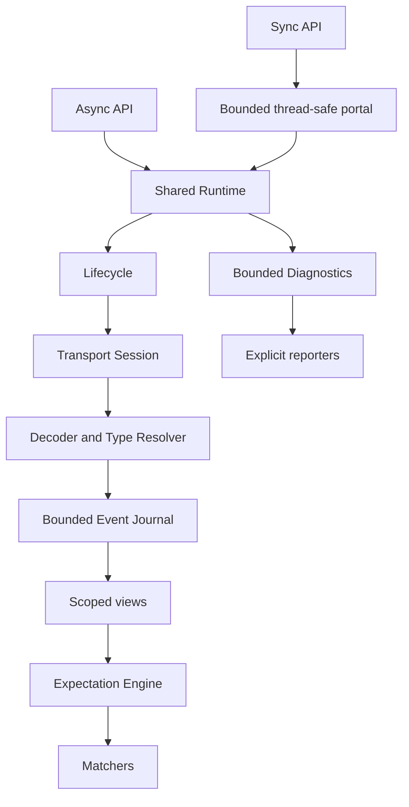

# Event Observer — окончательная техническая спецификация

**Редакция:** 1.0  
**Дата:** 1 ноября 2026 года  
**Основание:** решения ADR-001–012 и дополнительное требование поддержки синхронных тестов.  
**Первый целевой выпуск:** 0.1.0.  
**Рабочий дистрибутив:** `event-observer`; рабочее пространство импортов: `event_observer`.  
**Статус:** нормативное задание на реализацию, а не описание уже выпущенного или протестированного продукта.

Доступность имени в PyPI, право использования имени, лицензия и подтверждённые диапазоны зависимостей должны быть проверены перед публикацией. Команды установки с рабочим именем не являются рекомендацией устанавливать одноимённый существующий сторонний пакет.

Документ описывает самостоятельную библиотеку. Он не содержит исходников, схем сообщений, адресов инфраструктуры, credentials или иных материалов закрытого проекта. Примеры предметной области вымышлены. Реализация не должна требовать доступа к закрытому репозиторию.

## Содержание

1. [Статус требований и реестр решений](#s01)
2. [Назначение, границы продукта и MVP](#s02)
3. [Основные сценарии: sync и async](#s03)
4. [Архитектура и владение ресурсами](#s04)
5. [Нормализованные модели данных](#s05)
6. [Публичный API наблюдения](#s06)
7. [Readiness, стартовые позиции и replay](#s07)
8. [Event Journal, память и полнота](#s08)
9. [Transport Adapter API и backpressure](#s09)
10. [Kafka Adapter первого выпуска](#s10)
11. [Decoder, Protobuf и смешанные типы](#s11)
12. [Matchers и Expectations](#s12)
13. [Scoped correlation](#s13)
14. [Время, конкурентность и фиксация результата](#s14)
15. [Lifecycle, ошибки и cleanup](#s15)
16. [Дополнение ADR-013: синхронный API](#s16)
17. [Diagnostics, Allure, secrets и trace context](#s17)
18. [Temporal Assertions: контракт следующего этапа](#s18)
19. [Программная конфигурация и pytest](#s19)
20. [Каталог ошибок](#s20)
21. [Тестирование и contract testing framework](#s21)
22. [Совместимость, benchmarks, CI/CD и release gates](#s22)
23. [Packaging, pyproject.toml и публикация](#s23)
24. [Стабильность API, документация и deprecation](#s24)
25. [План реализации и критерии приёмки](#s25)
26. [Уточнения при консолидации ADR](#s26)
27. [Внешние технические основания](#s27)

---

<a id="s01"></a>
## 1. Статус требований и реестр решений

### 1.1. Нормативные формулировки

**MUST / MUST NOT** — обязательное требование / запрет. **SHOULD / SHOULD NOT** — рекомендуемое поведение, отступление требует документированного основания и теста. **MAY** — допустимое расширение, не являющееся обязательством выпуска.

Если ранний иллюстративный пример ADR расходится с этой спецификацией, для реализации используется данный документ. Изменения существенных контрактов после принятия спецификации оформляются новой редакцией и записью в changelog. Названия методов в кодовых блоках нормативны, если блок прямо не обозначен как схема, шаблон или пример реализации.

Числовые defaults ниже — проектные настройки, а не измеренная производительность и не гарантия верхнего предела RSS. Положения о сторонних инструментах снабжены ссылками на первичную документацию в разделе 27. Собственные MUST/SHOULD — решения этого проекта.

### 1.2. Реестр

| Решение | Выбор | Нормативное содержание |
|---|---|---|
| ADR-001 | B | Унифицированный Event Observer, разделение Core, Transport, Decoder и Reporting |
| ADR-002 | B | Новые события по умолчанию, явный replay, readiness и fail-closed при выявленном нарушении наблюдения |
| ADR-003 | B | Ограниченный Journal; FAIL по умолчанию; независимые читатели |
| ADR-004 | B | Python predicates и структурированные matchers; единый deadline |
| ADR-005 | A | Программная конфигурация; пользовательские fixtures; отсутствие скрытых подключений |
| ADR-006 | B | Публичный Transport Protocol, явная передача адаптера, contract tests |
| ADR-007 | B | Decoder abstraction, Protobuf и явный resolver для mixed-type streams |
| ADR-008 | B | Структурированная диагностика, необязательный Allure, пассивный trace context |
| ADR-009 | B | Scoped correlation поверх общего Journal |
| ADR-010 | B | Temporal assertions без сценарного DSL; реализация после 0.1 |
| ADR-011 | B | Contract tests, реальные брокеры, fault injection и release gates |
| ADR-012 | A | Один дистрибутив, optional extras, единое версионирование |
| Дополнение ADR-013 | Новое требование | Полноценный sync API в 0.1 поверх того же runtime; архитектурная детализация в разделе 16 |

Пользователь отдельно подтвердил необходимость синхронных тестов. Название `SyncEventObserver` и модель выделенного event loop — техническая конкретизация этого требования в данной спецификации, а не ранее существовавшая реализация.

<a id="s02"></a>
## 2. Назначение, границы продукта и MVP

### 2.1. Задача

Библиотека помогает black-box интеграционным тестам подключиться к брокеру **до тестового действия**, накопить сообщения и проверить результаты без собственного consumer loop, sleeps, десериализации в каждом тесте и ручного управления offsets.

Она предназначена для обычных `def test_*` и асинхронных `async def test_*`. Core MUST работать вне pytest. Тестируемая система не обязана использовать определённый Python-фреймворк или вообще быть написана на Python.

### 2.2. Обязательный состав 0.1.0

| Область | Входит в 0.1.0 |
|---|---|
| Runtime | `EventObserver` для async и `SyncEventObserver` для sync; единое ядро |
| Транспорт | Kafka через `confluent-kafka`; независимые sessions, ручное назначение партиций |
| Старт | `latest`, `earliest`, явные Kafka offsets, разрешение timestamp |
| Форматы | Raw bytes / null payload; обычный Protobuf через `*_pb2.py` |
| Mixed types | Явные header/source/callable resolvers; `FAIL_FAST`, `SKIP_UNKNOWN_TYPE` |
| Journal | Ограниченный in-memory журнал, FAIL / DROP_OLDEST / DROP_NEWEST, учёт потерь |
| Ожидания | `wait_for`, `wait_for_event`, `wait_for_count` |
| Matchers | Поля, presence, partial Protobuf, композиция, payload/event predicates |
| Корреляция | Scopes, вложенные scopes, история / from-now / sequence, payload и metadata |
| Диагностика | Ограниченные snapshots, причины несовпадений, ошибки; Allure по opt-in |
| Трассировка | Извлечение W3C trace context без создания spans |
| Тестирование | Fake adapter, переиспользуемые contract tests, реальная Kafka, базовые faults, xdist, sync/async parity |
| Поставка | Wheel + sdist, типизация, extras, документация, защищённый release pipeline |

### 2.3. После MVP

Temporal assertions, RabbitMQ, Redis Streams, затем Redis Pub/Sub и NATS реализуются отдельными этапами. Их архитектурные контракты фиксируются сейчас, но наличие этих разделов не разрешает рекламировать несуществующий адаптер или публиковать пустые extras.

За пределами ближайшего MVP: Schema Registry, автоматическое угадывание схем, отправка сообщений, HTTP/gRPC-клиенты, дисковый Journal, reconnect с восстановлением checkpoints, динамическое расширение partition assignment, distributed journal, сценарный DSL и генерация OpenTelemetry spans.

### 2.4. Границы гарантий

Наблюдение не доказывает exactly-once, отсутствие дубликатов, глобальный порядок между Kafka partitions, отсутствие потерь у producer, абсолютную сохранность данных брокера или отсутствие события в будущем. Библиотека MUST делать явными обнаруженную неполноту и область, в которой выполнено утверждение.

MVP не является hard real-time системой. Синхронный пользовательский callback или зависший native-клиент нельзя считать принудительно прерываемым по таймеру.

<a id="s03"></a>
## 3. Основные сценарии: sync и async

Примеры описывают целевой API. Модули `example_pb2`, `sync_service_client` и `async_service_client` относятся к пользовательскому тестовому проекту.

### 3.0. Публичная synthetic схема примера

Эта схема не связана с закрытым проектом; её можно использовать в examples и contract fixtures. Generated Python-файл создаётся обычным Protobuf toolchain в development environment, а не во время работы observer.

```proto
syntax = "proto3";
package example;

enum OperationStatus {
  OPERATION_STATUS_UNSPECIFIED = 0;
  CREATED = 1;
  COMPLETED = 2;
  FAILED = 3;
}

message OperationEvent {
  string operation_id = 1;
  OperationStatus status = 2;
}

message OperationCreated {
  string operation_id = 1;
}

message OperationCompleted {
  string operation_id = 1;
}
```

### 3.1. Обычный синхронный pytest-тест

```python
from uuid import uuid4

import pytest

from event_observer import ScopeStart, SyncEventObserver
from event_observer.matchers import field_equals
from event_observer.transports.kafka import KafkaAdapter, KafkaConfig
from example_pb2 import OperationEvent, COMPLETED


@pytest.fixture(scope="session")
def kafka_config() -> KafkaConfig:
    return KafkaConfig(bootstrap_servers="localhost:9092")


@pytest.fixture
def events(kafka_config: KafkaConfig) -> SyncEventObserver:
    return SyncEventObserver(transport=KafkaAdapter(kafka_config))


def test_operation(events, sync_service_client):
    operation_id = uuid4().hex

    with events.watch(
        source="example.events",
        message_type=OperationEvent,
    ) as watcher:
        scope = watcher.scope(
            field_equals("operation_id", operation_id),
            start=ScopeStart.from_now(),
        )

        # Reader продолжает работать, пока этот обычный вызов блокирует тест.
        sync_service_client.perform(operation_id=operation_id)

        event = scope.wait_for(
            field_equals("status", COMPLETED),
            timeout=10.0,
        )
        assert event.operation_id == operation_id
```

Для этого режима не нужны `pytest.mark.asyncio`, async fixture или установленный `pytest-asyncio`. Блокирующее ожидание возвращает значение, а не coroutine и не Future.

### 3.2. Асинхронный тест

```python
from uuid import uuid4

import pytest

from event_observer import EventObserver, ScopeStart
from event_observer.matchers import field_equals
from event_observer.transports.kafka import KafkaAdapter, KafkaConfig
from example_pb2 import OperationEvent, COMPLETED


@pytest.fixture
def async_events(kafka_config: KafkaConfig) -> EventObserver:
    return EventObserver(transport=KafkaAdapter(kafka_config))


@pytest.mark.asyncio
async def test_operation_async(async_events, async_service_client):
    operation_id = uuid4().hex

    async with async_events.watch(
        source="example.events",
        message_type=OperationEvent,
    ) as watcher:
        scope = watcher.scope(
            field_equals("operation_id", operation_id),
            start=ScopeStart.from_now(),
        )
        await async_service_client.perform(operation_id=operation_id)
        event = await scope.wait_for(
            field_equals("status", COMPLETED),
            timeout=10.0,
        )
        assert event.operation_id == operation_id
```

Тип ожидаемого сообщения, matcher, scope, Journal, ошибки и диагностические форматы в двух режимах одинаковы. Различаются механизм вызова и владелец event loop.

### 3.3. Быстро прошедшие промежуточные состояния

```python
created = scope.wait_for(field_equals("status", CREATED), timeout=5.0)
completed = scope.wait_for(field_equals("status", COMPLETED), timeout=5.0)
```

Второе ожидание MUST обнаружить уже сохранённый `COMPLETED`, даже если он поступил до завершения первого. Эти вызовы не являются проверкой порядка `CREATED → COMPLETED`: порядок задаётся отдельным temporal API после MVP.

### 3.4. Проверка metadata

```python
observed = scope.wait_for_event(
    field_equals("status", COMPLETED),
    timeout=10.0,
)
assert observed.payload.operation_id == operation_id
assert observed.raw.source == "example.events"
partition = observed.raw.metadata["kafka.partition"]
```

Публичный результат не даёт изменять канонический payload Journal. Полученные пользователем результаты после возврата принадлежат пользователю и не входят в дальнейший бюджет хранения библиотеки.

<a id="s04"></a>
## 4. Архитектура и владение ресурсами



### 4.1. Правила зависимостей

Core MUST NOT импортировать `confluent_kafka`, `google.protobuf`, `pytest`, `allure` или `opentelemetry` при обычном импорте `event_observer`. Необязательные модули загружаются при использовании соответствующей возможности.

Transport не знает о business predicates, Protobuf-классах и Allure. Decoder не знает о consumer lifecycle. Journal не выполняет commits/acks. Expectation Engine читает Journal, а не брокер. Reporter не участвует в подтверждении доставки.

### 4.2. Владельцы

| Объект | Владелец и время жизни |
|---|---|
| `EventObserver` / `SyncEventObserver` | Ленивая фабрика пользователя; без соединений и фоновых потоков до `watch().__enter__` / `__aenter__` |
| `TransportAdapter` | Фабрика независимых sessions; хранит неизменяемую конфигурацию |
| `TransportSession` | Один watcher; собственный клиент и контролируемые ресурсы |
| `EventJournal` | Один watcher; один writer в одном event loop |
| `EventScope` | Лёгкое представление; без собственного consumer и копии Journal |
| Expectation | Один вызов ожидания; deadline, позиция сканирования и ограниченное состояние |
| Sync runtime loop | Один активный sync watcher; работает непрерывно до cleanup |
| Kafka polling worker | Одна Kafka session; сериализует операции blocking-клиента |
| Reporter binding | Один watcher/тестовый reporting context; не глобальный singleton |

Адаптер, поддерживающий оба facade, MUST создавать loop-bound ресурсы внутри `open`, а не в конструкторе. Реализация MUST NOT разделять transport session, task, lock или Journal между pytest-xdist процессами.

<a id="s05"></a>
## 5. Нормализованные модели данных

### 5.1. RawEvent

```python
from dataclasses import dataclass
from typing import Mapping

MetadataScalar = str | int | float | bool | bytes | None


@dataclass(frozen=True, slots=True)
class RawEvent:
    payload: bytes | None
    source: str
    headers: tuple[tuple[str, bytes | None], ...] = ()
    key: bytes | None = None
    metadata: Mapping[str, MetadataScalar] = ...
    delivery_id: str | None = None
```

`...` в моделях означает поле, подлежащее реализации, а не runtime default. В реализации отсутствующие mappings создаются безопасной factory и копируются в неизменяемое представление.

**DATA-01.** `payload=None` отличается от `payload=b""`. Null payload и пустая бинарная строка не взаимозаменяемы.

**DATA-02.** Заголовки сохраняют порядок, повторяющиеся имена и null values. Преобразование в `dict` с потерей дублей запрещено.

**DATA-03.** `source` — конкретный нормализованный источник события. Транспортно-специфичные поля имеют namespace: `kafka.partition`, `kafka.offset`, `kafka.timestamp_ms`, `kafka.timestamp_kind`. Строковое представление native client object не является metadata.

**DATA-04.** `delivery_id` — непрозрачный session-local токен для settlement extension. Это не бизнес-идентификатор и не ключ дедупликации; в стандартный отчёт не включается.

### 5.2. Событие Journal

```python
from datetime import datetime
from typing import Generic, TypeVar

T = TypeVar("T")


@dataclass(frozen=True, slots=True)
class ObservedEvent(Generic[T]):
    observer_id: str
    sequence: int
    payload: T
    raw: RawEvent
    recorded_at: datetime
    recorded_monotonic: float
    message_type: str | None
    trace_context: "TraceContextInfo | None"
```

`sequence` монотонно увеличивается внутри watcher и никогда не переиспользуется. Это не Kafka offset. Один Kafka record, повторно доставленный транспортом, может получить другой Journal sequence: автоматической дедупликации нет.

`recorded_monotonic` присваивается в атомарной операции admission/append. Именно это время используется для deadlines и temporal assertions. Время получения native-клиентом и broker timestamp MAY сохраняться отдельно, но не подменяют время Journal.

`recorded_at` — timezone-aware UTC для отчёта. Wall-clock никогда не используется для расчёта timeout.

### 5.3. Ошибка декодирования — не payload

Journal имеет типизированные внутренние записи `DecodedRecord`, `FilteredRecord`, `DecodeFailureRecord` и `LossRange`. Ошибку декодирования MUST NOT представлять как `ObservedEvent(payload=None)`: `None` является допустимым значением RawDecoder, и смешение состояний разрушает типизацию.

В обычные payload matchers поступают только успешно декодированные события. Отфильтрованные и ошибочные записи доступны через ограниченную диагностику.

### 5.4. Immutable envelope не делает Protobuf immutable

Frozen dataclass запрещает замену поля, но не модификацию mutable payload. Journal сохраняет исходные bytes и собственный декодированный объект. Для встроенного Protobuf-кодека публичные результаты и пользовательские callbacks получают независимые копии через интерфейс сообщения; `CopyFrom` документирован Protobuf. [S04]

Пользовательский Decoder MUST передавать владение результатом runtime. Для произвольного mutable типа используется `PayloadAccess[T]`: независимое копирование и модель учёта размера. По умолчанию допустим `deepcopy`; неудача копирования — явная `PayloadIsolationError`, а не передача внутреннего объекта без защиты.

<a id="s06"></a>
## 6. Публичный API наблюдения

### 6.1. Factories

```python
class EventObserver:
    def __init__(
        self,
        *,
        transport: "TransportAdapter | BuiltinTransportConfig",
        journal: "JournalPolicy | None" = None,
        lifecycle: "LifecyclePolicy | None" = None,
        buffers: "TransportBufferLimits | None" = None,
        runtime_limits: "RuntimeLimits | None" = None,
        diagnostics: "DiagnosticPolicy | None" = None,
        reporters: "Sequence[DiagnosticReporter]" = (),
    ) -> None: ...

    def watch(
        self,
        *,
        source: "str | TransportSource",
        message_type: "type[T] | None" = None,
        decoder: "Decoder[T] | None" = None,
        payload_access: "PayloadAccess[T] | None" = None,
        start: "StartPosition | None" = None,
        decoding: "DecodingPolicy | None" = None,
        identity: "ObservationIdentity | None" = None,
    ) -> "AsyncContextManager[EventWatcher[T]]": ...


class SyncEventObserver:
    # Тот же набор аргументов конструктора и watch.
    # watch возвращает ContextManager[SyncEventWatcher[T]], не coroutine.
    ...
```

Реальные annotations `watch` MUST использовать overloads: `message_type=type[T]` и `decoder=Decoder[T]` дают `T`; отсутствие обоих даёт `bytes | None`. Указание обоих запрещено. Generic `T` в сокращённой сигнатуре не означает обязательной зависимости Core от Protobuf.

Разрешение встроенного `KafkaConfig` в `KafkaAdapter` — изолированный convenience-layer. Core не проверяет `isinstance(session, KafkaSession)` для выбора семантики.

### 6.2. Watchers и scopes

| Метод | Async watcher/scope | Sync watcher/scope |
|---|---|---|
| `wait_for(matcher, *, timeout, description=None, require_complete=True)` | `await → T` | `→ T` |
| `wait_for_event(...)` | `await → ObservedEvent[T]` | `→ ObservedEvent[T]` |
| `wait_for_count(matcher, count, *, timeout, description=None, require_complete=True)` | `await → list[T]` | `→ list[T]` |
| `scope(matcher, *, name=None, start=None)` | `→ EventScope[T]`, без I/O | `→ SyncEventScope[T]`, bounded portal call |
| `snapshot()` | Согласованный `JournalSnapshot` / `ScopeSnapshot` в owner loop | Detached snapshot через portal |
| `diagnostics.snapshot()` | Безопасный `DiagnosticSnapshot` | Detached безопасный snapshot |
| `close()` | `await → None`, только watcher | `→ None`, только watcher |

Scopes не имеют собственного `close()`. Закрытие watcher делает новые ожидания всех scopes недопустимыми. Завершённый watcher сохраняет detached snapshots для диагностики, но не предоставляет replay после закрытия в MVP.

### 6.3. Нормы вызова

`watch()` MUST NOT выполнять I/O. Вход в контекст выполняет запуск и возвращает READY watcher. Повторный вход в тот же context/session запрещён; новый вызов `watch()` создаёт новое наблюдение.

Factory может использоваться как session-scoped fixture, если не имеет loop-bound состояния. Активный watcher SHOULD быть function-scoped или жить непосредственно внутри теста. Share одного watcher между тестами не создаёт автоматической логической изоляции.

<a id="s07"></a>
## 7. Readiness, стартовые позиции и replay

### 7.1. StartPosition

```python
StartPosition.latest()
StartPosition.earliest()
StartPosition.at_offset({0: 125, 1: 242})
StartPosition.at_timestamp(timestamp, require_existing=False)
```

| Политика | Норма |
|---|---|
| `latest()` | Default. Зафиксировать текущие границы; читать новые записи относительно этих границ |
| `earliest()` | Начать с ранней доступной позиции, не обещая существование всей истории |
| `at_offset(mapping)` | Явные включающие нижние границы Kafka по всем выбранным partitions; без silent fallback |
| `at_timestamp(t)` | Разрешить стартовую позицию по timestamp; не устанавливает вечный фильтр по timestamp |
| `committed()` | Не поддерживается в MVP |
| Произвольная native position | Extension после появления соответствующего адаптера |

`timestamp` MUST быть timezone-aware datetime либо явно типизированным epoch milliseconds, но не неоднозначным `float`. Mapping offsets MUST покрывать весь выбранный набор partitions. Позиции отсутствующих partitions отклоняются.

### 7.2. Readiness barrier

**START-01.** Успешный вход в контекст означает: источник разрешён; поддерживаемая политика проверена; reader независим; позиции установлены; receive path способен принимать события; известной startup failure нет.

**START-02.** Между transport readiness и запуском core reader не должно быть незащищённого окна потери. Пустой topic не требует публикации служебного тестового сообщения для READY.

**START-03.** Сообщения между фиксацией boundary и возвратом входа в контекст входят в диапазон наблюдения. Они не отбрасываются ради формулировки «только после `with`».

**START-04.** Подготовка имеет отдельный `startup_timeout`. Ошибка/отмена частично выполненного запуска MUST запускать rollback уже созданных ресурсов, даже если session ещё не возвращена.

### 7.3. Kafka boundary

Kafka boundary — вектор offsets по partitions, не атомарная отметка времени топика. Для `latest` фиксируется uncached high watermark каждой выбранной partition и используется явный numeric assignment. High watermark описывается клиентом как offset последней записи + 1. [S05]

Нельзя заменять эту процедуру одной настройкой `auto.offset.reset=latest`. В MVP reset при недоступной позиции настроен на ошибку, сохранённые group offsets не используются.

Позиция `offset == high` допустима: это ожидание будущих сообщений. `offset < low` и `offset > high` при разрешении позиции дают явную ошибку. Внутри `[low, high)` compacted/control/невидимая transactional запись может не выдаваться. Поэтому `at_offset(n)` означает «читать с нижней границы n», а не «гарантировать наличие бизнес-сообщения точно n».

### 7.4. Timestamp replay

`offsets_for_times` возвращает раннюю доступную позицию с timestamp не меньше запроса; при отсутствии подходящей записи клиент может вернуть `-1`. [S05]

При отсутствии записи и `require_existing=False` выбирается зафиксированная high boundary этой partition. При `require_existing=True` отсутствие подходящей позиции хотя бы в одной выбранной partition — `StartPositionUnavailableError`.

Затем выполняется обычное чтение. Timestamp replay не доказывает, что timestamp всех последующих сообщений монотонен или удовлетворяет исходному порогу. Для такого требования нужен отдельный matcher.

### 7.5. Isolation и topology

Kafka использует `assign`, уникальный diagnostic `group.id`, `enable.auto.commit=false`, `enable.auto.offset.store=false`, без commits. Независимость обеспечивается прямым чтением, а не только уникальным именем группы.

Топология MVP — `STATIC_FAIL`: набор partitions фиксируется, metadata проверяется периодически. Обнаруженное изменение завершает наблюдение ошибкой; новые partitions не подключаются молча с конца.

Проверка топологии не является непрерывной транзакционной блокировкой: изменение может быть обнаружено после завершения отдельного assertion. Уже возвращённый результат не переписывается. Известная background failure MUST быть видна при выходе из контекста, даже если активных waiters не осталось.

### 7.6. Непрерывность

`CONTINUOUS` означает отсутствие обнаруженного нарушения в заявленной области; это не доказательство отсутствия всех потерь. `UNCERTAIN` и `GAP_DETECTED` приводят к fail-closed в MVP при затронутой требуемой области. Адаптер не запускает новый reader с `latest` после ошибки.

Скачок Kafka offsets сам по себе MUST NOT считаться потерей: compaction и transactional visibility делают арифметику `offset + 1` недостаточной. Зафиксированные ошибки доступности позиции, переполнение handoff и известный разрыв наблюдения учитываются отдельно.

<a id="s08"></a>
## 8. Event Journal, память и полнота

### 8.1. Модель хранения

Journal — single-writer / multiple-readers структура одного runtime event loop. Каждый watcher имеет отдельный Journal. Reader брокера один; waiters не конкурируют за доставку и не удаляют найденные события.

**JOURNAL-01.** Admission назначает sequence, монотонное время и увеличивает version атомарно. Любой не принятый из-за политики payload получает запись о пропуске либо terminal failure, а не исчезает без следа.

**JOURNAL-02.** Matchers никогда не вызываются под Journal lock. Структурированный matcher библиотеки может читать каноническое сообщение; пользовательский predicate/custom matcher получает независимую копию.

**JOURNAL-03.** Ограничиваются не только сохранённые события, но и pinned batches, промежуточные копии, результаты незавершённых expectations, gaps ledger и diagnostic samples.

### 8.2. Defaults

| Настройка | Default | Значение |
|---|---:|---|
| `max_events` | 10 000 | Сохранённые decoded records |
| `max_bytes` | 64 MiB | Accounted budget Journal, не точный RSS |
| `max_event_bytes` | 16 MiB | Hard limit сырого события: payload, key, headers и ограниченные metadata |
| `max_active_waiters` | 128 | Защита от неограниченного состояния expectations |
| `max_scopes` | 256 | Зарегистрированные логические определения scopes |
| `max_loss_ranges` | 1 024 | Точный ledger утраченных диапазонов до conservative compaction |
| `max_result_events` | 10 000 | Верхняя граница `count` и одного результата |
| `max_result_bytes` | 64 MiB | Суммарный accounted budget ещё не выданных результатов watcher |
| `scan_batch_events` | 64 | Максимальный шаг сканирования до cooperative yield |

Настройки MUST быть положительными конечными значениями соответствующего типа. `max_event_bytes` не может превышать предел вместимости transport handoff. Уменьшение бюджета ниже одного разрешённого события — configuration error, а не deadlock на ожидании свободного места.

Дополнительные лимиты waiters/scopes/results конкретизируют ранее открытый вопрос ресурсов. Они настраиваемы и не являются обещанием производительности при максимальных значениях.

### 8.3. Accounted bytes

Модель учёта MUST быть детерминированной и опубликованной: длина raw bytes, key/headers, ограниченный encoded metadata size, фиксированные overhead-поправки структур и оценка декодированного объекта. Для Protobuf wire size не равен фактическому native heap; его использование допускается только как документированная оценка.

Библиотека MUST NOT обещать, что `max_bytes=64 MiB` ограничит весь процесс 64 MiB. Дополнительную память используют Python, native client buffers, парсер, результаты у пользователя и другие fixtures. Размер до декодирования ограничивается, но это не абсолютная защита от расширения бинарного представления в heap.

Snapshot не должен копировать весь Journal неограниченно. Defaults snapshot — metadata и ограниченная выборка; явный экспорт payload подчиняется отдельным budget и disclosure policy.

### 8.4. Политики aggregate overflow

| Политика | Поведение | Продолжение |
|---|---|---|
| `FAIL` | Записать bounded failure summary; observer terminal failure | Нет |
| `DROP_OLDEST` | Удалить старые записи до освобождения места; зарегистрировать утраченный диапазон | Да, история неполна |
| `DROP_NEWEST` | Не сохранить новую запись; зарегистрировать её sequence/диапазон и причину | Да, история неполна |

`max_event_bytes` — отдельный hard safety limit. Его превышение даёт `EventTooLargeError` при любой aggregate overflow policy; нельзя пытаться безлимитно распарсить запись, чтобы затем её отбросить. Это явное уточнение раннего примера ADR-003, согласованное с transport backpressure.

DROP-политики MUST NOT распространяться автоматически на скрытые transport queues. Там потеря является transport failure.

### 8.5. Полнота диапазона

Глобальный `DEGRADED` — только summary. Проверка полноты MUST выполняться для конкретного диапазона `sequence` expectation и его области декодирования.

По умолчанию новая проверка наследует **логическую начальную границу watcher/scope**, а не незаметно сдвигается на первую сохранившуюся запись. Поэтому ранняя eviction не превращает неполную историю в полную только потому, что waiter создан позже.

`ScopeStart.from_now()` может создать новый полный диапазон после предыдущей eviction. Это не восстанавливает удалённую историю, а явно выбирает более позднюю область.

Если records удалены после их проверки, в MVP выбирается консервативное правило: `require_complete=True` требует сохранённой/подтверждённой полноты всего проверяемого диапазона к точке фиксации результата. Waiter MUST NOT выдавать полный результат, опираясь на неограниченные приватные архивы удалённых записей.

Loss ledger хранит объединяемые диапазоны. При достижении `max_loss_ranges` разрешено укрупнить область до conservative `UNKNOWN/INCOMPLETE`; запрещено забыть gap и объявить историю полной. Границы после последней затронутой позиции могут оставаться пригодными.

### 8.6. Filtered, failed и lost

| Состояние | Значение |
|---|---|
| `FILTERED` | Явно исключено из заявленной decode domain; не является потерей транспорта |
| `MISMATCH` | Декодировано, но не подошло matcher |
| `NOT_APPLICABLE` | Проверка не применима к данному допустимому типу |
| `DECODE_FAILED` | Тип/формат не удалось обработать; fail-fast в MVP, кроме явно unknown-type exclusion |
| `DROPPED` | История утрачена из-за retention policy |
| `TRANSPORT_GAP` | Известное нарушение доставки/позиции |

Scope фильтруется после admission. Он не уменьшает поток в общем Journal и не защищает watcher от переполнения нерелевантными сообщениями.

<a id="s09"></a>
## 9. Transport Adapter API и backpressure

### 9.1. Базовые контракты

```python
from typing import AsyncIterator, Protocol


class TransportSession(Protocol):
    @property
    def readiness(self) -> "TransportReadiness": ...

    def receive(self) -> AsyncIterator[RawEvent]: ...

    async def wait_failure(self) -> "TransportError | None": ...

    async def close(self, *, deadline: float) -> None: ...


class TransportAdapter(Protocol):
    @property
    def capabilities(self) -> "TransportCapabilities": ...

    async def open(
        self,
        source: "TransportSource",
        start: "StartPosition",
        *,
        context: "OpenContext",
    ) -> TransportSession: ...
```

`receive` — обычный метод, возвращающий async iterator, либо async generator с эквивалентной внешней формой. Он не возвращает coroutine, которую сначала нужно отдельно await для получения iterator.

`OpenContext` содержит observation identity, startup deadline в общем monotonic clock domain, buffer limits и safe diagnostic sink. Он не содержит Protobuf-класс, matcher или Allure object.

`wait_failure()` нужен, чтобы terminal transport failure стала видна, даже когда reader временно остановлен backpressure. Он возвращает типизированную ошибку при failure, `None` только при намеренном закрытии. Отмена одного monitor waiter не отменяет исходный session failure signal. Если receive неожиданно завершился у бесконечного источника, Core создаёт `UnexpectedStreamEndError`.

### 9.2. Resolved readiness

```python
@dataclass(frozen=True, slots=True)
class TransportReadiness:
    boundary: "ObservationBoundary"
    resolved_capabilities: "TransportCapabilities"
    source_metadata: "Mapping[str, MetadataScalar]"
    ready_monotonic: float
```

Static capabilities описывают потенциальные возможности адаптера; resolved capabilities — реально применимый режим конкретной session. Permission failure не кодируется как «capability нет» и не проглатывается.

### 9.3. Capability model

| Группа | Пример значений |
|---|---|
| `start_modes` | LATEST, EARLIEST, OFFSET, TIMESTAMP, NATIVE_POSITION |
| `isolation_modes` | INDEPENDENT_READER, DEDICATED_SUBSCRIPTION |
| `flow_control_modes` | FETCH_LIMIT, PAUSE_RESUME, PREFETCH, NONE |
| `ordering_scope` | NONE, SOURCE, PARTITION, NATIVE_DOMAIN |
| `supports_headers` | Доступность нормализованных headers |
| `supports_key` | Доступность message key |
| `supports_source_timestamps` | Timestamp и его происхождение |
| `supports_position_tracking` | Native позиция для диагностики |
| `supports_topology_detection` | Проверка выбранной топологии |
| `supports_settlement` | Нужен optional settlement extension |

Наличие flow control не является гарантией фиксированного native RSS. Capability MUST NOT означать «неограниченный replay»: retention, compaction и права описываются отдельно.

Рабочий режим competing consumer обычной очереди приложения не является безопасным режимом официального адаптера. Для будущего RabbitMQ выбирается отдельная очередь с собственными bindings; для Redis Streams — независимый XREAD, не чужая consumer group. RabbitMQ Streams — отдельная transport semantics, не AMQP queue replay.

### 9.4. Settlement extension

Ранее формулировка «ack после Journal» не имела точки вызова в протоколе. Фиксируется явный optional extension:

```python
class SettlementSession(Protocol):
    async def settle(
        self,
        delivery_id: str,
        outcome: "DeliveryOutcome",
    ) -> None: ...
```

`DeliveryOutcome` — `ADMITTED`, `FILTERED` или `DISCARDED_BY_EXPLICIT_JOURNAL_POLICY`. Runtime вызывает settlement только после фиксации соответствующего outcome. Journal не вызывает адаптер сам.

При decode failure, hard oversize или FAIL overflow ack не отправляется как успешный. Адаптер документирует reject/requeue/закрытие своей изолированной subscription. При DROP policy разрешён settlement явно зафиксированного discard; полнота уже отмечена нарушенной.

Kafka не объявляет `supports_settlement`, не создаёт receipt и не выполняет offset commit. Никакого общего «commit» в EventWatcher нет.

### 9.5. Session ownership

Каждый `watch` создаёт отдельную session. В MVP нет shared consumer, connection pool и скрытого multiplexing. Одна session допускает только один receive iterator. Все loop-bound объекты принадлежат runtime loop; при sync mode это частный background loop.

`close` идемпотентен: concurrent close requests присоединяются к одной операции. Startup rollback является обязанностью `open`, если оно не смогло вернуть session. Error path MUST быть проверен на каждой ступени подготовки.

### 9.6. Bounded transfer

Default transport handoff: 256 записей и 16 MiB accounted bytes. Ограничение по bytes включает находящийся у producer-side bridge элемент и pending передачу, а не только длину `asyncio.Queue`.

**FLOW-01.** Нельзя создавать unbounded `call_soon_threadsafe` callbacks или отдельный Future/Task на каждое входящее сообщение без ограничения in-flight.

**FLOW-02.** Bridge резервирует capacity до публикации callback в event loop. Выборка и pause/resume имеют high/low watermarks, чтобы не дёргать управление на каждом сообщении.

**FLOW-03.** Native buffers настраиваются отдельно и отражаются в diagnostics. Их пределы не выдаются за точное ограничение общей RAM.

**FLOW-04.** У session остаётся отдельный control path для stop/failure. Полный data buffer не должен блокировать close или доставку terminal error.

**FLOW-05.** При невозможности сохранить принятую запись и отсутствии безопасного flow control возникает `TransportBackpressureError`. Молчаливый transport drop запрещён.

Для будущего RabbitMQ prefetch ограничивает неподтверждённые доставки; значение 0 означает отсутствие этого ограничения. [S07] Для Redis Streams cursor продвигается по полученным IDs; повторять `$` на каждом XREAD нельзя. [S08]

<a id="s10"></a>
## 10. Kafka Adapter первого выпуска

### 10.1. Клиент и потоковая модель

Используется `confluent-kafka.Consumer`. На session создаётся один polling worker; все операции consumer — configuration/start, assign, poll, pause/resume, metadata inspection и close — сериализуются через этот worker. Native blocking call MUST NOT выполняться в asyncio loop.

Полученные payload переводятся в принадлежащие Python immutable bytes с ограниченным временем удержания native message objects. Worker передаёт записи через bounded bridge. Broker callbacks преобразуются в типизированные состояния, но не вызывают Allure или пользовательские matchers.

### 10.2. Управляемые параметры

| Параметр | Норма |
|---|---|
| `enable.auto.commit` | `false`, переопределение запрещено |
| `enable.auto.offset.store` | `false`, переопределение запрещено |
| `auto.offset.reset` | `error`, не fallback к latest/earliest |
| `allow.auto.create.topics` | `false` |
| Assignment | Явный список topic/partition/numeric offset |
| Group coordination | Не используется для распределения partitions |
| `group.id` | Уникальный session diagnostic ID, без commit semantics |
| `enable.partition.eof` | Может использоваться readiness/diagnostics; EOF не является бизнес-событием или terminal end |
| `isolation.level` | Явно задан; default библиотеки `read_committed` |
| Native queue/fetch limits | Явно настроены, протестированы и показаны как отдельный budget |

`auto.offset.reset=error`, consumer queue limits и transactional isolation имеют клиент-специфичную семантику; применяется конфигурация librdkafka, не механическая копия Java consumer options. [S06]

### 10.3. Транзакции

`read_committed` означает, что абортированные транзакционные записи не выдаются. Наблюдаемая доступность может останавливаться на last stable offset. [S06]

MVP сохраняет из ADR-002 **numeric high-watermark boundary для latest**: записи с offset ниже зафиксированной границы исключены, даже если существовавшая до READY транзакция закоммитится позже. Это «новые log records после boundary», а не «всё, что стало committed после READY».

Readiness MUST NOT требовать получения committed бизнес-записи или бесконечно ждать закрытия чужой открытой транзакции. Реализация должна подтверждать работоспособность fetch path отдельно от наличия видимых данных. Transactional integration tests обязательны для объявления такой поддержки.

### 10.4. Readiness и faults

Одних успешных `metadata` и `assign` недостаточно для заявления «Read ACL точно проверен». Адаптер SHOULD подтвердить успешный fetch/доступность reader для выбранных partitions, включая пустые, без изменения топика. Если подтверждение не получено за startup budget, вход завершается ошибкой, а не оптимистическим READY.

Native-клиент может выполнять внутренние сетевые retries. Библиотека не обещает видеть каждый короткий сетевой сбой. Известная terminal error, недоступная позиция или интервал, непрерывность которого невозможно подтвердить по политике адаптера, фиксируются fail-closed. Молчаливый restart с другой позиции запрещён.

Для топологии задаётся положительный `topology_check_interval`; предлагаемый default 1.0 s. Это контрольная периодичность, не hard real-time гарантия обнаружения. Metadata probe и poll имеют конечные таймауты, ограниченные lifecycle budget.

### 10.5. Kafka-specific acceptance

MUST проверить: empty topic readiness; несколько partitions; данные между boundary и READY; production сразу после READY; retained committed offsets не используются; offset==high; out-of-range без reset; compacted gaps; transactional visibility; topic recreated/topology changed при обнаружении; EOF не завершает observer; bridge pressure; close под нагрузкой; auth/ACL failures; две независимые sessions на одном topic.

<a id="s11"></a>
## 11. Decoder, Protobuf и смешанные типы

### 11.1. Decoder API

```python
from typing import Protocol, TypeVar

T_co = TypeVar("T_co", covariant=True)


class Decoder(Protocol[T_co]):
    def decode(self, event: RawEvent) -> T_co: ...
```

Decoder синхронный, не выполняет сетевого I/O, не изменяет RawEvent, создаёт отдельный результат на вызов. Encoder не обязателен и в MVP отсутствует. Custom callbacks считаются доверенным кодом проекта, но не освобождаются от требований ограниченного времени и отсутствия мутаций канонического состояния.

`RawDecoder` возвращает `bytes | None`. `ProtobufDecoder[T]` принимает generated Python class `type[T]`. Сокращение `message_type=T` создаёт этот decoder.

### 11.2. Protobuf deserialization

Алгоритм: проверить размер → проверить null → создать новый message → `ParseFromString` → при включённой настройке `IsInitialized` → вернуть сообщение. Ошибки библиотечного парсера сохраняются как cause нормализованной ошибки. API чтения, presence и копирования сообщений соответствует generated Python API. [S04]

**PROTO-01.** `b""` может быть корректным Protobuf-сообщением с default fields. Его MUST NOT объявлять повреждённым только из-за нулевой длины. `None` в default ProtobufDecoder даёт `NullPayloadError`.

**PROTO-02.** `validate_required_fields=True` по умолчанию проверяет missing required fields proto2 после разбора. Это не проверка бизнес-валидности, а Protobuf initialization.

**PROTO-03.** Unknown fields сохраняются настолько, насколько это обеспечивает используемый runtime. Нельзя «починить» несовместимый payload, удалив неизвестные поля перед matcher.

**PROTO-04.** Успешный parse не доказывает правильный тип. Нельзя определять тип перебором всех `*_pb2` классов до первого успешного parse.

**PROTO-05.** Generated-code/runtime compatibility проверяется отдельно от совместимости wire schema. При несовместимости `*_pb2.py` и установленного Protobuf runtime нельзя обещать работоспособность только потому, что пакет `protobuf` установлен. [S14]

### 11.3. Resolver API

```python
class ProtobufTypeResolver(Protocol):
    def resolve(self, event: RawEvent) -> "type[Message] | None": ...
```

Опциональный `known_message_types` даёт конечный набор классов для ранней валидации matchers. Built-in resolvers публикуют его обязательно; dynamic custom resolver может не знать полный набор.

```python
decoder = ResolvingProtobufDecoder(
    resolver=HeaderTypeResolver(
        header="event_type",
        types={
            b"operation.created": OperationCreated,
            b"operation.completed": OperationCompleted,
        },
    ),
)
```

Default mapping keys бинарные. Текстовые ключи разрешены только с явно заданным `encoding`. `SourceTypeResolver` использует нормализованное имя источника. `CallableTypeResolver` принимает пользовательскую функцию; неправильный тип результата даёт `UnsupportedMessageTypeError`.

### 11.4. Missing, unknown, ambiguous

| Ситуация | Default |
|---|---|
| Discriminator отсутствует | `UnknownMessageTypeError(reason="missing_discriminator")` |
| Значение не зарегистрировано | `UnknownMessageTypeError(reason="unregistered_type")` |
| Несколько одноимённых headers | `AmbiguousMessageTypeError`, даже если значения одинаковы |
| Некорректная выбранная текстовая кодировка | `TypeResolverError` |
| Resolver выбросил exception | `TypeResolverError` с cause |
| Возвращён не Protobuf class | `UnsupportedMessageTypeError` |
| Тип известен, parse невозможен | `InvalidPayloadError` |

`REQUIRE_UNIQUE` — политика type header по умолчанию. FIRST/LAST не включаются неявно.

### 11.5. Decode policies

`FAIL_FAST` — default. Первая decode/resolver error регистрируется bounded summary и переводит watcher в terminal failure.

`SKIP_UNKNOWN_TYPE` подавляет **только** `UnknownMessageTypeError` (включая отсутствие discriminator согласно явно принятой области). Событие становится `FILTERED`. Ambiguous header, ошибка функции resolver, null payload известного Protobuf-типа и повреждённый payload остаются фатальными.

`SKIP_INVALID` не входит в 0.1. Это предотвращает превращение реального нарушения схемы в обычный timeout.

Область декодирования фиксируется на старте. Нельзя ожидать неизвестный/исключённый тип и одновременно заявлять полноту всех сообщений topic. Diagnostics показывает счётчики filtered records без безлимитного сохранения их raw payload.

### 11.6. Typing и ownership

`message_type=OperationEvent` даёт `EventWatcher[OperationEvent]` или `SyncEventWatcher[OperationEvent]`. Mixed-type decoder даёт явно аннотированный union либо `Message` при динамическом наборе. Union не обещается автоматически выводить из произвольного dictionary.

Пользовательский decoder для mutable типа MAY передать `PayloadAccess[T]` с `clone_for_user(value)` и `estimate_bytes(value)`. Встроенные Raw/Protobuf обеспечивают этот контракт. Кодирование сообщения обратно для каждой проверки не требуется: для Protobuf используется независимое копирование уже разобранного значения.

<a id="s12"></a>
## 12. Matchers и Expectations

### 12.1. Два явных протокола

```python
T_contra = TypeVar("T_contra", contravariant=True)


class PayloadMatcher(Protocol[T_contra]):
    def match(self, value: T_contra) -> "MatchResult": ...


class EventMatcher(Protocol[T]):
    def match_event(self, event: ObservedEvent[T]) -> "MatchResult": ...
```

Разные имена методов устраняют неоднозначность двух структурных Protocol с одинаковым `match(...)`. Обычный `Callable[[T], bool]` трактуется только как payload predicate. Полный event predicate требует явной обёртки `event_predicate(fn)`.

Внутри Engine всё компилируется в event matcher. Композиции умеют поднимать payload matcher к event matcher; публичный пользователь не пишет adapter вручную.

### 12.2. MatchResult

```python
class MatchStatus(Enum):
    MATCH = "match"
    MISMATCH = "mismatch"
    NOT_APPLICABLE = "not_applicable"


@dataclass(frozen=True, slots=True)
class MatchResult:
    status: MatchStatus
    mismatches: tuple["Mismatch", ...] = ()


@dataclass(frozen=True, slots=True)
class Mismatch:
    path: str
    reason_code: str
    expected: "DiagnosticValue"
    actual: "DiagnosticValue"
```

`DiagnosticValue` проходит disclosure/redaction до экспорта. Произвольный `repr` живого объекта или полная строка predicate не являются безопасным диагностическим значением.

### 12.3. MVP matchers

| Matcher | Семантика |
|---|---|
| `field_equals(path, value)` | Равенство поля |
| `field_matches(path, matcher)` | Вложенная проверка |
| `has_field(path)` | Explicit presence; неподдерживаемая presence — configuration error |
| `protobuf_partial(mapping)` | Рекурсивное сравнение заданных полей |
| `all_of`, `any_of`, `not_` | Композиция трёхзначных результатов |
| `predicate(fn)` | Явная обёртка payload predicate |
| `event_predicate(fn)` | Явная обёртка полного события |
| `is_message_type(T)` | Проверка класса сообщения; другой класс — MISMATCH |
| `on_type(T, matcher)` | Type guard: другой тип → NOT_APPLICABLE, вложенный matcher не вызывается |
| `header_equals`, `key_equals`, `source_equals` | Сравнение metadata |
| `trace_id_equals` | Сравнение валидного extracted trace ID |

`on_type` добавлен как точное защитное правило для mixed streams. `all_of(is_message_type(T), user_predicate)` не является гарантией short-circuit: all_of может собирать диагностику всех ветвей. Для predicate, безопасного только на `T`, MUST использовать `on_type` либо собственную явную проверку `isinstance`.

### 12.4. Protobuf semantics

Field paths используют имена полей protobuf schema, не JSON aliases. Вложенный absent message при explicit presence даёт mismatch, а не подстановку созданного по умолчанию вложенного объекта. У implicit-presence scalar читается значение по Protobuf semantics; `has_field` для него отклоняется. Presence не угадывается через `value != default`. [S04]

В partial comparison: указанные scalar поля сравниваются; вложенные messages рекурсивно; repeated — вся заданная упорядоченная последовательность; maps — указанные ключи; oneof — активная ветвь; неизвестное имя поля — ошибка конфигурации. `None` не означает отсутствие поля. Enum сравнивается численно/совместимым enum значением; строковые имена не преобразуются молча.

Для конечного набора допустимых типов field path валидируется при binding. Если его нет ни в одном допустимом descriptor — configuration error. Для события другого типа отсутствие пути может дать NOT_APPLICABLE.

Для dynamic decoder без конечного набора типов ранняя валидация невозможна. Структурированный доступ к типоспецифичным полям требует `on_type(T, ...)`/явного descriptor binding; произвольные predicates остаются доступны. Нельзя скрывать опечатки бесконечным NOT_APPLICABLE.

### 12.5. Композиция

Нормативная трёхзначная логика:

- `all_of`: если есть MISMATCH → MISMATCH; иначе если есть NOT_APPLICABLE → NOT_APPLICABLE; иначе MATCH.
- `any_of`: если есть MATCH → MATCH; иначе если есть NOT_APPLICABLE → NOT_APPLICABLE; иначе MISMATCH.
- `not_`: MATCH ↔ MISMATCH; NOT_APPLICABLE остаётся NOT_APPLICABLE.

Пустые `all_of`/`any_of` в публичном API отклоняются, чтобы случайная пустая конфигурация не совпала со всем потоком. `all_of` собирает bounded mismatches всех применимых ветвей. `any_of` может завершить оценку после первого MATCH в порядке объявления; непройденные ветви не оцениваются задним числом ради отчёта.

Исключение оценённой ветви не превращается в mismatch. Callback MUST быть детерминированным, коротким и без I/O. Между callbacks каноническое значение не должно изменяться; для независимых пользовательских ветвей мутация их copy не влияет на другие ветви.

### 12.6. `wait_for` и `wait_for_event`

Ожидание сканирует историю от логической нижней границы, затем новые записи; не потребляет события; возвращает первый MATCH по Journal sequence. NOT_APPLICABLE пропускается с отдельным счётчиком. Одинаковая запись может удовлетворить нескольким независимым waiters.

Каждому вызову назначаются expectation ID, один deadline и `next_sequence`. Проверенная данным waiter запись повторно не оценивается при обычном пробуждении; диагностика не запускает predicate повторно.

`wait_for` возвращает payload copy. `wait_for_event` возвращает detached envelope с независимым payload. После terminal failure новые ожидания сразу получают ошибку.

### 12.7. `wait_for_count`

`count=N` означает найти первые N различных Journal records, удовлетворивших matcher, и вернуть их в Journal order. Это «не меньше N к моменту успеха», не доказательство ровно N за всё время. Автоматической дедупликации по бизнес-ID нет.

`N` — положительное целое, не bool; превышение result limits отклоняется до ожидания. На весь набор действует один deadline. Реализация через N повторных `wait_for` запрещена: так можно получить одну запись несколько раз.

Незавершённый CountExpectation резервирует ограниченную память найденных результатов. При превышении бюджета — `ExpectationResourceLimitError`, а не скрытое удаление совпадений.

### 12.8. Exceptions predicates

Predicate должен возвращать настоящий `bool`; coroutine/awaitable или другое значение дают `InvalidMatcherResultError`. Async callback SHOULD отклоняться при binding; обнаруженный возвращённый coroutine закрывается безопасно, чтобы не оставить предупреждение «never awaited».

Обычное исключение функции оборачивается в `MatcherEvaluationError` с chaining и safe указанием sequence. Ошибка завершает только конкретный waiter, не весь observer. `KeyboardInterrupt`, `SystemExit` и cancellation не преобразуются в mismatch; отмена ожидания сохраняет свою семантику.

<a id="s13"></a>
## 13. Scoped correlation

### 13.1. Scope — представление, не подписка

`watcher.scope(filter, *, name=None, start=None)` создаёт неизменяемое определение области. Оно использует общий Journal и не создаёт consumer, transport session или собственную копию истории.

Scope filter и expectation matcher — разные уровни: первый определяет принадлежность сценарию, второй — ожидаемое состояние. Одно сообщение может входить в несколько scopes. Отмена или ошибка одного scoped waiter не меняет остальные.

### 13.2. Границы

```python
ScopeStart.all_retained()       # default: логическая история родителя
ScopeStart.from_now()           # следующая admission-позиция
ScopeStart.from_sequence(100)   # явная нижняя граница Journal
```

Название `all_retained` не разрешает игнорировать уже известные gaps: оно включает доступные записи логического диапазона родителя и наследует его completeness. Для намеренного отказа от старой истории нужен `from_now` или явный sequence.

`from_now` фиксируется в runtime атомарно с Journal version и следующим sequence. В sync mode граница фиксируется при исполнении команды в runtime, а не в момент её отправки из тестового потока; метод возвращает только после фиксации. События, ещё находящиеся в broker/native buffers, могут поступить позже и входят в новую область.

`from_sequence` принимает неотрицательную позицию не позже текущего next sequence. При ссылке на удалённый участок scope создаётся, но строгие ожидания дают `IncompleteObservationError`. Позиция трактуется только в текущем watcher; foreign observer event/reference отклоняется.

### 13.3. Вложенность

Effective lower bound — максимум границ всех предков. Effective filter — последовательное применение фильтров от родителя к ребёнку, затем matcher expectation.

Между уровнями используется short-circuit: событие, не прошедшее parent scope, не запускает child predicate. Внутри `all_of` действуют отдельные правила композиции раздела 12.

Scopes не меняются после создания. Для другой корреляции создаётся новый scope. Лимит числа зарегистрированных scope definitions действует на watcher; безлимитный registry запрещён.

### 13.4. Correlation metadata

Допускается корреляция по Protobuf field, exact source, message key, headers и валидному trace ID. `header_equals(name, expected_bytes)` по умолчанию требует уникального header. Отсутствие — mismatch; неоднозначный дублирующий header — явная ошибка оценки при REQUIRE_UNIQUE. Null header отличается от пустого.

Обёртка с `encoding="utf-8"` разрешает текстовое сравнение, но не молчаливое replacement decoding. Транспортные имена headers не превращаются автоматически в case-insensitive HTTP headers; правила normalization конкретного extractor документируются отдельно.

Mixed types SHOULD использовать `on_type` и descriptor-aware matchers. Correlation predicate получает те же гарантии копирования и ошибок, что и обычный matcher.

### 13.5. Trace correlation

`trace_id_equals(expected)` сравнивает только validated trace ID. Missing/invalid context даёт mismatch и безопасную диагностическую причину, не decode failure.

Trace ID не является доказательством принадлежности единственной бизнес-операции. Библиотека не меняет traceparent, не создаёт context propagation в HTTP/gRPC и не добавляет correlation IDs к бизнес-сообщениям. Выбор business ID/header/trace ID всегда явный.

### 13.6. Scoped waiters и snapshots

В MVP каждый waiter вычисляет scope filters независимо, со своим cursor и deadline. Общего membership cache нет. Пользовательские callbacks не должны зависеть от числа вызовов или mutable внешнего состояния.

`ScopeSnapshot` содержит definition, lower bound, completeness и bounded результаты expectations. Он не запускает пользовательский predicate повторно ради подсчёта сообщений.

Correlation counters относятся к конкретному expectation. Если summary агрегирует несколько waiters, поле явно называется `evaluations`, а не «уникальные события»: одно событие могло быть проверено много раз. Нельзя выдавать сумму повторных оценок за число полученных records.

Полный Journal остаётся доступным для диагностики в рамках budget/disclosure. Нерелевантные payload не раскрываются автоматически.

<a id="s14"></a>
## 14. Время, конкурентность и фиксация результата

### 14.1. Единый Clock

Core использует инъецируемый `Clock.monotonic()`, production-реализация — `time.monotonic()`. Все внутренние deadlines и Journal timestamps одного watcher принадлежат одному clock domain. Wall-clock UTC используется только для отчёта. Планировщику asyncio передаётся вычисленный остаток времени; абсолютный `loop.time()` нельзя сравнивать с произвольным injected Clock без явного преобразования.

В sync API deadline фиксируется при входе в публичный блокирующий метод и передаётся runtime как абсолютное значение. Время очереди команд входит в budget; новый полный timeout после dispatch не выдаётся.

`timeout` и `duration` — положительные конечные секунды, не bool. Ноль, отрицательные значения, NaN и infinity отклоняются. Бесконечное ожидание в MVP запрещено.

### 14.2. Scanning и notification protocol

Нормативный порядок:

1. На owner loop проверить lifecycle и relevant completeness; зарегистрировать waiter с lower bound и deadline.
2. Под Journal synchronization получить ограниченный стабильный batch, version и retention сведения.
3. Освободить synchronization; выполнить callbacks на защищённых пользовательских копиях.
4. После batch вернуть управление loop; не допускать бесконечного scan без cooperative yield.
5. Перед успехом повторно проверить terminal state, полноту диапазона и result budget.
6. Если совпадения нет, под тем же synchronization проверить version и условия сна; ожидать только когда изменений действительно нет.

Это предотвращает lost wakeup между «проверил пустой журнал» и «начал ждать». Сам факт наличия `Condition` недостаточен без согласованной проверки version.

### 14.3. Граница deadline

Событие допустимо, если его `recorded_monotonic <= deadline`. При наступлении deadline фиксируется финальный upper sequence и выполняется ограниченная финальная обработка уже admitted допустимых записей. Сообщения, только находившиеся в broker/client buffers к deadline, не считаются наблюдавшимися вовремя.

Final scan может закончиться после deadline. Поэтому timeout ограничивает окно допуска событий и ожидания новых данных, но не является жёсткой гарантией wall-clock длительности вызова при CPU starvation, тяжёлом matcher, копировании и reporting. Инструментация показывает `elapsed`, `deadline_overrun` и время callback; не обещает невозможного принудительного прерывания Python-кода.

### 14.4. Linearization point результата

Результат expectation становится окончательным при atomic commit в owner runtime после проверок состояния. До этой точки известная terminal failure запрещает успех. При строгом режиме known gap в требуемом диапазоне запрещает успех.

После commit позднее событие или failure не переписывает возвращённое значение. Однако terminal observer failure всё равно MUST быть поднята при normal exit контекста, если нет другого основного исключения.

Гарантия относится к **известному runtime** состоянию. Ошибку, ещё не доставленную клиентом из native/network layer, невозможно поставить «раньше» уже выполненного commit задним числом.

### 14.5. Приоритет исходов

До commit соблюдается порядок: явная отмена текущего вызова → известная terminal observer failure → неподдерживаемая/неполная область → ошибка текущего matcher → совпадение → исчерпание deadline.

Уже завершившийся matcher error не превращается в success при позднем совпадении. Отмена одного waiter снимает только его регистрации и reservations. Shutdown отдельно отменяет все активные ожидания по lifecycle policy.

### 14.6. Неограничиваемые callbacks

`asyncio` выполняет callback/task в своём loop thread; blocking-код останавливает этот loop. Для взаимодействия между OS threads предусмотрены thread-safe scheduling API. [S01]

Core MUST измерять длительность callback и выдавать bounded slow-callback diagnostics. Он MUST NOT автоматически переносить arbitrary predicates в неограниченный thread pool. Изоляция недоверенного CPU-кода отдельным процессом не входит в MVP.

<a id="s15"></a>
## 15. Lifecycle, ошибки и cleanup

### 15.1. Состояния

Operational lifecycle: CREATED → STARTING → READY → STOPPING → CLOSED. Ошибка подготовки/работы фиксирует FAILED. После успешной очистки operational failure остаётся в `terminal_error`, даже если ресурсный lifecycle дошёл до CLOSED.

Состояние очистки отдельно: NOT_STARTED, RUNNING, COMPLETE, FAILED/ABANDONED. При зависшем ресурсе нельзя объявлять cleanup COMPLETE только потому, что caller перестал его ждать.

Continuity и Journal completeness — отдельные измерения; они не сворачиваются в один enum «всё хорошо/плохо».

### 15.2. Запуск и фоновые задачи

Watcher владеет всеми созданными runtime tasks: receive, failure monitor, topology probe, bounded control handlers. Их handles сохраняются, исключения собираются, fire-and-forget без учёта запрещён.

При startup failure порядок rollback обратен порядку создания ресурсов. Startup timeout не оставляет поздно вернувшуюся session бесхозной: generation/lifecycle token блокирует публикацию READY после отмены запуска.

### 15.3. Выход из контекста

При выходе MUST: запретить новые ожидания; зафиксировать stopping; разбудить/завершить waiters; остановить reader и settlement; закрыть transport; собрать diagnostics; завершить owned tasks; освободить bridges; в sync mode завершить loop и join controlled threads.

Если пользовательский код уже выбросил исключение, оно остаётся основным. Cleanup failures прикрепляются безопасным diagnostic record и `add_note` без credentials; нельзя заменять AssertionError на ошибку закрытия.

Если body завершилось успешно, terminal transport/decoder/Journal failure MUST быть поднята при exit. Это предотвращает «тест прошёл, хотя reader умер». Если одновременно возникла cleanup failure, сохраняется основная terminal cause и дополнительная cleanup diagnostics.

Если нет основной ошибки, но cleanup не выполнен, exit выбрасывает cleanup error и тест не считается успешным.

В тесте, намеренно ожидающем terminal observer failure, `pytest.raises` SHOULD охватывать весь context manager, а не подавлять ошибку только внутри `wait_for` и затем ожидать чистого exit.

### 15.4. Defaults lifecycle

| Настройка | Default |
|---|---:|
| `startup_timeout` | 15 s |
| `shutdown_timeout` | 5 s |
| `sync_control_timeout` | 5 s для snapshot/scope/control без явного timeout |
| `cancellation_grace` | 1 s, в пределах общего shutdown budget при shutdown |

`shutdown_timeout` — бюджет добросовестной очистки и ожидания, а не разрешение небезопасно убить thread. Native вызовы должны использовать собственные конечные таймауты и обслуживать stop requests.

### 15.5. Cancellation и KeyboardInterrupt

Cleanup выполняется в отдельной tracked operation, защищённой от исходной отмены на ограниченный срок. Исходный `CancelledError` / `KeyboardInterrupt` после cleanup повторно распространяется. Простого `shield` без tracking и join недостаточно: после него не должна бесконтрольно жить забытая task.

Если callback/native call не возвращает управление, runtime может не успеть завершиться. Библиотека фиксирует failure/abandoned resources, не ложно сообщает CLOSED и не заявляет, что поток принудительно остановлен. Для таких fault tests используется subprocess с внешним hard timeout.

GC/finalizer может выдать `ResourceWarning`, но не является основным механизмом сетевого cleanup. При SIGKILL, аварийном завершении worker и падении интерпретатора Python cleanup не гарантируется.

<a id="s16"></a>
## 16. Дополнение ADR-013: синхронный API

### 16.1. Решение и область

**SYNC-01.** Поддержка обычных синхронных тестов входит в 0.1.0 наравне с async API.

**SYNC-02.** Сохраняется `EventObserver` для async. Добавляются `SyncEventObserver`, `SyncEventWatcher[T]`, `SyncEventScope[T]`. Не используются auto-detect методы, которые в одном окружении возвращают `T`, а в другом coroutine.

**SYNC-03.** Брокерные адаптеры и Expectations реализуются один раз. Sync facade не реализует второй Kafka consumer algorithm и не дублирует matchers, scopes, codecs, completeness или temporal logic.

### 16.2. Почему недостаточно `asyncio.run` в каждом методе

`asyncio.run` создаёт/управляет event loop и закрывает его по завершении; его нельзя вызвать, когда в том же потоке уже работает другой loop. [S02]

Обёртка «`asyncio.run` вокруг open, потом вокруг wait_for» оставила бы промежуток без непрерывно работающего runtime и создала бы проблемы владения loop-bound объектами. Такой подход, а также `nest_asyncio` и скрытое monkey-patching loop, запрещён.

### 16.3. Runtime модель

На входе в sync `with` создаётся выделенный background thread с собственным asyncio event loop. Loop работает **всё время контекста**, включая выполнение обычного HTTP/gRPC-вызова в pytest thread.

```text
pytest/test thread                         watcher runtime thread
------------------                         ----------------------
with events.watch(...)  -- open request --> event loop + core startup
                         <-- READY -------- boundary + reader prepared
sync_service.perform()                     receive -> decode -> Journal
scope.wait_for(...)     -- expectation -->  scan history + await new records
                         <-- typed result - commit result
exit with               -- close --------> cancel tasks + close session
                         <-- closed ------- stop loop, join resources
```

Kafka session дополнительно имеет собственный polling worker согласно разделу 10. Native клиент может иметь внутренние threads; число потоков не скрывается в performance diagnostics.

Default — один runtime thread на активный sync watcher, а не глобальный loop на весь pytest run. Shared runtime/pooling откладываются: они усложняют isolation и cleanup.

### 16.4. Portal contract

Sync facade передаёт команды посредством thread-safe scheduling, например `asyncio.run_coroutine_threadsafe`, и ожидает `concurrent.futures.Future` из другого потока. Эти API предназначены для такой межпоточной передачи; прямое обращение к asyncio objects из pytest thread запрещено. [S01, S03]

Команда содержит operation ID, immutable arguments, copied execution context, абсолютный deadline и lifecycle generation. Portal имеет bounded очередь/количество in-flight commands; для owner-thread MVP одновременно допускается один внешний blocking call на конкретном handle.

Возвращаемый объект полностью detached от Journal. Mutating результат в pytest thread не влияет на runtime и другие ожидания. Успешная команда не оставляет coroutine/task, ожидающую забытого future.

### 16.5. Thread affinity и API misuse

| Сценарий | Поведение MVP |
|---|---|
| Обычный `def test_*` в одном тестовом потоке | Поддерживается |
| Несколько sync watchers в одном тесте | Поддерживаются; у каждого отдельный runtime |
| Sync и async тесты в одном pytest run | Поддерживаются; независимые sessions |
| `SyncEventObserver` внутри потока с активным asyncio loop | `SyncAPIInAsyncContextError`; использовать `EventObserver` |
| Вызов sync handle из его runtime thread | `ReentrantSyncCallError`, без deadlock |
| Один sync watcher одновременно из нескольких пользовательских threads | Не поддерживается в 0.1; `ThreadAffinityError` |
| Передача активного watcher другому process / после fork | Не поддерживается; PID/owner guard |
| Передача async watcher в другой event loop | `EventLoopMismatchError` |

Ограничение owner thread касается публичного sync handle, не независимых внутренних runtime tasks. Для параллельных waiters пользователь использует async API; последовательные sync expectations по-прежнему видят общую накопленную историю.

### 16.6. Где выполняется пользовательский код

Decoders, resolvers, scope predicates, custom matchers и payload-copy helpers выполняются в runtime loop thread. Это MUST быть явно документировано.

Они MUST NOT предполагать pytest main thread, thread-local ORM session, синхронный UI loop, Allure context или thread-affine клиент. Они не должны вызывать blocking API того же watcher. Передаваемые closures должны быть чистыми; внешнее mutable состояние нельзя менять во время ожидания.

Для каждого публичного вызова MAY использоваться снимок `contextvars.copy_context`, чтобы разрешить чтение явно переданных context values. Обратная передача изменений contextvars в caller не выполняется. Thread-local variables не переносятся. Неявное применение OpenTelemetry context к background consumer запрещено.

Startup/decoder context фиксируется при входе в `with`; matcher context — при конкретном ожидании. Извлечённый из сообщения trace context остаётся данными, а не текущим span контекстом runtime.

### 16.7. Timeouts и отмена bridge

`timeout` начинается до dispatch. Если сообщение уже было admitted в допустимом интервале, позднее планирование runtime не меняет его timestamp.

Portal MUST отличать domain `EventTimeoutError` от технического `SyncRuntimeUnresponsiveError`. Внешний timeout Future не разрешает немедленно забыть underlying coroutine: нужно послать cancel, получить подтверждение завершения в grace budget и снять reservations.

`KeyboardInterrupt` возникает в caller; facade инициирует controlled cancellation и bounded cleanup, затем сохраняет исходное исключение. При неотзывчивом runtime фиксируются незавершённые ресурсы. Принудительное прекращение произвольного Python/native thread не входит в контракт.

### 16.8. Allure в sync mode

Background threads формируют только structured diagnostic records. Создание Allure steps и attachments выполняется в исходном pytest/reporting thread на безопасных точках фасада, а не из Kafka polling callback или runtime reader.

Сведения о событии могут быть собраны в фоне, но renderer получает уже отредактированный bounded export. Ошибка reporter не превращает совпадение в неуспех.

### 16.9. Fixtures

Обычная fixture, возвращающая `SyncEventObserver`, не требует teardown: factory ничего не открывает. Активный sync watcher может предоставляться yield fixture:

```python
@pytest.fixture
def operation_watcher(events):
    with events.watch(
        source="example.events",
        message_type=OperationEvent,
    ) as watcher:
        yield watcher
```

Session-scoped active watcher допустим только как сознательно общая история; он не является рекомендуемым default. После закрытия runtime нет новых blocking calls кроме чтения cached detached diagnostics.

### 16.10. Обязательная sync/async parity

Для одинаковой детерминированной последовательности admitted events оба режима MUST вернуть те же sequence IDs, match outcomes, domain error classes и completeness result. Время выполнения и число threads не обязаны совпадать.

Отдельно проверяются сбор во время блокирующего service call; readiness до body; уже поступившие события; timeout без dangling task; Ctrl-C в subprocess; exceptions chaining; cleanup после failed enter; повторное close; многократное создание/уничтожение watcher без накопления threads; Allure только в caller context.

<a id="s17"></a>
## 17. Diagnostics, Allure, secrets и trace context

### 17.1. Контракт

Core предоставляет `DiagnosticRecord`, `DiagnosticSnapshot`, `ExpectationDiagnostics` и `ScopeDiagnostics`. Структуры immutable, versioned и JSON-сериализуемы после политики экспорта. Они не содержат native client, task, live exception или mutable protobuf object.

`DiagnosticRecord` содержит schema_version, kind, observer/scope/expectation IDs, UTC/monotonic timestamps и typed attributes. Diagnostic sequence не равен event sequence; ссылка на событие явная.

Reporter получает **санитизированный export**, а не полный внутренний Journal. Reporters задаются при создании observer; hot-plug после READY не входит в MVP.

```python
class DiagnosticReporter(Protocol):
    def emit(self, report: "DiagnosticExport") -> None: ...
```

Это synchronous bounded callback на reporting boundary, не на пути receive. Долгие/сетевые reporters не включаются в MVP. Явный `export()` MAY возвращать ошибку caller; автоматический best-effort reporting не меняет результат expectation.

### 17.2. Что показывается при timeout

Отчёт MUST различать: сообщений нет; сообщения есть, но исключены scope; correlation прошла, expectation не совпал; тип неприменим; нужный count не достигнут; нужный диапазон неполон; произошла runtime/transport error.

Сохраняются requested/resolved start boundary, scope lower bound, deadline и elapsed, evaluated/matched/filtered counters, bounded mismatch samples, terminal/cleanup outcomes и truncated flags. Для произвольного lambda нет обещания автоматически объяснить Python-выражение; используется safe description и факт false.

Matcher не вызывается повторно ради отчёта. Sequence/trace/key/payload previews не подменяют сохранённый outcome.

### 17.3. Allure steps

Подключение явно:

```python
from event_observer.integrations.allure import AllureReporter

events = SyncEventObserver(
    transport=kafka_adapter,
    reporters=[AllureReporter()],
)
```

Allure предоставляет step contexts и attachments через публичный API. [S09] Интеграция MUST NOT предполагать автоматически task-local step stack при нескольких concurrent asyncio waiters.

Безопасный default MVP — **завершённые summary steps**: после окончания операции renderer создаёт короткий step и прикрепляет фактическую duration/timeline из diagnostics. Он не держит открытый Allure context между `await` нескольких tasks. Для sync допускается live step в caller thread, но выдаваемая структура отчёта и error semantics должны совпадать.

Долгоживущий step всего watcher, открытый в background task, запрещён. Отдельного step на каждое входящее сообщение нет. При parallel async expectations точная длительность берётся из attachment, а не из длительности короткого summary step.

Reporter MUST проверить активный test/report context; без него не записывать данные в следующий тест. В штатном context exit diagnostics flush выполняется до завершения fixture/test. Caller отвечает за свои внешние tasks; библиотека управляет только своими.

### 17.4. Attachments и limits

Default mode — `ERRORS_ONLY`. `SUMMARY` добавляет краткие результаты успехов; `VERBOSE` не отменяет budgets.

| Артефакт | Условие |
|---|---|
| `observer-summary.json` | Ошибка watcher/контекста |
| `expectation-result.json` | Timeout, matcher error, failed expectation |
| `mismatches.json` | Есть структурированные несовпадения |
| `event-timeline.json` | Bounded существенные события lifecycle/expectation |
| `transport-state.json` | Transport failure |
| `protobuf-message.json` | Только разрешённый disclosure и redactor |
| `raw-payload.bin` | Отдельный явный opt-in, ограничение размера |

| Diagnostic limit | Default |
|---|---:|
| Lifecycle/diagnostic records | 1 000 |
| Completed expectation summaries | 256 |
| Mismatch samples на expectation | 20, первые и последние |
| Mismatches на один sample | 10 |
| Attachment | 256 KiB |
| Суммарный export budget watcher | 2 MiB |
| Задаваемый пользователем общий test/report budget | Дополнительный явный объект, если несколько watchers |

Budget включает не только payload, но и encoded JSON overhead. При усечении JSON остаётся валидным; сохраняются counts/omitted/truncated. High-frequency receive events агрегируются, ошибки/lifecycle имеют резервированные квоты. Arbitrary неограниченные exception chains не сериализуются.

### 17.5. Redaction

Default `METADATA_ONLY`: разрешённый allowlist технических полей; payload, key, произвольные headers, credentials, строки exception, matcher expected/actual values и пользовательские descriptions не раскрываются автоматически.

`REDACTED_PAYLOAD` требует заданный redactor. `FULL_PAYLOAD` — явное разрешение вывода сообщений, но **не** разрешение выводить transport credentials/config.

Redactor вызывается на независимой копии вне locks. Он MUST возвращать ограниченную JSON-compatible структуру. При его ошибке — fail-closed для **экспорта содержимого**: payload опускается, сохраняется безопасный redaction error code; нельзя fallback к raw.

Topic names, source labels, file paths, correlation IDs и даже schema names могут быть чувствительными. Политика предоставляет allowlist/aliasing для них. Хеширование ID не объявляется анонимизацией и не используется по умолчанию как «безопасная» замена.

Оригинальная cause сохраняется в Python exception chaining. Библиотека не гарантирует, что pytest traceback, пользовательский logger или сторонний plugin не покажет содержащийся там секрет. Санитизированность собственных attachments не равна санитизированности всего процесса.

### 17.6. Trace context

Core извлекает W3C `traceparent` / `tracestate` через отдельный extractor без обязательного OpenTelemetry SDK. Format/version/length/zero IDs валидируются по W3C. [S10]

`TraceContextInfo` содержит status (MISSING/VALID/INVALID/AMBIGUOUS), normalized trace ID/span ID/flags и по политике tracestate. Несколько неоднозначных traceparent не выбираются молча. Невалидный context не ломает Protobuf decode и не устанавливается в current context.

Status основного trace context относится к `traceparent`; невалидный `tracestate` отбрасывается отдельно и не уничтожает корректно извлечённый trace ID. Validation поддерживает versioning по W3C, а не объявляет любое отличие от жёстко заданной длины version 00 ошибкой.

Baggage не экспортируется и не переносится автоматически. Trace IDs/tracestate включаются в отчёт только через opt-in. Библиотека не создаёт spans, не экспортирует telemetry и не обещает, что trace ID является единственным корректным business correlation key.

<a id="s18"></a>
## 18. Temporal Assertions: контракт следующего этапа

Этот раздел нормативен для реализации temporal feature set после 0.1. В первом выпуске не публикуются методы-заглушки с `NotImplementedError` как будто это поддерживаемая функция.

### 18.1. Общий контракт

Все temporal операции доступны на watcher и scope; после появления функции — в sync и async facade. Используются Journal order, `recorded_monotonic`, один общий deadline, независимость waiters и полный проверяемый диапазон.

| Операция | Результат |
|---|---|
| `wait_for_sequence(matchers, *, timeout, order=OBSERVED, contiguous=False, require_complete=True)` | Список разных payload records в найденном порядке |
| `wait_for_any(alternatives, *, timeout, require_complete=True)` | `AnyMatch(name, event, event_sequence)` |
| `assert_no_message(matcher, *, duration, start=NOW)` | `None` после полного окна либо ошибка |
| `wait_for_event(matcher, *, timeout, after=event, within=seconds, ...)` | Событие после anchor в заданном интервале |

### 18.2. Порядок

`OBSERVED` — sequence Journal. `TRANSPORT` разрешён только для сопоставимых ordering-domain positions. Kafka records разных partitions не становятся причинно упорядоченными из-за timestamp или очередности доставки.

Transport ordering требует capability/optional comparator с документированной областью. Если выбранная последовательность требует сравнить несопоставимые события, возникает `IncomparableEventOrderError`. Нельзя silently fallback к OBSERVED.

### 18.3. Последовательности

`contiguous=False` ищет существующую упорядоченную подпоследовательность. `contiguous=True` требует соседства среди событий, **прошедших scope**, а не всего broker stream. События вне scope не разрывают кандидата.

Одна запись не занимает две позиции одного результата. Поиск поддерживает перекрывающиеся начала и повторный старт. Для простой подпоследовательности без дополнительных временных условий допустим корректный greedy алгоритм; для contiguous/ограниченных вариантов нужен алгоритм, не теряющий валидные кандидаты. Утверждение «greedy всегда некорректен» не принимается.

Успех existential: найдена хотя бы одна последовательность. Это не утверждение, что весь бизнес-процесс соблюдал state machine. Best prefix — диагностический результат, не partial success.

Состояние поиска ограничено `max_sequence_candidates` и result budget; при невозможности продолжить полный поиск — `ExpectationResourceLimitError`, а не скрытое отбрасывание кандидатов.

### 18.4. Альтернативы

`wait_for_any` сканирует события по sequence. Для одного события проверяет альтернативы в insertion order, первая MATCH побеждает. Более раннее событие имеет приоритет над порядком альтернатив. После выбранного MATCH последующие ветви не обязаны оцениваться.

Ошибка реально оценённого matcher не считается проигрышем альтернативы. Операция не реализуется гонкой нескольких независимых waiters с недетерминированным выбором уже сохранённой истории.

### 18.5. Отрицательные проверки

`NOW` атомарно фиксирует next Journal sequence при запуске. `SCOPE_START` проверяет историю от logical scope lower bound **и** продолжает наблюдать `duration` после вызова. Продолжительность не трактуется как «до scope_start + duration».

Совпавшее forbidden event в допустимом диапазоне даёт немедленный `UnexpectedEventError`. Успех возможен только после завершения полного окна и финального scan. Observer close, known gap, runtime failure и Journal loss не дают успеха.

`require_complete=False` для negative assertion запрещён. Нельзя доказать отсутствие сообщения, которое могло быть потеряно.

### 18.6. after/within

Anchor обязан принадлежать тому же watcher. Событие результата имеет `sequence > anchor.sequence` и `0 <= recorded_time - anchor.recorded_time <= within`. Это время наблюдения, не SLA обработки сервиса.

Если временное окно уже закончилось, проверяется сохранённая допустимая история без нового ожидания. Deadline вызова и temporal boundary независимы: раньше исчерпанный call budget даёт `EventTimeoutError`; закрытое temporal окно без совпадения — `TemporalConstraintError`. При совпадении границ используется явный temporal reason в diagnostics.

### 18.7. Диагностика и приёмка temporal feature set

MUST проверить: накопленную до вызова последовательность; повторяющиеся начала; overlapping matchers; разные записи на разных шагах; scoped contiguous; детерминированную альтернативу; одинаковое событие для нескольких альтернатив; forbidden event до/на/после boundary; исключение исторических records в NOW; включение истории в SCOPE_START; gap в отрицательном окне; anchor другого watcher; incomparable order; cancellation; одинаковый sync/async результат.

На каждом failure сохраняется bounded prefix/alternative/window/anchor diagnostics без автоматического раскрытия payload.

<a id="s19"></a>
## 19. Программная конфигурация и pytest

### 19.1. Конфигурация

Нет обязательного YAML/TOML registry подключений, известных библиотеке env names или auto-discovery brokers. Пользователь создаёт типизированные configs через свои fixtures, secrets provider или test infrastructure.

Config валидируется и копирует mutable mappings. Изменение исходного словаря не меняет работающую session. Фабрика не соединяется на import/collection. Для custom adapter нужен только реализованный Protocol, а не глобальная регистрация.

`client_options` разрешены для непредусмотренных клиентских настроек, но зарезервированные correctness параметры отклоняются при попытке переопределения. Неизвестный параметр не должен молча исчезать: ошибку выдаёт validation/client startup.

### 19.2. Credentials

Secrets не выводятся через `repr`, не сериализуются в config snapshots и не сохраняются на диск библиотекой. `repr=False` — только дополнительная защита, не полноценная redaction policy.

MVP получает уже разрешённые credentials перед подключением. External secret manager не вызывается из matcher/consumer loop. Ротация действует для новых sessions; обновление активных OAuth credentials возможно только через явно поддержанный и протестированный callback клиента, без обещания общего credential refresh framework.

### 19.3. Fixtures и loop scopes

| Объект | Рекомендованный fixture scope |
|---|---|
| Конфигурация брокера | session |
| Stateless adapter/factory | function или session |
| Активный watcher | function / explicit test context |
| Journal | только watcher |
| Stateless matcher definitions | любой |

Async watcher принадлежит одному loop. Fixture scope активной async session MUST быть согласован с loop scope pytest-asyncio. Сама обычная fixture, возвращающая ленивую factory, не требует async plugin. Синхронный режим не использует pytest-asyncio и не меняет его настройки.

### 19.4. Pytest plugin

Пассивный `pytest11` entry point разрешён ADR-012. Pytest обнаруживает installed entry points независимо от того, какой extra использовался при установке. [S11]

Следовательно, plugin MUST безопасно загружаться при наличии pytest и не требовать Kafka/Protobuf/Allure; MUST NOT создавать fixture `events`, открывать соединения, устанавливать autouse observer или менять event loop policy.

Explicit integration MAY передать nodeid, worker_id, run_id в `ObservationIdentity` и добавить безопасные diagnostics к report. Без plugin библиотека полностью работоспособна. Core не читает «текущий pytest test» из глобального mutable state.

### 19.5. pytest-xdist

Каждый worker создаёт собственные clients, loops, journals и identities. `observer_id` уникален для каждого `watch`, включая reruns. Worker/session fixture не является singleton на весь xdist запуск; это подтверждается документацией xdist. [S12]

Factory не передаёт активные handles между процессами. Runtime object содержит PID guard. Shared Kafka topic может быть прочитан каждым worker независимо, но логическая корреляция по operation ID всё равно обязательна для общего потока.

Вне pytest identity fields run/test/worker могут отсутствовать; observer ID обязателен. Сырые nodeids и correlation values не включаются в публичные отчёты без проверки disclosure policy.

### 19.6. Каталог публичных конфигурационных объектов

| Объект | Минимальные поля / назначение |
|---|---|
| `JournalLimits` | `max_events`, `max_bytes`, `max_event_bytes`, `max_loss_ranges`; defaults раздела 8 |
| `JournalPolicy` | `limits: JournalLimits`, `overflow: OverflowPolicy = FAIL` |
| `RuntimeLimits` | `max_active_waiters`, `max_scopes`, `max_result_events`, `max_result_bytes`, `scan_batch_events`; defaults раздела 8 |
| `TransportBufferLimits` | `max_events=256`, `max_bytes=16 MiB`; native client budget задаётся отдельно |
| `LifecyclePolicy` | `startup_timeout`, `shutdown_timeout`, `sync_control_timeout`, `cancellation_grace`; раздел 15 |
| `DecodingPolicy` | `error_policy=FAIL_FAST`; Protobuf-specific required-fields настройка передаётся ProtobufDecoder |
| `DiagnosticPolicy` | `disclosure=METADATA_ONLY`, `mode=ERRORS_ONLY`, `limits`, optional redactor и allowlists, trace export flags off |
| `DiagnosticLimits` | Лимиты records/summaries/samples/attachments из раздела 17 |
| `KafkaConfig` | `bootstrap_servers`, `security_protocol`, optional SASL/TLS, `isolation_level`, `topology_check_interval`, `client_options` |
| `ObservationIdentity` | Optional `run_id`, `worker_id`, `test_id`; runtime добавляет уникальный observer ID |

`KafkaConfig.bootstrap_servers` принимает непустую строку либо tuple адресов. `security_protocol` допускает PLAINTEXT, SSL, SASL_PLAINTEXT, SASL_SSL; default PLAINTEXT предназначен для явно выбранного тестового окружения, не для автоматического понижения безопасности. TLS/SASL не переключаются на plaintext при ошибке. Опциональные `sasl_mechanism`, `sasl_username`, `sasl_password`, `ssl_ca_location`, certificate/key settings валидируются согласованно; secret fields исключаются из repr. `isolation_level=read_committed` и `topology_check_interval=1.0` задаются явно библиотекой.

Policy/config dataclasses логически immutable. Default-объекты создаются factory, а не разделяются как mutable singleton. Настройки конкретного watch фиксируются перед startup; изменение factory configuration во время активной session не поддерживается.

Официальный API этой редакции принимает `journal=JournalPolicy(...)`, `buffers=TransportBufferLimits(...)` и `runtime_limits=RuntimeLimits(...)`. Ранний пример `journal_limits=...` был иллюстрацией, не вторым обязательным alias несуществующего релиза.

<a id="s20"></a>
## 20. Каталог ошибок

### 20.1. Иерархия и различие failure/assertion

`EventObserverError` — базовая operational/configuration ошибка. `EventAssertionError(AssertionError)` — неуспешное проверяемое утверждение при достаточных данных. Operational failure не маскируется под отсутствие нужного сообщения.

`EventTimeoutError` наследует `EventAssertionError`; совпадение имени с builtin `TimeoutError` не означает обязательного наследования от него. Bridge Future timeout — внутренний механизм, не публичный domain result.

| Класс | Смысл и область |
|---|---|
| `ConfigurationError` | Неверные/конфликтующие настройки до I/O |
| `MissingOptionalDependencyError` | Запрошена возможность без нужной зависимости |
| `UnsupportedCapabilityError` | Адаптер не поддерживает запрошенную semantics |
| `TransportError` | Базовый класс нормализованных клиентских ошибок |
| `TransportConnectionError` | Не удалось установить/обслужить соединение |
| `TransportAuthenticationError` | Неверная аутентификация |
| `TransportAuthorizationError` | Недостаточно прав |
| `TransportReadinessError` | Подготовка reader не подтверждена |
| `TransportSubscriptionError` | Ошибка подписки/назначения |
| `StartPositionUnavailableError` | Нельзя использовать requested position |
| `TopologyChangedError` | Обнаружено изменение зафиксированной топологии |
| `TransportInterruptedError` | Выявлен разрыв требуемого наблюдения |
| `TransportBackpressureError` | Нельзя безопасно передать/сохранить transport record |
| `UnexpectedStreamEndError` | Неожиданно завершился бесконечный receive stream |
| `ObserverStartupTimeoutError` | Истёк общий startup deadline |
| `ObserverFailedError` | Background terminal failure; содержит исходную typed cause |
| `ObserverClosedError` | Ожидание вызвано/оборвано закрытием |
| `ObserverCleanupError` | Неполная/неудачная очистка |
| `ObserverCleanupTimeoutError` | Cleanup budget исчерпан |
| `JournalOverflowError` | Aggregate overflow при FAIL |
| `EventTooLargeError` | Hard single-event budget превышен |
| `IncompleteObservationError` | Требуемый диапазон неполон/его полнота неизвестна |
| `ExpectationResourceLimitError` | Waiter/result/candidate budget превышен |
| `ScopeResourceLimitError` | Превышен лимит определений scopes |
| `EventDecodingError` | Базовая decode error |
| `NullPayloadError` | Null нельзя обработать выбранным decoder |
| `InvalidPayloadError` | Повреждённое/неинициализированное сообщение |
| `UnknownMessageTypeError` | Missing/unregistered discriminator |
| `AmbiguousMessageTypeError` | Неоднозначный discriminator |
| `TypeResolverError` | Ошибка выбора типа |
| `UnsupportedMessageTypeError` | Resolver вернул недопустимый class |
| `PayloadIsolationError` | Нельзя безопасно отделить публичный mutable payload |
| `MatcherConfigurationError` | Ошибка field path/type binding/композиции |
| `UnsupportedFieldPresenceError` | Presence отсутствует у выбранного Protobuf field |
| `InvalidMatcherResultError` | Не bool / не MatchResult / coroutine вместо результата |
| `MatcherEvaluationError` | Исключение пользовательского predicate или matcher |
| `EventTimeoutError` | Ожидаемое событие/count не найдено за budget |
| `EventLoopMismatchError` | Async object используется из другого loop |
| `ThreadAffinityError` | Sync handle используется не из owner thread |
| `ProcessAffinityError` | Активный object использован в другом process |
| `SyncAPIInAsyncContextError` | Blocking facade вызван при active loop в caller thread |
| `ReentrantSyncCallError` | Callback пытается блокирующе вызвать свой runtime |
| `SyncRuntimeUnresponsiveError` | Portal не получил корректный ответ/отмену в control budget |
| `DiagnosticConfigurationError` | Небезопасная/невалидная disclosure configuration |
| `DiagnosticExportError` | Явный export не удался |

После MVP: `UnexpectedEventError`, `EventSequenceTimeoutError`, `TemporalConstraintError` наследуют `EventAssertionError`; `IncomparableEventOrderError` — operational ошибка недостаточной сопоставимости, не обычный timeout.

### 20.2. Нормализация выдачи

Startup ошибки поднимаются входом в контекст с конкретным typed классом. Background decoder/transport/Journal failure фиксируется один раз и выдаётся waiters/normal context exit как `ObserverFailedError` с причиной соответствующего класса.

`MatcherEvaluationError`, `EventTimeoutError` и resource error конкретного waiter не переводят исправный observer в FAILED. Incomplete interval не обязательно уничтожает reader при DROP policy, но запрещает строгий результат данного expectation.

Каждая ошибка MUST иметь стабильный `code`, safe summary, observer/expectation IDs при наличии и detached diagnostic reference. Полный `str(cause)` не копируется в safe summary. Exception chaining сохраняется для локальной отладки.

<a id="s21"></a>
## 21. Тестирование и contract testing framework

### 21.1. Уровни

| Уровень | Содержание | Запуск |
|---|---|---|
| Unit | Bounds, scopes, codecs, matchers, tri-state logic, errors, redaction | Каждый PR |
| Core integration | FakeTransport + deterministic scheduler/clock, lifecycle и notification races | Каждый PR |
| Transport contract | Единые обязательные гарантии на реальном брокере | Каждый PR для primary Kafka |
| Reliability | Network faults, topology/retention, cancellation, backpressure, xdist | Критические в PR; полный main/release |
| Benchmarks | Core overhead и real-broker throughput/latency/RSS | Закреплённый runner, scheduled/release |
| Packaging | Clean wheel/sdist installs, optional dependency isolation, typing, docs | Каждый PR/release |

Hypothesis/property tests MAY использоваться для чистых алгоритмов Journal/matchers; это не требование построить полноценную chaos platform. Для time-sensitive unit tests используется Clock injection, а не реальный `sleep(5)`.

### 21.2. FakeTransport

FakeTransport MUST поддерживать controlled READY, immediate delivery, pause/failure barriers, empty source, внезапный end, invalid metadata, oversized event, stalled close и cancellation races. Он не должен скрывать ошибки real adapters; его задача — доказуемо воспроизводить Core interleavings.

Failing сценарии получают seed/event script и regression test. «Стало зелёным после retry» не является доказательством устранения гонки.

### 21.3. Reusable contract suites

Testing utilities поставляются в `event_observer.testing`, без import при работе core. Они подключаются явно. Каждая контрактная проверка — отдельный pytest node, не один mega-test.

```python
from event_observer.testing.contracts import (
    LifecycleContract,
    ReadinessContract,
    IsolationContract,
)


class TestCustomAdapter(
    LifecycleContract,
    ReadinessContract,
    IsolationContract,
):
    pass
```

Проект адаптера предоставляет fixture `adapter_harness`. В base classes методы используют fixture аргументы; они не создают глобальное состояние или соединения на collection.

### 21.4. Harness

```python
class AdapterTestHarness(Protocol):
    @property
    def adapter(self) -> TransportAdapter: ...

    async def create_source(self, *, case_id: str) -> TransportSource: ...

    async def publish(
        self,
        source: TransportSource,
        payload: bytes | None,
        *,
        key: bytes | None = None,
        headers: tuple[tuple[str, bytes | None], ...] = (),
    ) -> "PublishReceipt": ...

    async def cleanup(self) -> None: ...
```

Publisher использует независимый code path. Receipt подтверждает, что публикация принята соответствующим test broker API, а не только помещена в локальную очередь producer.

Fault/position/topology controls — отдельные harness extension protocols, а не methods, которые молча ничего не делают на неподдерживаемом брокере. Test applicability задаётся declarative preconditions. `NOT_APPLICABLE` сохраняется в contract report, а не прячет непроверенную заявленную capability.

Минимальные безопасность/independent observation/cleanup требования нельзя обойти, объявив их optional.

### 21.5. Реальные брокеры и Testcontainers

Для Kafka используется Testcontainers Python с pinned container image и документированным supported KRaft profile. Официальный KafkaContainer API и пример KRaft существуют, но конкретную комбинацию image/class/version необходимо проверить: нельзя подставить произвольный Apache image в рассчитанный на другой image entrypoint. [S13]

В MVP обязательна реальная Kafka. RabbitMQ/Redis/NATS получают такие же suites при добавлении. Docker не нужен для импорта библиотеки, unit tests или конечного пользователя, подключающегося к существующему broker.

Правила: dynamic mapped ports; уникальные source names; readiness по API/health condition; pinned image digest; cleanup при partially failed fixture; контейнерные логи при ошибке; отключён reuse между независимыми CI runs; bounded startup budgets.

### 21.6. xdist infrastructure

Обычные transport tests могут использовать один job-level broker и уникальные resources на case/worker. Координация общей инфраструктуры находится в test harness/CI, не в production Core.

Fault tests используют отдельный контейнер либо изолированный path через proxy. Остановка shared broker не должна ломать unrelated тесты. Session fixtures xdist создаются per worker; нельзя считать их общим singleton. [S12]

### 21.7. Fault injection

Toxiproxy предоставляет управляемые TCP faults; конкретный контейнер/клиент может подключаться через generic Testcontainers container, если специального модуля нет в закреплённой версии. [S15]

Для Kafka проксируются **advertised broker endpoints**, а не только bootstrap address. Harness MUST доказать, что consumer не обошёл proxy после получения metadata.

| Fault | Проверяемый outcome |
|---|---|
| Broker недоступен при startup | Typed error/timeout + rollback |
| Ошибочные credentials / ACL | Auth/authz, не EventTimeout |
| Disconnect после READY | Известное нарушение наблюдения fail-closed, без reset |
| Latency / blackhole | Документированный detection budget; deadlines не перезапускаются |
| Broker restart | Нет притворного uninterrupted latest reader |
| Retention удалил позицию | Position/continuity error без fallback |
| Compaction / control gaps | Нет ложного «gap по offset+1» |
| Добавление partition | Topology failure после обнаружения |
| Bridge overload | Bounded рост, flow control или явная ошибка |
| Journal overflow | Точная политика и completeness |
| Invalid Protobuf / discriminator | Decode-policy semantics |
| Callback exception | Только waiter failure |
| Callback завис | Документированная невозможность preemption; subprocess guard |
| Cancel/KeyboardInterrupt | Controlled cleanup, исходное исключение |
| Failed/stalled close | Cleanup failure, не ложный CLOSED |
| Reporter/redactor failure | Нет утечки raw fallback и нет изменения match result |

Не используются случайные sleeps как единственный способ попасть в race. Fault запускается после определённого barrier: READY, admitted sequence, ожидание bridge capacity, registered waiter и т.п. Детектору сети даётся конечный budget; мгновенное обнаружение физического отключения не обещается.

### 21.8. Concurrency suites

Обязательные сценарии: 100 async waiters в пределах лимитов; overlapping count; вложенные scopes; mutation isolation; half-waiter cancellation; snapshot во время записи; append между scan и wait; error между match и commit; close при full bridge; scope FROM_NOW boundary; DROP policies с pinned batch; metadata failure без активного waiter.

Для sync дополнительно: service call блокирует caller, а события продолжают записываться; slow caller не останавливает reader; foreign-thread misuse немедленно отвергается; pytest run содержит sync и async cases; сотни циклов enter/exit не накапливают runtime threads.

Sync/async parity проверяется одинаковыми event scripts в раздельных тестовых режимах. Нельзя запускать sync facade прямо из async test loop ради удобства harness: это нарушает контракт, который тестируется.

### 21.9. Golden reports и секреты

Synthetic fixtures MUST содержать известные тестовые secret markers в payload, headers, key, matcher expected values, descriptions, filenames и exception strings. Safe reports проверяются на отсутствие markers и корректное поведение redactor failure.

Отдельные tests подтверждают отсутствие ложного обещания: локальный raw traceback может содержать пользовательскую cause, но встроенный safe export — нет. Непреднамеренные payload snapshots не включаются в публичные CI artifacts.

<a id="s22"></a>
## 22. Совместимость, benchmarks, CI/CD и release gates

### 22.1. Compatibility policy

Целевая матрица первого выпуска — CPython 3.11–3.14. Это выбранный диапазон проекта, а не утверждение, что других актуальных версий Python нет. Поддержка объявляется только после прохождения матрицы.

Linux — обязательная платформа Kafka integration gates. macOS/Windows получают Core, sync runtime, packaging и по возможности transport smoke; Kafka production support на платформе объявляется только после соответствующей проверки. Free-threaded Python, PyPy и альтернативные event loops не обещаются в 0.1 без отдельных tests.

| Измерение | PR | Release / scheduled |
|---|---|---|
| CPython 3.11–3.14 | Core + sync/async parity на всех | Все поддерживаемые комбинации |
| Kafka | Основной pinned broker profile | Основной и минимум один заявленный старый profile |
| `confluent-kafka` | Lock profile и нижняя заявленная граница | Заявленный диапазон с representative combinations |
| `protobuf` | Selected runtime + generated-code fixtures | Min/max заявленных runtime, несколько допустимых protoc generations |
| pytest / pytest-asyncio / xdist | Основной profile | Нижние/верхние заявленные версии |
| Allure | Safe report smoke и concurrency cases | Golden-output compatibility |
| OS | Linux всё, macOS/Windows Core | Полная заявленная platform matrix |
| Images | Pinned tags + digest | Те же проверенные digest, не плавающий latest |

Результаты публикуются как tested matrix с точными версиями. «Не проверено» нельзя подписывать как «поддерживается». Lockfile фиксирует development environment, но не заменяет lower-bound tests публичных dependency ranges.

### 22.2. Benchmarks

Core и real-broker benchmarks разделены. Предлагаемые profiles: payload 256 B / 4 KiB / 256 KiB, burst 10 000 events, 1/10/100 waiters, несколько scopes, Protobuf copy on/off только в отдельных внутренних experiments, sync и async facade.

Метрики: decode throughput, Journal admission latency, matcher cost, event-to-result latency, readiness/shutdown latency, CPU, peak RSS, accounted bytes, bridge occupancy, pending tasks, live threads, iterations cleanup, sync portal overhead.

Числа workload — тестовые настройки, не рекламные результаты. До baseline нельзя объявлять абсолютные throughput SLA или произвольный «порог +20%» обязательным gate. После воспроизводимого baseline пороги вводятся отдельной versioned benchmark policy.

Memory/boundedness gates обязательны сразу: фиксированные event/byte/command limits соблюдаются; не возникает неограниченного списка callbacks, Futures, diagnostics или retained failed results.

Измерения выполняются с warm-up и повторениями на стабильном runner. Публикуются commit, hardware/OS, Python/client/broker versions, payload profile и raw JSON. Сравнение результатов разных CI host types без нормализации не является доказательством регрессии.

### 22.3. Pipeline

PR: lint/format/type checks → unit/core/parity → primary Kafka contracts → critical reliability → clean package build/install checks → docs examples.

Main/scheduled: расширенные dependencies/brokers, xdist, faults, repeated readiness, benchmarks. Release: полный обязательный набор на конкретном candidate commit и дистрибутивах.

Концептуальные команды проекта:

```bash
uv sync --locked --all-groups --all-extras
uv run ruff check .
uv run ruff format --check .
uv run pyright
uv run pytest tests/unit tests/core
uv run pytest tests/contracts tests/integration/kafka
uv run pytest tests/reliability tests/sync
uv run pytest tests/packaging
uv build --no-sources
uv run twine check dist/*
```

Группы/директории должны быть реализованы в репозитории; это не свидетельство уже выполненных прогонов. Separate minimal-dependency jobs не используют `--all-extras`, иначе они не проверяют isolation импортов.

### 22.4. CI artifacts

JUnit, coverage, sanitized diagnostics, container logs после redaction, fault script/seed, compatibility manifest, benchmark JSON и distribution checksums сохраняются с ограничением retention и размера.

Контейнерные/network logs также считаются потенциально содержащими credentials. Binary payload не включается автоматически. Сведения из закрытых тестовых стендов не попадают в публичный CI.

### 22.5. Release gates

| Gate | Обязательный результат |
|---|---|
| RG-01 | Все MUST requirements MVP имеют тест/проверку в traceability matrix |
| RG-02 | Core и sync/async parity проходят на заявленном Python range |
| RG-03 | Kafka проходит base и заявленные capability contract tests на реальном брокере |
| RG-04 | Readiness, concurrent waiters, loss accounting и cleanup reliability tests зелёные |
| RG-05 | Sync runtime получает события во время blocking action; нет leak в штатных сценариях |
| RG-06 | Credentials/payload redaction fixtures не протекают в built-in artifacts |
| RG-07 | Allure explicit opt-in не меняет outcome и не смешивает тестовые контексты |
| RG-08 | Wheel и sdist устанавливаются в чистой среде; core import без extras работает |
| RG-09 | `py.typed`, публичные signatures и documentation examples проверены |
| RG-10 | Dependency minima и actual tested matrix зафиксированы; untested claims отсутствуют |
| RG-11 | Нет unbounded queues; memory/resource caps протестированы |
| RG-12 | Tag/version/changelog совпадают; source archive не содержит secrets/закрытых артефактов |
| RG-13 | Имя, license и права публикации разрешены; publisher/environment настроены |
| RG-14 | Publish job использует проверенный artifact того же run/commit; hash manifest совпадает |
| RG-15 | Нет игнорируемых обязательных flaky failures и релизных заглушек |

Автоматический retry может помочь диагностике, но не переписывает первый обязательный failure в успешное свидетельство gate. Quarantine обязательного контракта требует изменения заявляемых гарантий/поддержки; нельзя просто скрыть тест и выпустить тот же обещанный продукт.

Все gates — требования будущего выпуска. Эта спецификация не утверждает, что они уже пройдены.

<a id="s23"></a>
## 23. Packaging, pyproject.toml и публикация

### 23.1. Один дистрибутив

Один repository, version и wheel/sdist; runtime extras устанавливают зависимости только реализованных возможностей. Пустые будущие adapters не публикуются. Сторонний adapter может быть отдельным дистрибутивом с зависимостью на документированный Core API; automatic plugin discovery нет.

```text
event-observer/
├── pyproject.toml
├── uv.lock
├── SPEC.md
├── README.md
├── CHANGELOG.md
├── CONTRIBUTING.md
├── SECURITY.md
├── LICENSE                       # появляется после выбора лицензии
├── src/event_observer/
│   ├── __init__.py
│   ├── py.typed
│   ├── core/
│   │   ├── observer.py
│   │   ├── watcher.py
│   │   ├── scope.py
│   │   ├── journal.py
│   │   ├── expectations.py
│   │   ├── lifecycle.py
│   │   ├── models.py
│   │   └── errors.py
│   ├── _runtime/
│   │   ├── loop.py
│   │   ├── clock.py
│   │   └── sync_portal.py
│   ├── sync.py
│   ├── transports/
│   │   ├── base.py
│   │   └── kafka.py
│   ├── codecs/
│   │   ├── base.py
│   │   ├── raw.py
│   │   ├── protobuf.py
│   │   └── resolvers.py
│   ├── matchers/
│   ├── diagnostics/
│   ├── integrations/
│   │   ├── allure.py
│   │   └── pytest_plugin.py
│   └── testing/
│       ├── harness.py
│       └── contracts/
├── tests/
│   ├── unit/
│   ├── core/
│   ├── sync/
│   ├── contracts/
│   ├── integration/kafka/
│   ├── reliability/
│   ├── benchmarks/
│   └── packaging/
├── examples/
│   ├── proto/example.proto
│   ├── test_sync_example.py
│   └── test_async_example.py
├── docs/
│   ├── getting-started/
│   ├── concepts/
│   ├── guides/
│   ├── api/
│   ├── compatibility.md
│   └── adr/
└── .github/workflows/
    ├── ci.yml
    ├── reliability.yml
    └── release.yml
```

Internal modules с `_` не являются стабильными extension points. Документированные Protocols в `transports.base`, `codecs.base`, `matchers` и diagnostics — публичные.

### 23.2. Extras

| Extra | Состав 0.1 | Включает поведение автоматически? |
|---|---|---|
| Без extra | stdlib Core + sync facade + raw | Нет |
| `kafka` | `confluent-kafka` | Нет подключения |
| `protobuf` | `protobuf` | Нет automatic schema loading |
| `pytest` | `pytest` | Только пассивный plugin entry point при pytest startup |
| `pytest-asyncio` | `pytest`, `pytest-asyncio` | Не меняет loop mode проекта |
| `allure` | `allure-pytest` и его транзитивные зависимости | Reporter включается только явно |
| `contract-tests` | pytest/pytest-asyncio/Testcontainers Kafka tooling | Контейнеры только при запуске harness |
| `all` | Реализованные end-user runtime/testing integrations, без contract benchmark infrastructure | Нет |

Будущие `rabbitmq`, `redis`, `nats` объявляются только вместе с адаптерами. Sync extra не нужен: sync facade использует stdlib threading/asyncio. Наличие `allure-pytest` естественно влечёт pytest; независимость Core от pytest сохраняется при базовой установке.

Optional dependencies и development dependency groups различаются: вторые не включаются в published runtime metadata. [S16, S17]

### 23.3. pyproject.toml — структурный шаблон

Шаблон ниже синтаксически полный, но dependency floors намеренно не выдуманы. Перед первым релизом широкие зависимости MUST заменить на диапазоны с проверенными нижними границами; release gate это контролирует. Имя, description и classifiers также проходят publication review.

```toml
[build-system]
requires = ["hatchling"]
build-backend = "hatchling.build"

[project]
name = "event-observer"
version = "0.1.0"
description = "Typed event observation and assertions for synchronous and asynchronous Python tests"
readme = "README.md"
requires-python = ">=3.11,<3.15"
dependencies = []
classifiers = [
    "Programming Language :: Python :: 3",
    "Programming Language :: Python :: 3.11",
    "Programming Language :: Python :: 3.12",
    "Programming Language :: Python :: 3.13",
    "Programming Language :: Python :: 3.14",
    "Framework :: Pytest",
    "Typing :: Typed",
]

# license и license-files добавляются после отдельного выбора лицензии.
# Apache-2.0 ранее было предложением, не подтверждённым выбором владельца.

[project.optional-dependencies]
kafka = ["confluent-kafka"]
protobuf = ["protobuf"]
pytest = ["pytest"]
pytest-asyncio = ["pytest", "pytest-asyncio"]
allure = ["allure-pytest"]
contract-tests = ["pytest", "pytest-asyncio", "testcontainers[kafka]"]
all = [
    "confluent-kafka",
    "protobuf",
    "pytest",
    "pytest-asyncio",
    "allure-pytest",
]

[project.entry-points.pytest11]
event_observer = "event_observer.integrations.pytest_plugin"

[dependency-groups]
dev = ["ruff", "pyright", "build", "twine"]
test = [
    "pytest",
    "pytest-asyncio",
    "pytest-xdist",
    "pytest-cov",
    "hypothesis",
    "testcontainers[kafka]",
    "grpcio-tools",
]
benchmark = ["pytest-benchmark"]
docs = ["mkdocs", "mkdocstrings[python]"]

[tool.hatch.build.targets.wheel]
packages = ["src/event_observer"]

[tool.hatch.build.targets.sdist]
include = [
    "/src",
    "/tests",
    "/examples",
    "/docs",
    "/pyproject.toml",
    "/README.md",
    "/CHANGELOG.md",
    "/CONTRIBUTING.md",
    "/SECURITY.md",
    "/SPEC.md",
    "/LICENSE",
]

[tool.pytest.ini_options]
asyncio_mode = "strict"
asyncio_default_fixture_loop_scope = "function"
testpaths = ["tests"]
addopts = "--strict-markers"
markers = [
    "contract: transport conformance tests",
    "integration: real broker required",
    "reliability: fault and resource tests",
    "benchmark: performance measurements",
]
```

Этот pytest config относится к **разработке библиотеки**, а не навязывается тестовым проектам пользователя. Наличие `grpcio-tools` нужно для synthetic Protobuf fixtures/examples и не добавляет gRPC runtime dependency в Core.

Hatchling выбран build backend; uv — development/build frontend, не runtime dependency. `uv build --no-sources` проверяет сборку без локальных source overrides. [S18, S19]

`py.typed` MUST присутствовать в wheel. Wheel содержит только package files; sdist может включать публичные synthetic tests/docs, но не закрытые fixtures, reports, keys или `.env`.

### 23.4. Build/release workflow

Нормативная схема вместо YAML с непроверенными action SHA:

```text
protected release tag vX.Y.Z
    -> verify tag/version/source commit
    -> lint/type/tests/full release gates
    -> build wheel + sdist once
    -> test installed artifacts in clean environments
    -> write SHA-256 manifest + compatibility manifest
    -> upload immutable same-run artifact
    -> protected environment approval
    -> download exact artifact + verify manifest
    -> PyPI Trusted Publishing
    -> smoke-install published version + publish release notes
```

Все сторонние GitHub Actions фиксируются полным проверенным commit SHA; pin обновляется отдельным reviewed PR. Минимальные permissions задаются по jobs. GitHub рекомендует least privilege и immutable SHA pinning как меры защиты workflow. [S20]

Build/test jobs не имеют PyPI publishing privileges. Publish job не запускает произвольный код пакета, не получает артефакт по принципу «последний успешный run» и не делает повторную сборку после проверки.

Tag/version mismatch, неизвестное имя дистрибутива, изменённый checksum, отсутствующий gate или unresolved placeholder MUST блокировать публикацию. Публикация из непроверенного fork PR запрещена. `pull_request_target` с checkout недоверенного кода не используется для сборки с привилегиями.

### 23.5. Trusted Publishing

Используется PyPI Trusted Publisher: короткоживущая OIDC identity GitHub Actions вместо сохранённого PyPI API token. [S21]

Настройки publisher связывают owner/repository, точное имя release workflow и environment. Для production — защищённый environment `pypi`; TestPyPI — отдельный publisher/environment. Pending publisher не резервирует имя проекта до первой публикации. [S22]

Только publish job имеет `id-token: write`; на уровне workflow default — read-only/минимальные права. Используется официальный `pypa/gh-action-pypi-publish` с проверенным SHA и без username/password token settings.

PyPA publishing action поддерживает автоматические publish attestations при Trusted Publishing. В release artifacts и документации сохраняется provenance; attestation не объявляется доказательством отсутствия уязвимостей исходного кода. [S23]

### 23.6. Административные release blockers

До публикации владелец выбирает окончательное имя, лицензию и repository. Maintainer фиксирует проверенные dependency ranges, image digests и action SHAs. Это обязательные publication inputs, а не оставленные на усмотрение агента архитектурные решения.

Агент реализации MUST NOT сам публиковать пакет, регистрировать имя, выбирать лицензию от имени владельца или добавлять закрытый код. Реализация и локальные проверки могут выполняться до этих административных решений.

<a id="s24"></a>
## 24. Стабильность API, документация и deprecation

### 24.1. Public surface

Стабильность распространяется на документированные exports: factories, watcher/scope methods, configs, models, matchers, transport/decoder extension Protocols, error codes и diagnostic schema. Internal underscore modules не обещают совместимости.

Изменение semantics readiness, latest/replay, копирования payload, completeness, predicate threading, ordering, default overflow или exception classification является изменением API даже без изменения сигнатуры.

### 24.2. Версионирование

До 1.0: `0.1.x` — исправления без намеренного breaking change; новый minor может содержать несовместимые изменения только с явным changelog и migration guide. Нельзя скрывать удаление метода под видом patch.

После 1.0: patch — совместимые исправления; minor — добавления; major — несовместимые изменения. Экспериментальные интерфейсы явно помечены отдельно.

Сторонние адаптеры SHOULD ограничивать supported Core API range и прогонять contract suite при его расширении. Добавление обязательного method в Transport Protocol — breaking change. Optional extensions и capability negotiation предпочтительнее изменения базового протокола.

Diagnostic export содержит `schema_version`. Additive optional fields MAY добавляться совместимо; переименование/изменение значения существующих полей требует migration/version change. Enum expansion требует документировать unknown-value handling потребителей.

### 24.3. Deprecation

После 1.0 deprecated API выдаёт `DeprecationWarning` с корректным caller stacklevel, имеет замену и migration example. Оно сохраняется минимум один minor release; для широко используемого API SHOULD два. Удаление — только в последующем major release, не раньше опубликованного срока.

До 1.0 SHOULD сохраняться warning/migration period, если это не мешает исправлению критической ошибки корректности. Причина исключения из обычного периода публично документируется.

В tests проекта предупреждения собственной deprecated surface проверяются. Нельзя спамить warning на каждое событие: warning привязан к использованию deprecated API, а не к receive loop.

### 24.4. Документация

Документация публикуется из Markdown через MkDocs и обязана включать:

| Раздел | Обязательное содержание |
|---|---|
| Quickstart | Полные sync и async примеры с одинаковым контрактом |
| Concepts | Factory, session, watcher, Journal, scope, matcher, expectation |
| Readiness/replay | Boundary vector, timestamp selector, empty source, transaction caveats |
| Sync runtime | Thread model, callbacks, owner affinity, blocked action, cleanup limits |
| Protobuf | Generated types, null/empty, presence, mixed resolver, runtime compatibility |
| Reliability | Loss ranges, overflow, fail-closed, backpressure, limitations |
| Diagnostics | Safe defaults, redaction, Allure concurrency, trace context |
| Extension guide | Custom adapter/decoder/matcher и reusable contract tests |
| Compatibility | Tested Python/client/broker/OS matrix |
| Security | Credentials, artifact policy, reporting failures |
| Migration | Из ручных consumers и между версиями публичного API |
| Releases | Changelog, deprecation, known issues, constraints |

Примеры MUST проверяться в CI: syntax/type smoke, generated synthetic proto, функциональные runs на fake/real broker по месту. Документация явно отделяет поддержанные функции от roadmap и не ссылается на закрытые business services.

<a id="s25"></a>
## 25. План реализации и критерии приёмки

### 25.1. Последовательность реализации

| Этап | Результат | Условие перехода |
|---|---|---|
| M0 | Repository, build metadata, публичные модели/errors/Protocols, synthetic proto | Core import без extras, type checks, сборка |
| M1 | Clock, bounded Journal, gap accounting, lifecycle и FakeTransport | Deterministic race/resource tests |
| M2 | Payload/event matchers, Expectation Engine, copies и scopes | History/concurrency/count/completeness tests |
| M3 | Sync portal и отдельный facade над тем же Core | Sync/async parity, blocked-action collection, cleanup/thread-affinity |
| M4 | Kafka Adapter, positions/readiness/native bridge | Реальные Kafka contract tests и faults |
| M5 | Protobuf single/mixed, typed resolver validation | Schema/presence/null/unknown-type/copy tests |
| M6 | Diagnostics, redaction, trace extractor, Allure | Safe-output golden tests и reporting-context isolation |
| M7 | Full compatibility, reliability, packaging, docs и release gates | Candidate 0.1.0 готов к разрешённой владельцем публикации |
| M8 | Temporal Assertions | Отдельные temporal acceptance tests для обоих facade |
| M9 | RabbitMQ / Redis Streams, затем ephemeral transports | Контракт каждого брокера подтверждён независимо |

Реализация отдельных Protobuf utilities может идти параллельно M2; последовательность выражает зависимости гарантии, а не запрет локального прототипирования. Один этап не считается завершённым только по наличию API stub.

### 25.2. MVP acceptance matrix

В репозитории MUST существовать machine-readable mapping `requirement_id → tests/checks`. Таблица ниже — обязательный минимум; ссылки на конкретные test nodeids заполняются реализацией, не выдумываются в документе.

| ID | Сценарий | Критерий |
|---|---|---|
| AC-01 | Импорт Core без extras | Не импортируются pytest, Kafka, Protobuf и Allure |
| AC-02 | Создание factory/watch object | Нет сети, tasks, consumer или runtime thread |
| AC-03 | Sync enter | Возвращает READY watcher до выполнения body |
| AC-04 | Async enter | Та же readiness semantics |
| AC-05 | Empty topic | READY без искусственной публикации |
| AC-06 | Событие сразу после READY | Обнаруживается без startup race |
| AC-07 | Событие между boundary и READY | Не отбрасывается |
| AC-08 | Latest на нескольких partitions | Явный vector start positions |
| AC-09 | Сохранённые committed offsets | Не меняют выбранную start policy |
| AC-10 | Earliest | Читается доступная история, не обещается удалённая |
| AC-11 | Offset == high | Допустимая live стартовая граница |
| AC-12 | Offset вне допустимого диапазона | Typed failure, без auto reset |
| AC-13 | Timestamp отсутствует | Документированный fallback/require_existing по partition |
| AC-14 | Timestamp будущий | Не выдаётся обещание постоянного фильтра timestamp |
| AC-15 | Compacted/control gaps | Нет ложной потери по offset arithmetic |
| AC-16 | Transactional stream | Проверены isolation и latest boundary |
| AC-17 | Topology change | После обнаружения fail-closed, не молчаливое расширение |
| AC-18 | Две sessions одного adapter | Независимые connections/journals/cleanup |
| AC-19 | Два workers один topic | Независимо получают опубликованный record |
| AC-20 | Raw payload None и b"" | Различаются без повреждения данных |
| AC-21 | Duplicate/null headers | Сохраняются RawEvent без потерь |
| AC-22 | Protobuf parse | Generated class восстанавливается автоматически |
| AC-23 | Empty Protobuf bytes | Допустимы для подходящего message schema |
| AC-24 | Required proto2 fields | Документированный initialization failure |
| AC-25 | Wrong-type успешный parse | Не рекламируется как auto type detection |
| AC-26 | Unknown type | FAIL_FAST / SKIP_UNKNOWN_TYPE строго по политике |
| AC-27 | Ambiguous/invalid discriminator | Не скрывается unknown-type skip |
| AC-28 | Mutable predicate argument | Не меняет Journal или другой waiter |
| AC-29 | Mutable returned payload | Не меняет каноническое сообщение |
| AC-30 | Aggregate Journal FAIL | Typed terminal failure, все waiters уведомлены |
| AC-31 | DROP_OLDEST | Правильные loss ranges и scoped completeness |
| AC-32 | DROP_NEWEST | Нет незарегистрированных дыр |
| AC-33 | Hard oversized event | Ошибка до decode, без безлимитного парсинга |
| AC-34 | Loss ledger overflow | Conservative incomplete, не восстановленная полнота |
| AC-35 | Waiter/result/scope limits | Resource error без неограниченного состояния |
| AC-36 | История до вызова wait_for | Первое подходящее событие находится |
| AC-37 | Два ожидания одного matcher | Допускается один и тот же record |
| AC-38 | wait_for_count | N разных records, единый deadline, нет повторного счёта |
| AC-39 | Broker duplicate | Считается отдельной записью; нет скрытой dedup |
| AC-40 | Lost-wakeup interleaving | Append между scan и sleep не теряется |
| AC-41 | Matcher exception/non-bool | Явная ошибка waiter, не timeout |
| AC-42 | Descriptor typo/presence | Ранняя configuration error |
| AC-43 | Mixed-type guard | on_type не вызывает неподходящий predicate |
| AC-44 | MATCH/MISMATCH/NA | Все композиции проверены таблицей истинности |
| AC-45 | Nested scopes | Не расширяют parent interval/filter |
| AC-46 | FROM_NOW sync/async | Атомарная runtime boundary, не publisher time |
| AC-47 | Новый strict waiter после eviction | Не теряет сведения о неполноте |
| AC-48 | Поздний новый scope | Может явно выбрать полный post-gap диапазон |
| AC-49 | Scope snapshot | Не вызывает predicate повторно и не дублирует Journal |
| AC-50 | Событие до/on/after deadline | Правильная eligibility и final scan |
| AC-51 | Error перед result commit | Known failure не проигрывает success |
| AC-52 | Error после result commit | Нет retroactive result rewrite; normal exit видит failure |
| AC-53 | Callback блокирует loop | Нет ложного hard-timeout promise; диагностируемый overrun |
| AC-54 | Transport failure без waiter | Context exit не остаётся успешным |
| AC-55 | Startup cancellation на каждом шаге | Rollback без забытых resources |
| AC-56 | Normal/failed cleanup | Основная ошибка сохраняется, secondary diagnostic |
| AC-57 | Repeated/concurrent close | Одна очистка без double-free |
| AC-58 | Cancel одного waiter | Другие продолжают работу |
| AC-59 | Full data bridge + close | Control path не заблокирован data capacity |
| AC-60 | Sync blocking service action | Reader продолжает принимать сообщения |
| AC-61 | Sync result | Значение T, не coroutine/Future |
| AC-62 | Sync callback thread | Документированное runtime execution, безопасные copies |
| AC-63 | Sync inside async context | Явный отказ, без nested loop/deadlock |
| AC-64 | Foreign thread/process/loop | Affinity error, не повреждение состояния |
| AC-65 | Sync Ctrl-C/timeout | Controlled cancel; нет забытой coroutine при compliant callbacks |
| AC-66 | Многократный sync lifecycle | Нет накопления контролируемых tasks/threads |
| AC-67 | Sync/async event-script parity | Одинаковые domain results и errors |
| AC-68 | Callback использует sync handle рекурсивно | Немедленный ReentrantSyncCallError |
| AC-69 | Diagnostics limits | Валидные bounded JSON и явные truncation flags |
| AC-70 | Metadata-only reporting | Payload/key/headers/expected secrets не выводятся |
| AC-71 | Redactor failure | Нет fallback к raw содержимому |
| AC-72 | Allure concurrent waiters | Нет смешения parent/steps или потери outcome |
| AC-73 | Reporter failure | Не меняет match result, bounded safe error |
| AC-74 | Trace context invalid/duplicate/missing | Safe status, Protobuf продолжает работать |
| AC-75 | Valid traceparent | Корректные IDs; экспорт только по opt-in |
| AC-76 | Reusable contract suite | Custom adapter подключается без правки Core |
| AC-77 | Fault proxy для Kafka | Трафик не обходит proxy через advertised endpoints |
| AC-78 | Contract test applicability | Нельзя скрыть заявленную capability через skip |
| AC-79 | Clean wheel/sdist installs | Публичные импорты и py.typed работают |
| AC-80 | Неустановленные optional deps | Понятная MissingOptionalDependencyError |
| AC-81 | pytest plugin autoload | Пассивный, без скрытой fixture/connection |
| AC-82 | Pure sync pytest environment | Работает без pytest-asyncio |
| AC-83 | xdist logs/resources | Уникальные IDs, нет общего mutable runtime |
| AC-84 | Runtime memory/load | Собственные очереди и pending work ограничены |
| AC-85 | Artifact/release integrity | Проверенные файлы, version/tag/hash согласованы |
| AC-86 | Trusted Publishing | Нет long-lived PyPI token; protected workflow/environment |
| AC-87 | Public docs | Реализованные и отложенные возможности не смешаны |
| AC-88 | NDA-independent package | Нет внутренних имён/схем/credentials/исходников |

### 25.3. Definition of Done 0.1.0

0.1.0 готова, когда обязательные требования и AC-01–AC-88 имеют воспроизводимое доказательство, release gates RG-01–RG-15 пройдены для candidate artifacts, документация соответствует коду и нет неразрешённых критических reliability/security defects.

API stub, mock-only Kafka test, untested dependency range, скрытое отключение flaky contract или benchmark без описания окружения не являются доказательством выполнения требования.

### 25.4. Что не блокирует начало реализации

Окончательное публичное имя, лицензия, точные compatibility floors и publishing identity не препятствуют созданию Core и тестов. Они блокируют **публикацию**, а не дают основание откладывать реализацию всей архитектуры. Никакие закрытые исходники для старта не требуются.

<a id="s26"></a>
## 26. Уточнения при консолидации ADR

Это явный журнал согласования ранних примеров. Он не добавляет скрытых функций: устраняет противоречия и фиксирует недостающие точки расширения.

| Область ранних ADR | Нормативное уточнение этой редакции |
|---|---|
| Async-only примеры | Добавлен SyncEventObserver в MVP, одно ядро, отдельный непрерывный runtime |
| Неопределённый «sync bridge» | Owner-thread facade, bounded portal, общий deadline, no nested asyncio.run |
| Raw headers как Mapping | Tuple pairs с повторениями и `bytes | None` values |
| Raw payload | `bytes | None`; пустая строка не tombstone |
| EmptyPayloadError для Protobuf | NullPayloadError; b"" может быть валидным default message |
| `received_monotonic` разного происхождения | Authoritative `recorded_monotonic` на admission; transport time отдельно |
| Codec encode+decode | Для observer обязателен только Decoder; publisher не входит в MVP |
| Два Protocol с одинаковым `match` | Payload `.match`, event `.match_event`, явная adaptation |
| Binary MatchResult | Три состояния с полной таблицей composition |
| `is_message_type` как неявный guard all_of | Введён `on_type`; all_of не обещает short-circuit для защиты callback |
| ALL_RETAINED сдвигается на retained head | Логическая lower bound сохраняется; known gaps не исчезают |
| Только global DEGRADED | Range-aware completeness и bounded conservative loss ledger |
| «Лимит bytes равен лимиту RAM» | Accounted budget, отдельно native/transient/user-owned память |
| Неограниченные waiters/scopes/results | Явные настраиваемые пределы состояния |
| Oversize при DROP policy | Hard single-event limit фатален; DROP относится к aggregate retention |
| Ack после Journal без API | Optional SettlementSession и непрозрачный delivery ID |
| Только receive errors | Отдельный failure signal/monitor даже при backpressure |
| «Offset gap доказывает потерю» | Compaction/control/transaction visibility не считаются потерей арифметически |
| Timestamp replay как фильтр будущего | Только выбор начальной позиции; live records не фильтруются автоматически |
| Metadata+assign гарантируют Read ACL | Требуется подтверждение reader/fetch path либо startup failure |
| READ_COMMITTED latest неоднозначен | Numeric high-watermark boundary, не момент позднего commit старой транзакции |
| Идеальный hard timeout Python callback | Deadline eligibility + bounded cooperative execution; нет unsafe preemption |
| Успешный body скрывает умерший reader | Known terminal failure поднимается при normal context exit |
| «Shield гарантирует отсутствие tasks» | Tracked, bounded cleanup и честный incomplete/abandoned outcome |
| Allure context автоматически task-local | Safe completed summary steps; background code только собирает данные |
| Scope diagnostics суммируют сообщения | Отдельные per-expectation evaluations, без ложного unique count |
| Extras будущих брокеров заранее | Публикуются только реально реализованные extras |
| Версии зависимостей в примере приняты за tested | Dependency floors и matrix подтверждаются перед релизом |
| pytest extra включает entry point только по запросу | Entry point — metadata дистрибутива; plugin обязан быть пассивным |
| Apache-2.0 в черновике | Было предложением; лицензия требует отдельного решения владельца |
| Temporal API помещён в 0.1 в ранних разделах | Финальная граница: temporal после 0.1; оба facade при поставке |
| Sync поддерживает все пользовательские threading modes | В MVP owner-thread handle; parallel assertions доступны через async API |

### 26.1. Принцип изменения спецификации

Если реализация выявляет невозможность соблюдения обязательного контракта конкретного клиента/брокера, разработчик MUST остановить продвижение соответствующего release claim, описать воспроизводимый случай и предложить изменение SPEC/ADR. Он MUST NOT молча ослабить readiness, полноту, копирование, безопасность отчётов или cleanup.

### 26.2. Итоговый статус

Архитектура ADR-001–012 консолидирована. Поддержка синхронных тестов включена дополнительным ADR-013. Границы 0.1, последующих temporal/transport этапов и административные publication blockers разделены.

Спецификация готова к реализации. Это не означает, что библиотека написана, нагрузочные показатели измерены, совместимость подтверждена или выпуск опубликован.

<a id="s27"></a>
## 27. Внешние технические основания

Источники проверены при подготовке редакции 1.0. Они подтверждают свойства используемых платформ, но не являются доказательством работоспособности ещё не реализованной библиотеки. Точные версии зависимостей и container images фиксируются в compatibility manifest реализации.

| ID | Первичный источник | Использование |
|---|---|---|
| S01 | [Python: Developing with asyncio](https://docs.python.org/3.14/library/asyncio-dev.html) | Loop/thread ownership, thread-safe scheduling, blocking callbacks |
| S02 | [Python: Runners](https://docs.python.org/3.14/library/asyncio-runner.html) | Lifecycle asyncio.run/Runner, nested loop restrictions |
| S03 | [Python: Coroutines and Tasks](https://docs.python.org/3.14/library/asyncio-task.html) | run_coroutine_threadsafe, cancellation и timeouts |
| S04 | [Protobuf: Python Generated Code Guide](https://protobuf.dev/reference/python/python-generated/) | Parse/CopyFrom, generated classes, field presence |
| S05 | [Confluent Kafka Python API](https://docs.confluent.io/platform/current/clients/confluent-kafka-python/html/index.html) | Assignment, polling, watermark offsets, offsets_for_times |
| S06 | [librdkafka: Configuration Properties](https://docs.confluent.io/platform/current/clients/librdkafka/html/md_CONFIGURATION.html) | auto.offset.reset, read_committed, native consumer buffers |
| S07 | [RabbitMQ: Consumer Prefetch](https://www.rabbitmq.com/docs/consumer-prefetch) | Ограничение unacknowledged deliveries |
| S08 | [Redis: XREAD](https://redis.io/docs/latest/commands/xread/) | Stream cursor и использование `$` |
| S09 | [Allure: Pytest Reference](https://allurereport.org/docs/pytest-reference/) | Steps и attachments публичного API |
| S10 | [W3C Trace Context](https://www.w3.org/TR/trace-context/) | Формат traceparent/tracestate и validation |
| S11 | [pytest: Writing Plugins](https://docs.pytest.org/en/stable/how-to/writing_plugins.html) | pytest11 discovery и plugin lifecycle |
| S12 | [pytest-xdist: How-tos](https://pytest-xdist.readthedocs.io/en/stable/how-to.html) | Worker identity, session fixtures и per-process execution |
| S13 | [Testcontainers Python: Kafka](https://testcontainers-python.readthedocs.io/en/latest/modules/kafka/README.html) | KafkaContainer и KRaft test infrastructure |
| S14 | [Protobuf: Cross-Version Runtime Guarantee](https://protobuf.dev/support/cross-version-runtime-guarantee/) | Generated-code/runtime compatibility |
| S15 | [Toxiproxy — официальный репозиторий](https://github.com/Shopify/toxiproxy) | TCP fault injection |
| S16 | [PyPA: pyproject.toml Specification](https://packaging.python.org/en/latest/specifications/pyproject-toml/) | Project metadata и optional dependencies |
| S17 | [PyPA: Dependency Groups](https://packaging.python.org/en/latest/specifications/dependency-groups/) | Dev groups вне runtime metadata |
| S18 | [Hatch: Build Configuration](https://hatch.pypa.io/latest/config/build/) | Wheel/sdist selection и src layout |
| S19 | [uv: Building and Publishing a Package](https://docs.astral.sh/uv/guides/package/) | build frontend и --no-sources |
| S20 | [GitHub Actions: Secure Use Reference](https://docs.github.com/en/actions/reference/security/secure-use) | Permissions, untrusted code и action pinning |
| S21 | [PyPI: Publishing with a Trusted Publisher](https://docs.pypi.org/trusted-publishers/using-a-publisher/) | GitHub OIDC и publication workflow |
| S22 | [PyPI: Creating a Project through OIDC](https://docs.pypi.org/trusted-publishers/creating-a-project-through-oidc/) | Pending publisher и незарезервированное имя |
| S23 | [PyPI: Producing Attestations](https://docs.pypi.org/attestations/producing-attestations/) | Publish attestations |
